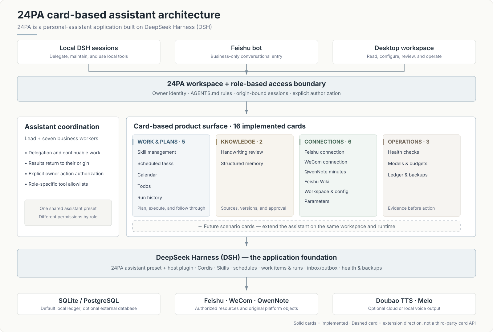

# 24PA (24私助) — AI Personal Assistant for Feishu / Lark

**English** | [中文](README.zh.md) | [npm](https://www.npmjs.com/package/@benz-ai-x/dsh-24pa) | [Releases](https://github.com/benz-ai-x/dsh-24-PA/releases)

[](https://www.npmjs.com/package/@benz-ai-x/dsh-24pa)
[](https://github.com/benz-ai-x/dsh-24-PA/releases/latest)
[](packages/24pa/package.json)
[](https://github.com/benz-ai-x/dsh-24-PA/releases/tag/v0.2.1-rc.3.2)

**From “remind me” to “prepare my week” — turn conversations into organized, reviewable action without giving up control.**

`@benz-ai-x/dsh-24pa` is a self-hosted AI personal-assistant plugin for [dsh](https://github.com/deepseek-ai/deepseek-harness). Local DSH sessions and a Feishu bot coordinate seven business workers in one owner-bound workspace; the desktop workspace adds sixteen capability cards for agent skills, scheduled tasks, calendars, todos, structured memory, handwriting review, and delivery evidence.


## Why 24PA?

- **More than a chatbot.** Move from a request to a work item, a Skill run, a platform object, and a traceable result — with schedules and follow-through built in.
- **Keep the tools you already use.** Work with original Feishu calendars, todos, documents, and notifications, plus WeCom calendars, todos, and one-way notifications — without forcing another source of truth.
- **Automation you can actually govern.** Inspect Skill packages and versions, preview permissions, separate execution from delivery, and keep human approval distinct from action authorization.
- **A personal-assistant surface that can grow.** Cards organize focused capabilities on one shared workspace and runtime, so new scenarios can be added without creating another disconnected bot.

## Card-based assistant architecture

The bundle combines one assistant preset with a host plugin. Conversational coordination and the desktop card surface share the same owner identity, role boundaries, Skill and schedule runtime, work records, storage, and delivery evidence.



**Cards are the product's extension unit.** A new personal-assistant scenario can add a focused card while reusing the same workspace, permissions, plans, run history, and operational foundation. The sixteen solid cards below are implemented today; the dashed card is an extension direction, not a claim that this release already exposes a third-party card SDK.

## Sixteen implemented cards

Every card below is part of the current product. Ordinary browsing is read-only and does not silently start a model, create a platform object, or run a task.

### Work & plans — 5 cards

| Card | What it helps you do | Included capabilities |
| --- | --- | --- |
| **Skill management** | Turn reusable know-how into controlled assistant capabilities. | Create/import Markdown or ZIP; edit and copy; complete package tree and read-only file preview; immutable versions; linked plans; test, run, disable, roll back, delete, and download. |
| **Scheduled tasks** | Put one-off and recurring work on a persistent timeline. | Blank, preset, or copied plans; Skill parameters, fixed time zone, approved targets and delivery; occurrence preview; enable, pause, resume, run now, delete, restore, and history. |
| **Calendar** | Understand and manage schedules across registered calendars. | Today and next-event views; source filters, conflicts and query completeness; platform verification; conversation-based create/change; native reminders; original-event links. |
| **Todos** | Manage real platform work without confusing it with assistant execution. | Overdue, today and open views; multi-source aggregation; five role scopes; conversation-based create, complete, postpone, edit and cancel; original-object links and related work items. |
| **Run history** | See what ran, what resulted, and what was actually delivered. | Separate executions, work items and unexecuted events; filters and export; diagnostics and reconciliation; retry delivery or rerun; supplement, stop, continue and accept work items. |

### Knowledge & materials — 2 cards

| Card | What it helps you do | Included capabilities |
| --- | --- | --- |
| **Handwriting review** | Turn handwritten material into reviewable content and explicitly authorized next actions. | Source comparison, draft editing, version publishing and diffs; Feishu review entry; verification and resend; candidate actions remain separate from content approval. |
| **Structured memory** | Keep long-term facts, preferences and decisions traceable. | Full text, sources, confirmation evidence, scope, validity, conflicts and revisions; query/filter; local create, edit, deactivate, delete, restore and undo; JSON remains the editable authority. |

### Connections & setup — 6 cards

| Card | What it helps you do | Included capabilities |
| --- | --- | --- |
| **Feishu connection** | Know whether the owner, app and required capabilities are really connected. | Owner, CLI, app and profile identity evidence; send/receive, review callback and resource checks; read-only diagnostics, explicitly triggered tests, cleanup and configuration links. |
| **WeCom connection** | Operate selected WeCom resources without adding another inbound bot. | Separate calendar, todo and one-way push evidence; identity and authorization checks; renewal, independent tests and configuration links; no inbound chat. |
| **QwenNote minutes** | Use recordings and meeting notes as traceable source material. | Local-only, on-demand list/transcript/minutes reading; connection evidence; source-backed summaries and candidate actions that still require review and authorization. |
| **Feishu Wiki** | Choose where memos and handwriting-review documents belong. | Destination, node, permission and related-document checks; configure, verify and open; save through material workflows without moving old documents or silently changing destinations. |
| **Workspace & config** | Keep each owner's rules, data and sessions attached to the right workspace. | Directory and binding status, configuration source, effective version and differences; bind, switch, reload, inspect effective config and enter parameter editing; failed reloads keep the current environment. |
| **Parameters** | Change everyday behavior through one controlled configuration surface. | Business parameters, source mappings, model routes, voice and budget settings; edit, validate, save, reset and locate errors; write-only secrets and separate saved/effective feedback. |

### Operations & maintenance — 3 cards

| Card | What it helps you do | Included capabilities |
| --- | --- | --- |
| **Full-app health checks** | Find what needs attention before it blocks work. | Module status, evidence time and scope, impact and next steps; full or per-module read-only checks; distinguish disabled, unchecked, unverified and failed states; diagnostics and repair links. |
| **Models & budgets** | Understand model consumption and stop new managed requests at explicit limits. | Actual model routes, token/request usage and pricing evidence; daily/monthly limits and warning thresholds; one-run permit after review; unknown cost is never reported as zero. |
| **Ledger & backups** | Protect the state needed for recovery and prove what was checked. | SQLite/PostgreSQL status; create backups, inspect manifests and verify real copies; isolated restore checks; secrets excluded; restore drills remain separate from authorized production cutover. |

See the [Manticore delivery and acceptance record](docs/planning/24PA-Manticore-交付验收.md) for module ownership and verification evidence.

## Inside the workspace

| Skill package management | Auditable run history |
| --- | --- |
|  |  |

## Quick start

### Requirements

- Node.js `^22.19.0` or `>=24.0.0` (the default SQLite ledger uses built-in `node:sqlite`).
- dsh `0.2.1-rc.3` for the current release line.
- No Feishu credentials are needed for the initial demo. PostgreSQL is optional.

### Install the current release

```sh
npm install -g @deepseek-ai/dsh@0.2.1-rc.3

dsh plugin --profile <name> add @benz-ai-x/dsh-24pa@0.2.1-rc.3.2 --registry=https://registry.npmjs.org
```

Restart the same Profile, open the 24PA workspace, and choose the「24私助」preset. Installation and startup must use the same `DSH_HOME`; the official npm registry is recommended because some mirrors lag behind.

**Setting up a new instance?** Follow the [step-by-step initialization guide](docs/24PA-初始化指南.md) for the isolated instance directory, workspace, launch script, expected pnpm build approval, token URL, and demo verification. After the demo works, tell the local assistant「帮我接通飞书」or use the bundled [Feishu setup guide](packages/24pa/feishu-setup.md).

<details>
<summary><strong>Using an older dsh host?</strong> Recommended version pins</summary>

24PA versions follow `<dsh baseline>.<serial>`. Use the release line matching your host instead of installing the newest package everywhere.

| dsh host | 24PA package |
| --- | --- |
| `0.2.1-rc.3` | `0.2.1-rc.3.2` (current) |
| `0.2.1-rc.2` | `0.2.1-rc.2.9` |
| `0.2.1-rc.1` | `0.2.1-rc.1.2` |
| `0.2.1-alpha.2` – `0.2.1-alpha.5` | `0.2.1-alpha.5.1` |
| `0.2.1-alpha.1` | `0.2.1-alpha.1.6` |
| `0.2.0-rc.2` | `0.2.0-rc.2.3`, plus the two schedule companions described in the [initialization guide](docs/24PA-初始化指南.md) |

</details>

## Architecture and safeguards

- **One preset, role-specific permissions.** Local sessions can use the standard coding toolset; Feishu entry sessions and business workers receive business-only allowlists. Managed Skill runs use their saved package and permission snapshots.
- **Local-first ledger.** SQLite is the zero-service default at `data/pa24.db` in the workspace; explicitly configured PostgreSQL is also supported. Durable inbox/outbox records preserve origin and delivery targets.
- **No blind replay of external writes.** An unknown platform result is reconciled against the original object before any retry. A successful action is not repeated merely to repair a local record or delivery.
- **Secrets stay out of prompts and backups.** Use server environment values or the write-only workspace secret store (`.24pa/secrets.json`, mode `0600`); environment values take precedence. `AGENTS.md` stores rules and non-secret configuration.
- **Review is not execution.** Approving a handwriting version does not execute its candidate actions. Notes, documents, minutes, web content, and subagent replies are material, not authorization.
- **Calendar-native clock reminders.** Feishu or WeCom owns the native alert; the ledger keeps backup and reconciliation records. Actual device delivery still depends on the platform and verified account configuration.

Read the [package reference](packages/24pa/README.md) for configuration fields, storage ownership, failure recovery, permission details, and the source map.

## Documentation

- [Initialization guide](docs/24PA-初始化指南.md) — new instance, demo verification, optional PostgreSQL, voice, and QwenNote setup.
- [Feishu setup](packages/24pa/feishu-setup.md) and [WeCom setup](packages/24pa/wecom-setup.md) — authoritative connection workflows.
- [Manticore backup and recovery](docs/Manticore-备份恢复.md) — verification, isolated restore drills, and manual cutover boundaries.
- [Product specification](docs/24PA-v1-SPEC.md) and [overall design](docs/24PA-整体设计方案.md) — behavior, flows, and trade-offs.
- [ADR-0001](docs/adr/0001-workspace-session-boundaries.md) — workspace, session, and permission boundaries.
- [GitHub Issues](https://github.com/benz-ai-x/dsh-24-PA/issues) — questions, bug reports, and delivery tracking.

## Known boundaries

- The desktop management UI is not a mobile-responsive product. Native Feishu and WeCom apps retain their own platform behavior.
- Real-account permissions, broader tenant/Lark-region compatibility, actual device reminder delivery, QwenNote OAuth and recording-card transcripts, and source verification require environment-specific verification.
- Model usage, prices, and budget estimates are not vendor bills. Reconcile actual provider usage and billing differences; budgets do not promise an exact invoice cap.
- Handwriting recognition accuracy is not yet quantified; the visual model route must be configured explicitly.
- Backup verification and an isolated restore check do not prove production recovery. Credentials, remote objects, pending actions, deliveries, plans, and budgets must be reconciled before a separately authorized cutover.
- External Codex/Claude Code delegation and QwenNote tools require their providers and explicit workspace opt-in; they are not silently enabled.

## FAQ

### Does 24PA require PostgreSQL?

No. SQLite is the default and needs no separate database service. PostgreSQL remains an explicit option for existing or preferred deployments.

### Can I customize routines without changing plugin code?

Yes. Use built-in or workspace Skills and scheduled tasks. Markdown files under `.dsh/skills/` are hot-reloaded; managed packages add versioning, review, execution, and rollback controls.

### Do clock reminders need the model or 24PA host to stay online?

They are written to the native calendar with an alert, so the model is not the reminder engine. Platform acceptance, device delivery, and read status are different facts; 24PA does not claim one proves another.

---

Package: [`@benz-ai-x/dsh-24pa`](https://www.npmjs.com/package/@benz-ai-x/dsh-24pa) · Current release: [`v0.2.1-rc.3.2`](https://github.com/benz-ai-x/dsh-24-PA/releases/tag/v0.2.1-rc.3.2)
