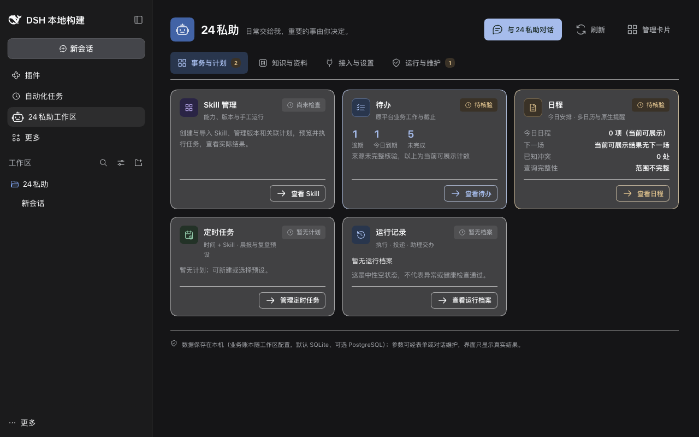
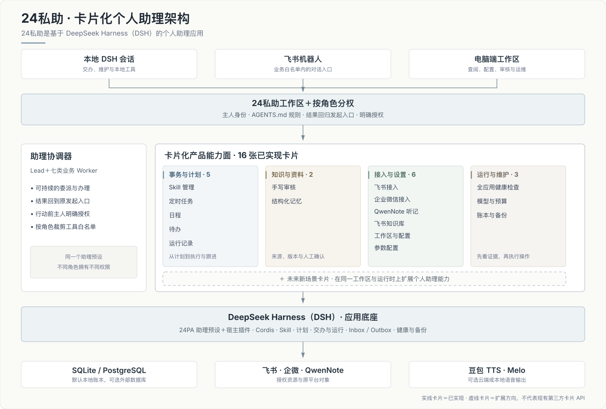
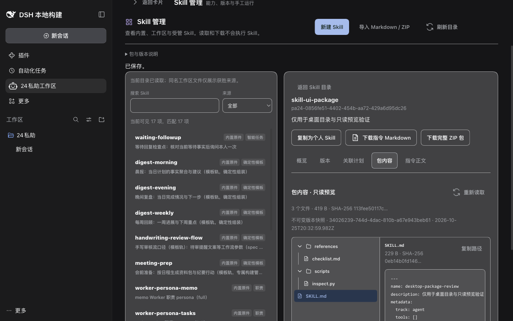
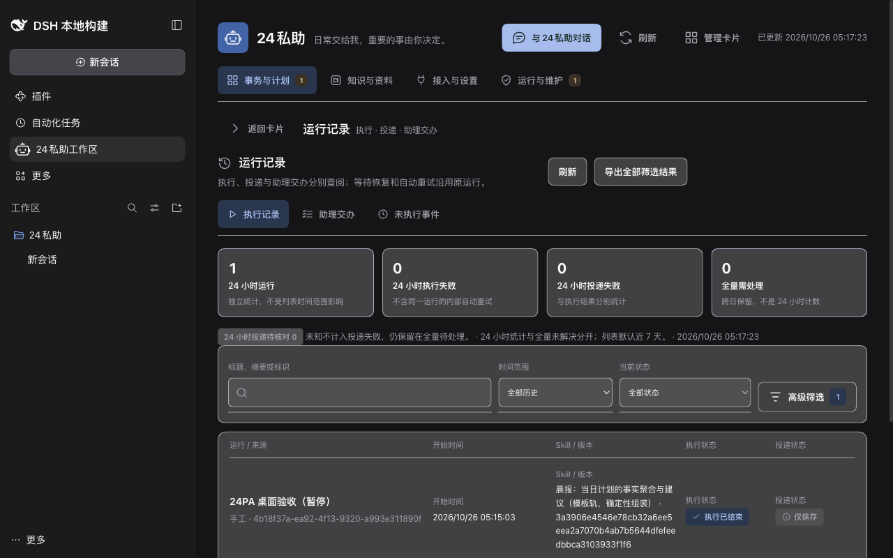

# 24私助（24PA）— 飞书 / Lark AI 私人助理

[English](README.md) | **中文** | [npm](https://www.npmjs.com/package/@benz-ai-x/dsh-24pa) | [版本发布](https://github.com/benz-ai-x/dsh-24-PA/releases)

[](https://www.npmjs.com/package/@benz-ai-x/dsh-24pa)
[](https://github.com/benz-ai-x/dsh-24-PA/releases/latest)
[](packages/24pa/package.json)
[](https://github.com/benz-ai-x/dsh-24-PA/releases/tag/v0.2.1-rc.5.1)

**从“提醒我”到“帮我准备这一周”——把对话变成有条理、可审核、能跟进的行动，同时把控制权留在自己手里。**

`@benz-ai-x/dsh-24pa` 是运行在 [dsh](https://github.com/deepseek-ai/deepseek-harness) 上的自托管 AI 私人助理插件。本地 DSH 会话与飞书机器人围绕同一位主人的工作区协调七类业务 Worker；电脑端工作区另以十六张能力卡片承接 Agent Skills、定时任务、日程、待办、结构化记忆、手写审核与送达证据。



## 为什么是24私助？

- **不止聊天，更能跟进事情。** 从一句委托到助理交办、Skill 运行、平台对象与可追溯结果，把定时计划和后续跟进串在同一条工作链路里。
- **继续用你熟悉的工具。** 直接承接飞书的日程、待办、文档与通知，以及企微的日程、待办和单向推送，不为了使用助理再迁出一套数据真相。
- **自动化也能看得见、管得住。** 查看 Skill 包与版本、预览权限、分开跟踪执行和投递，并把内容审核与行动授权明确分开。
- **个人助理能力可以持续生长。** 用卡片组织聚焦的能力，共享同一工作区与运行时；新需求可以扩展新场景卡片，而不是再造一个彼此割裂的机器人。

## 卡片化个人助理架构

24私助把一个助理预设与宿主插件组合在一起。对话协调与电脑端卡片能力面共享主人身份、角色权限、Skill 与计划运行时、工作记录、存储和送达证据。



**卡片是产品能力的扩展单元。** 新的个人助理需求可以增加聚焦的场景卡片，复用同一工作区、权限、计划、运行记录和运维底座。下方十六张实线卡片均已实现；虚线卡片代表产品扩展方向，不表示当前版本已经提供第三方卡片 SDK。

## 已实现的 16 张卡片

以下卡片全部属于当前产品。普通浏览是只读操作，不会悄悄启动模型、创建平台对象或运行任务。

### 事务与计划 · 5 张

| 卡片 | 能帮你做什么 | 已具备的能力 |
| --- | --- | --- |
| **Skill 管理** | 把可复用的经验变成可控的助理能力。 | 新建／导入 Markdown 或 ZIP；编辑、复制；完整包目录树与只读文件预览；不可变版本与关联计划；试运行、运行、禁用、回退、删除和下载。 |
| **定时任务** | 让一次性和周期性工作按持久计划推进。 | 空白、预设或复制计划；Skill 参数、固定时区、授权目标与投递；触发预览；启用、暂停、恢复、立即运行、删除、还原和历史查询。 |
| **日程** | 跨已登记日历查看并办理真实日程。 | 今日安排与下一场；来源筛选、冲突和查询完整性；平台核验；对话创建／变更；原生提醒；原日程入口。 |
| **待办** | 管理原平台业务工作，同时与助理执行保持分流。 | 逾期、今日到期和未完成视图；多来源聚合与五档角色范围；对话创建、完成、延期、修改、取消；原对象入口与关联交办。 |
| **运行记录** | 看清运行了什么、结果是什么、是否真正送达。 | 执行记录、助理交办、未执行事件分视图；筛选与导出；诊断与核对；补投、重跑；交办补充、停止、接续与验收。 |

### 知识与资料 · 2 张

| 卡片 | 能帮你做什么 | 已具备的能力 |
| --- | --- | --- |
| **手写审核** | 把手写材料整理成可审核的内容，再逐项授权后续行动。 | 原稿对照、草稿编辑、版本发布与差异；飞书审核入口；核验与重发；内容批准不会自动执行候选行动。 |
| **结构化记忆** | 让长期事实、偏好与决定有来源、有确认依据。 | 完整正文、来源、确认依据、范围、时效、冲突与修订；查询筛选；本地新建、修改、停用、删除、恢复和撤销；JSON 保持唯一可编辑权威。 |

### 接入与设置 · 6 张

| 卡片 | 能帮你做什么 | 已具备的能力 |
| --- | --- | --- |
| **飞书接入** | 确认主人、应用与所需能力是否真正接通。 | 主人、CLI、应用与 profile 身份证据；收发、审核回调与资源检查；只读诊断、明确触发的测试、清理和配置定位。 |
| **企业微信接入** | 办理授权范围内的企微对象，而不增加另一个收信机器人。 | 日程、待办、单向推送分域证据；身份与授权检查；续期、独立测试和配置定位；不提供收信对话。 |
| **QwenNote 听记** | 把录音、转写与会议纪要作为可追溯的资料来源。 | 仅本地按需读取列表、转写和纪要；接入证据；带来源的整理与候选行动提炼，仍需审核和行动授权。 |
| **飞书知识库** | 选择备忘与手写审核文档的保存落点。 | 落点、节点、权限与关联文档检查；配置、核验和打开；沿资料流程保存，不搬动旧文档，也不静默更换落点。 |
| **工作区与配置** | 让主人的规则、数据和会话始终归属正确的工作区。 | 目录、绑定、配置来源、生效版本与差异；绑定、切换、重载、生效配置查看和参数编辑入口；重载失败保留当前环境。 |
| **参数配置** | 在一个受控入口调整日常行为，不必翻找配置文件。 | 业务参数、来源映射、模型路由、语音和预算；编辑、校验、保存、重置和错误定位；密钥只写不回显，保存与生效分别反馈。 |

### 运行与维护 · 3 张

| 卡片 | 能帮你做什么 | 已具备的能力 |
| --- | --- | --- |
| **全应用健康检查** | 在问题阻断工作之前，找到真正需要处理的环节。 | 模块状态、证据时间与范围、影响和下一步；全量或分项只读检查；区分未启用、未检查、未验证与故障；诊断与修复定位。 |
| **模型与预算** | 看清模型消耗，并在明确限额处暂停新的受管请求。 | 实际模型路由、Token／请求用量与价格依据；日／月限额和预警；核对后单次放行；费用未知不会报成零。 |
| **账本与备份** | 保护恢复所需状态，并证明实际检查过什么。 | SQLite／PostgreSQL 状态；创建备份、查看清单、校验真实副本；隔离恢复检查；排除密钥；恢复演练不等于授权生产切换。 |

各模块归属与验证证据见 [Manticore 交付与验收记录](docs/planning/24PA-Manticore-交付验收.md)。

## 工作区实拍

| Skill 完整包管理 | 可追溯的运行记录 |
| --- | --- |
|  |  |

## 快速开始

### 前置要求

- Node.js `^22.19.0` 或 `>=24.0.0`（默认 SQLite 账本使用内建 `node:sqlite`）。
- 当前发版线使用 dsh `0.2.1-rc.5`。
- 初次 demo 不需要飞书凭据，也不需要单独安装 PostgreSQL。

### 安装当前版本

```sh
npm install -g @deepseek-ai/dsh@0.2.1-rc.5

dsh plugin --profile <name> add @benz-ai-x/dsh-24pa@0.2.1-rc.5.1 --registry=https://registry.npmjs.org
```

重启同一个 Profile，打开24私助工作区并选择「24私助」预设。安装与启动必须使用相同的 `DSH_HOME`；由于部分镜像同步滞后，建议显式使用 npm 官方 registry。

**要创建全新实例？** 请按[初始化指南](docs/24PA-初始化指南.md)逐步完成隔离实例目录、工作区、启动脚本、pnpm 构建审批、带 token 的面板地址与 demo 验收。demo 正常后，对本地助理说「帮我接通飞书」，或阅读随包[飞书接入指南](packages/24pa/feishu-setup.md)。

<details>
<summary><strong>使用旧版 dsh 宿主？</strong>查看推荐版本</summary>

24私助版本号遵循 `<dsh 基线>.<序号>`。请选择与宿主一致的发版线，不要给所有宿主都安装最新包。

| dsh 宿主 | 24私助包版本 |
| --- | --- |
| `0.2.1-rc.5` | `0.2.1-rc.5.1`（当前版本） |
| `0.2.1-rc.4` | `0.2.1-rc.4.2` |
| `0.2.1-rc.3` | `0.2.1-rc.3.2` |
| `0.2.1-rc.2` | `0.2.1-rc.2.9` |
| `0.2.1-rc.1` | `0.2.1-rc.1.2` |
| `0.2.1-alpha.2` – `0.2.1-alpha.5` | `0.2.1-alpha.5.1` |
| `0.2.1-alpha.1` | `0.2.1-alpha.1.6` |
| `0.2.0-rc.2` | `0.2.0-rc.2.3`，另需[初始化指南](docs/24PA-初始化指南.md)中的两个 schedule 伴随件 |

</details>

## 架构与安全边界

- **一个预设，按角色分权。** 本地会话可使用标准编程工具面；飞书入口与业务 Worker 仅获得业务白名单。受管 Skill 运行使用保存的包与权限快照。
- **本地优先账本。** 默认零外部服务的 SQLite 位于工作区 `data/pa24.db`；也可显式选择 PostgreSQL。持久 inbox／outbox 记录发起入口与固定投递目标。
- **外部写入不盲目重放。** 平台结果未知时先核对原对象，再决定是否重试；修复本地记录或补投不会重复已经成功的外部动作。
- **密钥不进入提示与备份。** 使用服务器环境变量或只写的工作区密钥库（`.24pa/secrets.json`，权限 `0600`）；同名环境变量优先。`AGENTS.md` 只保存规则与非秘密配置。
- **审核不等于执行。** 批准某个手写版本不会自动执行其中的候选行动。笔记、文档、听记、网页与子 Agent 回复都是材料，不构成授权。
- **时钟提醒归原生日历。** 飞书或企微负责原生提醒，账本保留备份与核对记录；实际设备送达仍取决于平台及经过核验的账号配置。

配置字段、账本归属、失败恢复、权限细节与源码地图见[包级参考文档](packages/24pa/README.md)。

## 文档入口

- [初始化指南](docs/24PA-初始化指南.md)——全新实例、demo 验收、可选 PostgreSQL、语音与 QwenNote 接入。
- [飞书接入](packages/24pa/feishu-setup.md)与[企微接入](packages/24pa/wecom-setup.md)——对应渠道的权威配置流程。
- [Manticore 备份恢复](docs/Manticore-备份恢复.md)——备份校验、隔离恢复演练与人工切换边界。
- [产品规格](docs/24PA-v1-SPEC.md)与[整体设计](docs/24PA-整体设计方案.md)——行为、流程与取舍。
- [ADR-0001](docs/adr/0001-workspace-session-boundaries.md)——工作区、会话与权限边界。
- [GitHub Issues](https://github.com/benz-ai-x/dsh-24-PA/issues)——问题、缺陷与交付跟踪。

## 已知边界

- 管理界面只面向电脑端，不提供手机响应式产品界面；飞书与企微原生 App 保持各自平台行为。
- 真实账号权限、更广的租户／Lark 地区兼容性、实际设备提醒送达、QwenNote OAuth 与录音卡转写，以及来源核验，仍需按部署环境验证。
- 模型用量、价格与预算估算不等于供应商账单；实际用量和账单差异需另行核对，预算不承诺精确账单封顶。
- 手写识别准确率尚未量化，需显式配置视觉模型路由。
- 备份校验与隔离恢复检查不等于生产恢复成功；凭据、远端对象、未决动作、待发结果、计划与预算完成核对后，才能另行授权人工切换。
- Codex／Claude Code 外部委派与 QwenNote 工具需安装对应通道并由工作区显式放行，不会静默开启。

## 常见问题

### 24私助必须使用 PostgreSQL 吗？

不需要。默认 SQLite 无需独立数据库服务；既有部署或明确偏好 PostgreSQL 时可显式选择。

### 不改插件代码，能调整例程吗？

可以。使用内置或工作区 Skill 与定时任务。`.dsh/skills/` 下的 Markdown 文件支持热加载；受管包另提供版本、审核、执行与回退控制。

### 时钟提醒需要模型或24私助宿主一直在线吗？

提醒会写入带原生提醒的日历日程，模型不是提醒引擎。平台接受、设备送达和已读是不同事实，24私助不会用其中一项证明另一项。

---

包：[`@benz-ai-x/dsh-24pa`](https://www.npmjs.com/package/@benz-ai-x/dsh-24pa) · 当前版本：[`v0.2.1-rc.5.1`](https://github.com/benz-ai-x/dsh-24-PA/releases/tag/v0.2.1-rc.5.1)
