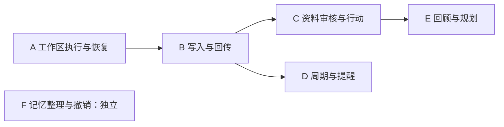

# 24私助 main 第三轮架构修复计划

基线：`main@8f70020a2f3808c3afb899e88092ee430d222efd`；规格 2.12 与 ADR-0001；复核日期 2026-10-19。

28 个问题编号完整保留，14 项维持结论、14 项收窄表述或修复方向；15 项 P1、13 项 P2。19 从 P1 调整为 P2。用户于2026-10-19授权开工；A #199、F #200、B #201、C #202、D #203 已合并，E #204 已完成最终复审与集成验收，随本 PR 合入 main 闭环。

目标是把28项修复归并为**6个可独立验收的功能PR**，避免一票一PR，也不把所有改动堆到同一PR。用户已授权按本计划实施。六组均在隔离工作树完成研究和实施；代码PR按功能组交付，部署不在本轮范围。

[逐项复核](../research/2026-10-19-main第三轮架构逐项复核.md) · [TODO](2026-10-19-main第三轮架构修复TODO.md) · [GitHub 总票 #170](https://github.com/benz-ai-x/dsh-24-PA/issues/170)

## 功能分组与顺序

| 计划 PR | 问题编号 | 前置合并组 | 合并后可完成 |
|---|---|---|---|
| A 工作区接纳、执行与恢复 | 01, 02, 10, 12, 13, 14 | 无 | 同一工作区正常接单、停止、续办、切换和重启，结果归属原入口；工具声明和角色目录能支撑实际操作。 |
| B 外部业务写入与结果回传 | 09, 11, 15, 16, 17, 18, 19 | A | 备忘、任务和通知返回真实且可核对的结果；缺能力、结果未知、日期及授权身份都不被误报。 |
| C 原稿、审核、会议资料与候选行动 | 03, 22, 23, 24, 27, 28 | B | 原稿批次闭合，审核对应当前内容；笔记与会议资料可解释来源和缺失，明确授权的候选行动可追溯且不会重复。 |
| D 周期事项、等待跟进与日历提醒 | 05, 06, 20, 21 | B | 周期事项可跳过、变更、重启；等待只询问一次；时钟提醒按既有 F45 使用日历 App，并可可靠停止和归档。 |
| E 周期回顾与日常规划 | 07, 08, 25, 26 | C | 计划卡编辑稳定，原生运行缺失不会被手动运行掩盖；日报/周报事实窗口一致，规划未知结果不引发重叠写入。 |
| F 记忆整理与撤销 | 04 | 无 | 批量整理可准确撤销，文件/审计中断可解释，主人手工修改的 JSON 不被静默覆盖。 |

箭头是功能集成/合并门槛，具体代码依赖见TODO和Issue；09、07等独立部分可先研究，但所在PR仍按完整流程交付。F不依赖A–E。B合入后C/D可并行，E中的UI和发生点研究可提前；修改相同runtime文件时由后起分支吸收已合入代码，避免平行复制生命周期。六个计划分支均已创建，实际交付顺序为 A → F → B → C → D → E。

每个 Issue 只归属一个主PR。24、27、28含笔记/会议/简报子项，同在C交付但分别测试；它们是库存编号，不意味着应该抽成一个跨域 module。若实现体量迫使拆PR，应先更新本表和票归属，保持每个新PR可独立使用，不能把迁移/恢复/界面漏到后续。

## 每个 PR 的实施包

### PR-A 工作区接纳、执行与恢复

问题：[R3-01 / #171](https://github.com/benz-ai-x/dsh-24-PA/issues/171)、[R3-02 / #172](https://github.com/benz-ai-x/dsh-24-PA/issues/172)、[R3-10 / #180](https://github.com/benz-ai-x/dsh-24-PA/issues/180)、[R3-12 / #182](https://github.com/benz-ai-x/dsh-24-PA/issues/182)、[R3-13 / #183](https://github.com/benz-ai-x/dsh-24-PA/issues/183)、[R3-14 / #184](https://github.com/benz-ai-x/dsh-24-PA/issues/184)。计划分支：`codex/architecture-r3-workspace`。前置合并：无。

**交付结果：**同一工作区正常接单、停止、续办、切换和重启，结果归属原入口；工具声明和角色目录能支撑实际操作。

建议组内顺序：10 → 02 → 01 → 12 → 13 → 14；具体依赖以每票为准。

- 既有 module：PaRuntime、WorkItemLifecycle、InboxLifecycle、RoleRegistry、HostLock、工具声明。
- depth / interface / seam：让工作区执行 module 持有接纳到退休全过程；现有 interface 保留宿主输入身份与恢复代次。宿主会话是 seam，真实 dsh 与隔离 adapter 都经过它。以同一归属决定替代散落的活动检查，提高 locality；各业务复用准入与恢复规则获得 leverage，depth 来自隐藏时序复杂度。
- deletion test：移除裸 drain 调用、独立归档停止路径、只在 start 外壳触发的恢复，以及角色目录累加式激活。删除后由已有生命周期承担行为，不能只换文件位置。
- 研究前置：复用 F02/M0-F01/F12 研究，并补已安装 dsh 的 prompt 接纳、输入 rpcId、实际 turn 消费、interrupt/drain 和两进程锁契约。
- 数据与恢复：绑定路径发现信息与工作区账本分层保存；旧执行/输入记录缺代次时明确待核对；动态角色文件兼容且失败不换有效目录。
- 验证：单测组 workspace-activation, transport-activation, work-item-lifecycle, lock, local-tool-access, panel-rpc, extra-tools；Loader f01, f02, f12, f33，涉及账本均跑SQLite/PostgreSQL。这里是相关组/新增回归的落点，不假定所有专门测试文件已经存在。
- 完整演示：A 中启动事项→在途停止/继续→尝试绑定 B→旧回执到达；所有回传仍正确，冷启动与手工重绑均自动恢复。

### PR-B 外部业务写入与结果回传

问题：[R3-09 / #179](https://github.com/benz-ai-x/dsh-24-PA/issues/179)、[R3-11 / #181](https://github.com/benz-ai-x/dsh-24-PA/issues/181)、[R3-15 / #185](https://github.com/benz-ai-x/dsh-24-PA/issues/185)、[R3-16 / #186](https://github.com/benz-ai-x/dsh-24-PA/issues/186)、[R3-17 / #187](https://github.com/benz-ai-x/dsh-24-PA/issues/187)、[R3-18 / #188](https://github.com/benz-ai-x/dsh-24-PA/issues/188)、[R3-19 / #189](https://github.com/benz-ai-x/dsh-24-PA/issues/189)。计划分支：`codex/architecture-r3-channels`。前置合并：A。

**交付结果：**备忘、任务和通知返回真实且可核对的结果；缺能力、结果未知、日期及授权身份都不被误报。

建议组内顺序：09 → 15 → 19 → 16 → 18 → 17 → 11；具体依赖以每票为准。

- 既有 module：ExternalOperations、TaskLifecycle、FeishuChannels、WecomChannels、OutboxDelivery、CLI gateway。
- depth / interface / seam：加深现有渠道 module 的 depth，让 interface 如实表达成功、确定失败与 unknown，并携带完整对象身份。两种渠道 adapter 构成已存在的 seam；事实归一留在渠道/任务生命周期，提高 locality，备忘、规划、提醒复用结果语义形成 leverage。
- deletion test：去除截断平台键、搜索未命中猜终态、仅看首条回执就成功、从 transport 有无推断 demo、永久不失效身份缓存。保留现有操作账与 unknown 不重放规则。
- 研究前置：复用 F03/F04/F16/F33 研究，核对本机 lark/wecom 按 ID 读取、逐项回执、个人完成/整项完成、date-only 和消息 uuid 契约；PG 备份期限单独记录规模假设。
- 数据与恢复：旧无文档 succeeded、旧平台键、旧任务终态和缓存目标必须有兼容策略；已排队通知不因刷新身份默默改投；未知远端效果不自动重放。
- 验证：单测组 cli-gateway, channel-reliability, lark, wecom, wecom-channels, wecom-setup, meeting-source, repo；Loader f01, f03, f04, f12, f16，涉及账本均跑SQLite/PostgreSQL。这里是相关组/新增回归的落点，不假定所有专门测试文件已经存在。
- 完整演示：同一备忘恢复能力后保存一次；两渠道任务改名/改截止/完成后准确回读；同 WorkItem 多轮通知和语音/文字均可区分并防重。

### PR-C 原稿、审核、会议资料与候选行动

问题：[R3-03 / #173](https://github.com/benz-ai-x/dsh-24-PA/issues/173)、[R3-22 / #192](https://github.com/benz-ai-x/dsh-24-PA/issues/192)、[R3-23 / #193](https://github.com/benz-ai-x/dsh-24-PA/issues/193)、[R3-24 / #194](https://github.com/benz-ai-x/dsh-24-PA/issues/194)、[R3-27 / #197](https://github.com/benz-ai-x/dsh-24-PA/issues/197)、[R3-28 / #198](https://github.com/benz-ai-x/dsh-24-PA/issues/198)。计划分支：`codex/architecture-r3-knowledge`。前置合并：B。

**交付结果：**原稿批次闭合，审核对应当前内容；笔记与会议资料可解释来源和缺失，明确授权的候选行动可追溯且不会重复。

建议组内顺序：22 → 03 → 23 → 28 → 24 → 27；具体依赖以每票为准。

- 既有 module：HandwritingPipeline、TrustedNotes、候选行动消费、会议准备/纪要、现有 WorkItem/Plan 生命周期。
- depth / interface / seam：分别加深笔记与会议 module 的 depth，以当前版本和来源认领为 interface 的测试面；文档读取、素材查询与实际写入 adapter 是已有 seam。各自拥有批次/版本/活动对象约束形成 locality，可信版本供检索、简报和采纳复用形成 leverage。
- deletion test：去掉两次读回混存、无条件复制旧派生内容、finally 宣告完成、查询失败直接当空、无关最近纪要兜底及锁外认领。24/27/28 分笔记、会议、简报子项验收，不能为相似写法新造跨领域通用 module。
- 研究前置：复用 F06/F07/F10/F11/F22 研究；先用真实 reader 核对标题、图片结构、稳定资源摘要与动态块表示。图片 token 变化不能直接等同图片内容变化。
- 数据与恢复：旧版本派生内容不能静默当当前真值；批次闭合独立于审核状态；pending/failed 文档状态恢复不得覆盖更新版本；旧 minutes 身份兼容防重。
- 验证：单测组 handwriting, handwriting-pipeline, note-publication-recovery, note-trust, meeting-source, plan-lifecycle, work-item-lifecycle, repo；Loader f06, f07, f10, f11, f22，涉及账本均跑SQLite/PostgreSQL。这里是相关组/新增回归的落点，不假定所有专门测试文件已经存在。
- 完整演示：收图→封批→发布→过期续卡→编辑重发→批准→明确澄清/采纳；失败读资料有说明，两会话同时处理同笔记/会议只保留一个活动对象。

### PR-D 周期事项、等待跟进与日历提醒

问题：[R3-05 / #175](https://github.com/benz-ai-x/dsh-24-PA/issues/175)、[R3-06 / #176](https://github.com/benz-ai-x/dsh-24-PA/issues/176)、[R3-20 / #190](https://github.com/benz-ai-x/dsh-24-PA/issues/190)、[R3-21 / #191](https://github.com/benz-ai-x/dsh-24-PA/issues/191)。计划分支：`codex/architecture-r3-followups`。前置合并：B。

**交付结果：**周期事项可跳过、变更、重启；等待只询问一次；时钟提醒按既有 F45 使用日历 App，并可可靠停止和归档。

建议组内顺序：05 → 06 → 20 → 21；具体依赖以每票为准。

- 既有 module：TaskTemplate、Waiting、ReminderRouter、原生日历渠道、维护归档。
- depth / interface / seam：周期任务与等待 module 各自持有发生/检查点决定；提醒 interface 只暴露已支持的日历或智能 skill 路径。原生日历/智能调度 adapter 构成 seam。去重、停止和推进留在所属领域以改善 locality，复用 A/B 的归属与回执形成 leverage；depth 不来自扩建第二套计时引擎。
- deletion test：移除 live 下回退旧 ledger 的入口与计时启动、锁外检查点提交、skip 后无后继、仅 active 的归档筛选以及旧 persona 文案。旧代码可保留但不得运行新时钟规则。
- 研究前置：复用 F08 与 F16；F05 旧研究须按 F45/ADR 修订使用。核对周期日历取消范围与智能跟进的宿主 Schedule/skill 接法。
- 数据与恢复：重复模板 generating/孤立 active 可恢复；等待同源重复行先诊断后明确保留关系；意外 legacy 活跃记录只停止/待确认并保留历史，禁止无指令自动转日历写入。
- 验证：单测组 repo, reminders, meeting-source, wecom-channels, plan-lifecycle, prompts；Loader f03, f05, f08, f12, f16，涉及账本均跑SQLite/PostgreSQL。这里是相关组/新增回归的落点，不假定所有专门测试文件已经存在。
- 完整演示：跳过本次后下次仍生成；检查点并发仅问一次；两渠道周期提醒取消及 archive stopRules 成功/部分失败均可核对，重启不启动旧 ledger。

### PR-E 周期回顾与日常规划

问题：[R3-07 / #177](https://github.com/benz-ai-x/dsh-24-PA/issues/177)、[R3-08 / #178](https://github.com/benz-ai-x/dsh-24-PA/issues/178)、[R3-25 / #195](https://github.com/benz-ai-x/dsh-24-PA/issues/195)、[R3-26 / #196](https://github.com/benz-ai-x/dsh-24-PA/issues/196)。计划分支：`codex/architecture-r3-planning`。前置合并：C。

**交付结果：**计划卡编辑稳定，原生运行缺失不会被手动运行掩盖；日报/周报事实窗口一致，规划未知结果不引发重叠写入。

建议组内顺序：07 → 08 → 25 → 26；具体依赖以每票为准。

- 既有 module：DigestService、DailyPlanning、PlanCard、原生 occurrence 关联。
- depth / interface / seam：让简报 module 的 interface 明确所用时间上下文，让规划 module 保留外部结果状态；原生 Schedule 与 React RPC adapter 维持独立 seam。运行窗口、事实窗口、输出解释集中获得 locality，各消费者复用时间与结果约定形成 leverage；depth 体现于隐藏恢复与异步 UI 时序。
- deletion test：删除 history 总量相减、按执行日暗取事实、unknown 等同未写入以及 render 内重新声明有状态 PlanCard。保留已修的确定失败不占用与手动窗口隔离。
- 研究前置：复用 F09/F40/F41；先核实周界、计划时区、迟到和 manual 口径，再锁定 25 的区间测试。不能无依据承诺过期日报补发。
- 数据与恢复：旧 run/occurrence 缺上下文时明确待核对；旧报告保留实际产生时的元数据。仅修窗口一致性和已定义本周/下周范围，不新增容量优化。
- 验证：单测组 plan-panel, daily-planning, digest-service, digest-reliability, digest-trigger, plan-lifecycle；Loader f04, f09, f10, f33，涉及账本均跑SQLite/PostgreSQL。这里是相关组/新增回归的落点，不假定所有专门测试文件已经存在。
- 完整演示：修改计划时间经过轮询仍留草稿；一次原生遗漏不被手动运行抵消；跨日/跨周报告与所选策略一致；首块 unknown 后不再写重叠块。

### PR-F 记忆整理与撤销

问题：[R3-04 / #174](https://github.com/benz-ai-x/dsh-24-PA/issues/174)。计划分支：`codex/architecture-r3-memory`。前置合并：无。

**交付结果：**批量整理可准确撤销，文件/审计中断可解释，主人手工修改的 JSON 不被静默覆盖。

建议组内顺序：04；具体依赖以每票为准。

- 既有 module：MemoryStore 与变更集/审计文件。
- depth / interface / seam：MemoryStore module 保持 JSON 权威，interface 表达实际变更与可恢复结果；文件与审计 adapter 是持久化 seam。由真实 ID、批前态和完整冲突检测承担 depth，提高撤销的 locality；整理与维护共享相同保证形成 leverage。
- deletion test：去掉用原始输入重建撤销、同 ID 覆盖批前态、只比正文/时间戳判断手改。不能为了原子性把记忆权威迁进数据库。
- 研究前置：复用 F02 与记忆规范，明确原子文件替换、审计部分提交、人工 JSON 编辑后的冲突判据。
- 数据与恢复：已有变更集缺实际 ID/完整 before 时标记不可安全撤销或从证据修复；不猜测删除记录；不覆盖手工来源/状态。
- 验证：单测组 memory；Loader f02，涉及账本均跑SQLite/PostgreSQL。这里是相关组/新增回归的落点，不假定所有专门测试文件已经存在。
- 完整演示：无 ID 新增与同 ID 多次修改都撤回整批前；在各写入点中断后重读可说明结果；手改 metadata 后撤销拒绝静默覆盖。

## 每组固定执行步骤

1. 从最新main确认本组缺陷仍存在，读取当前规格与研究；如被其他提交修掉，带证据更新票，不机械重写。
2. 在公开interface复现对应失败并保留反例；研究只针对实际平台/宿主不确定处，不先设计额外抽象。
3. 按组内顺序完成修复、数据兼容、恢复和必要界面/文案。外部成功但本地失败、结果未知不能当作未发生。
4. 跑相关单元与真实Loader；账本相关用SQLite/隔离PostgreSQL。异步UI用真实React DOM，平台请求核对实际SDK/CLI组装参数，两进程锁使用真实进程。
5. 运行build、preset:check及该组完整流程。各PR前执行适用回归；最终集成在同一代码版本运行一次完整单元和双后端Loader。无新改动/失败时不重复已通过检查。
6. 建立代码PR，关联本组所有票；按仓库强制规则执行独立Standards/Spec审查，逐条清偿后复审。审查发现及时归入所属票，不用“测试全绿”关闭审查问题。
7. 合并并通过本票验收后关闭；记录提交、命令、版本、结果及真实平台边界。实际部署/账号验收按后续授权与P40执行。

同组前置代码已在分支且验收通过即可继续，不要求Issue先关闭。跨组前置必须合并并验收；不以口头完成或单纯关票替代。

## 防止下一轮再次遗漏的验收矩阵

| 横向条件 | 必须覆盖的本轮问题 | 检查要点 |
|---|---|---|
| 接纳/停止/续办/切换/归档 | 01、12、13、14、28 | 原归属、真实执行身份、恢复一次、旧事件不结算新执行 |
| 并发重复与唯一身份 | 05、06、10、15、24、28 | 同源唯一、正确代次、平台长度限制后仍不碰撞 |
| 远端成功/本地失败/unknown | 05、09、11、17、20、23、26 | 状态可核对，不盲重发、不伪报未写 |
| 内容或来源改变 | 03、16、22、23、24、27 | 当前版本同源、终态和不确定性保留、授权不等同澄清 |
| 时钟/时区/发生窗口 | 05、08、18、20、21、25 | 日期与瞬时分开、manual与native分开、F45不回退 |
| UI/工具/宿主真实契约 | 02、07、09、10、12、15、17、20 | 参数声明和执行分别验证，React受控值、真实进程/服务方法 |
| 文件/迁移/人工编辑 | 04、05、13、14、22、23 | 部分提交可恢复，既有数据与主人改动不丢 |

这张矩阵是本次28项的闭环范围，不宣称证明整个软件不存在未知问题。新增确认缺陷需要清晰入口、影响及证据；只有推测的路径放入待验证覆盖。

## 决策门槛与范围控制

25先核实周界、计划时区、迟到和manual区间；现有资料无裁决时先写小型决策，保持该票未ready，不阻塞其他确定修复。persona覆盖和在途换skill两项未裁决政策不并入bug实施。

F45是现行约定：时钟提醒交由日历App，非时钟跟进交由智能skill，旧ledger代码保留但不启用。21不得写成先补强旧引擎、以后再退役。真实资源摘要、动态块和备份规模期限先查实际能力，禁止用测试桩猜测平台语义。

保持JSON记忆权威、默认SQLite/可选PG、单人工作区、原入口回传、批准与行动授权分离，不扩大工具权限，不修改既有技术标识。

## 验收记录

原始未修复基线为394/394单测与双后端Loader各84/84通过，其证据保留用于前后比较。六组已完成实现、故障回归及独立双轴复审，最终代码603e064的完整单元648/648通过，双后端全部17文件Loader各83/83通过。最终记录见[集成验收](../research/2026-10-19-main第三轮架构修复集成验收.md)。本轮未执行真实账号写入或部署。
