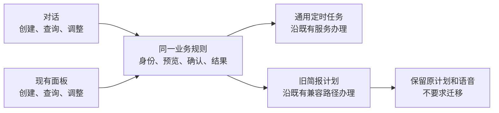

# 24私助周期服务一致性改进规格

规格增量：2.18-draft。修订日期：2026-11-08（Asia/Shanghai）。本轮范围已由主人确认：**仅改进对话与面板的一致性，不强制迁移旧计划，不改版桌面导航，保留语音功能。** 2026-11-08 已实现并完成隔离验收，交付归 [PR #275](https://github.com/benz-ai-x/dsh-24-PA/pull/275)；合并与关闭按远端状态核验。未发版或部署 8010。

父规格：[#1](https://github.com/benz-ai-x/dsh-24-PA/issues/1)。总事项：[#269](https://github.com/benz-ai-x/dsh-24-PA/issues/269)。唯一实施事项：F50 / [#271](https://github.com/benz-ai-x/dsh-24-PA/issues/271)，故事 160，一个主交付 [PR #275](https://github.com/benz-ai-x/dsh-24-PA/pull/275)。沿用原文件路径以保持引用；本轮不再是删除功能的计划，也不作为后续 Ontology 建模的强制前置。

原 F49 / `#270`、F51 / `#272` 均按主人要求删除；故事 159、161 及原 RED-01–18 编号仅作追溯，不安排实施，不复用为其他要求。

## 用户价值与事实依据

主人已明确表示，目前管理晨报/定时任务和寻找常用功能没有具体不顺手的情况。本轮不宣称已经发现普遍使用痛点、重复发送事故或性能瓶颈；选择以下有源码依据的一致性差异作为有限改进。

| 已核实的差异 | 本轮用户结果 | 依据 |
|---|---|---|
| 现有对话 `digest_control` 遇到通用计划，会要求去定时任务管理入口。 | 同一已授权主人可用对话或现有面板管理同一计划，不因计划新旧被迫换入口。 | [旧控制入口](https://github.com/benz-ai-x/dsh-24-PA/blob/3d7c7064683e613bf9b2698bf563a4a5f96923e6/packages/24pa/src/digest-service.ts#L168)、[对话动作](https://github.com/benz-ai-x/dsh-24-PA/blob/3d7c7064683e613bf9b2698bf563a4a5f96923e6/packages/24pa/src/runtime.ts#L994)、[面板计划入口](https://github.com/benz-ai-x/dsh-24-PA/blob/3d7c7064683e613bf9b2698bf563a4a5f96923e6/packages/24pa/src/panel.ts#L141) |
| 对话旧创建接口未指定 Skill 时默认固定模板；面板晨报预设默认智能规划。 | 相同创建意图和选择得到一致的运行方式，事前知道是否使用模型。 | [旧默认](https://github.com/benz-ai-x/dsh-24-PA/blob/3d7c7064683e613bf9b2698bf563a4a5f96923e6/packages/24pa/src/digest-service.ts#L127)、[面板默认](https://github.com/benz-ai-x/dsh-24-PA/blob/3d7c7064683e613bf9b2698bf563a4a5f96923e6/packages/24pa/client.js#L1735)、[已确认晨报契约](24PA-晨报重构-实施计划.md) |
| 通用计划管理与原地迁移已经存在，旧计划还承担实际服务。 | 复用已实现能力，原计划继续可用；不为统一接口让主人重建或搬迁服务。 | [计划服务](https://github.com/benz-ai-x/dsh-24-PA/blob/3d7c7064683e613bf9b2698bf563a4a5f96923e6/packages/24pa/src/task-plan-service.ts#L51)、[既有迁移](https://github.com/benz-ai-x/dsh-24-PA/blob/3d7c7064683e613bf9b2698bf563a4a5f96923e6/packages/24pa/src/task-plan-migration.ts#L19) |

以上是接口与默认行为事实，不等于主人已遭遇上述问题。收益以实际跨入口操作能否保持同一计划和结果验收，不以删除行数、入口数量或迁移数量验收。

## F50 的操作范围

限晨报、晚间复盘、周回顾及已有一次性简报的常用管理：**查询、创建、调整时间、暂停/恢复、按计划选择语音，以及查询最近运行与投递结果。** 新增对话入口与现有面板共用业务规则；保留两种交互形式，各自必要的交互反馈可以不同。

一致性成立的前提是同一工作区、同一计划、相同操作输入及等价授权条件。入口身份、会话权限或平台能力不同，须明确说明差异，不通过扩大权限制造“所有入口都一样”的假象。

### 1. 新建服务采用一致的选择与确认

1. 两个入口将相同意图解析为同一类计划配置，复用既有草稿、预览、确认及创建服务，不各自维护一套默认行为。
2. 沿规格 2.17，新建晨报预设默认智能工作晨报 `builtin:daily-planning`，明确提示模型用量及“建议不等于采纳”。主人明确选择现有固定模板时，两端按该选择办理；不把模板输出称为智能规划。
3. 创建前明确时间/时区、执行方式、语音选择、投递渠道/目标与必要授权。语音仍按既有默认及主人选择，不因入口变化强制开启或关闭，不修改工作区引擎/音色。
4. 保存草稿、启用、实际执行和投递分别反馈，不能把“已保存”说成“已经发送”。重复同一请求沿既有幂等机制办理，不创建第二份计划或调度。
5. “调整/恢复我的晨报”先定位现有计划，不当成新建；匹配多份计划时明确对象，不能仅凭同名覆盖、替换或复制。

### 2. 已有计划跨入口办理，不强制迁移

1. 面板创建的通用计划可从对话查询、改时间、暂停/恢复和调整语音；对话创建的计划可在现有面板查到并继续管理。保留同一业务计划 ID、历史关联与明确的操作结果。
2. 旧计划不迁移也能完成本票范围内原本支持的查询、时间调整、暂停/恢复和语音选择。界面或对话不能要求“先升级为通用计划”才能继续这些操作。
3. 程序升级、普通读取、编辑时间、暂停或恢复都不触发隐式迁移；不自动填充通用配置/授权，不换 Skill，不改 voice，不复制新计划，不让有效旧计划停服。
4. 未被主人修改的时间、时区、Skill、语音、启停意图及历史保持原样。调度 ID/generation 的变化按原生暂停、恢复、改期的正常生命周期办理；不虚假承诺所有原生字段永远不变，也不另建并行有效触发者。
5. 保留既有自愿迁移入口；只有主人明确提出并完成原核验/确认，才按已有流程迁移。旧计划没有持久保存的固定投递授权等信息不得猜测补齐；它们不是本票要求全部存量迁移的理由。
6. 不自动将已有固定模板换为智能规划，不补齐自定义 Skill 契约来强行迁移，不清除失权、未决、停止或失败阻断。缺少权限等真实限制应如实反馈，不以迁移代替修复。

### 3. 两个入口读取一致的事实与结果

1. 计划名称、时间、启停、voice、执行方式、下次运行和最近结果来自对应计划的真实记录；一端成功修改后，另一端刷新/查询看到同一生效值，不维护第二套展示状态。
2. 旧发生记录与通用 SkillRun 分别按原身份读取并关联呈现；不把旧历史迁写成新运行，不因读取了错误的历史来源而把已有结果报为“未执行”。
3. 执行成功、投递失败、部分送达、待核对等状态继续分列；未知不报成功，已有平台回执优先本地补账，不因新对话入口盲重试外部写入。
4. 沿用既有版本/指纹、目标核验、请求去重和并发保护。过期确认、已变化的投递身份或跨工作区请求明确失败/要求重新核验；模型自己的“已确认”不能代替主人授权。
5. 普通查询保持只读；主动核验和写操作沿既有授权办理。对话路径不获得工作区配置、密钥、长期记忆维护或其他入口原本没有的权限。

## 实现约束与保留边界

- 通用计划复用 `TaskPlanService` 与既有权限/生命周期服务；旧计划沿现有兼容服务办理。允许为共同业务规则做必要适配，但不重建调度器、迁移器、计划表或通用连接器框架。
- 提示词、Worker 动作、面板 RPC 和反馈按同一操作契约对齐；不能只修改提示词，仍让真实调用落到会拒绝通用计划的旧动作。
- 不要求旧计划清零，不以删除旧执行分支、停用既有旧计划或批量处置存量作为完成条件。仅整理本功能需要的接口分派；单纯清理闲置视图或无消费者读取不并入本票。
- 语音合成、引擎/音色、试听、按计划开关、音频投递与全文兜底继续有效。等待跟进、会前准备、原生日历提醒、工作规划、资料审核、记忆和其他业务不退役。
- 现有首页、分类、卡片及主要导航保持；只允许为本票一致性提供必要的小范围字段或状态反馈，不实施原 F51 四入口改版、卡片重排或批量改名。

## 用户故事与历史编号

159. （已撤回）原语音退役故事；原 F19/故事 126 的语音体验继续有效，原工单 `#270` 已删除。
160. 作为主人，我希望从对话或现有面板创建、查询和调整同一个周期服务，清楚知道晨报的运行方式，并在另一入口看到一致的状态与结果；旧计划无需迁移即可继续使用，语音选择和历史不因入口变化丢失。
161. （已撤回）原桌面入口改版故事；主人没有相关使用困扰，原工单 `#272` 已删除，当前布局与能力保留。

原 RED-01–18 属于已撤回的减法交付矩阵，保留编号追溯、不再作为本轮实施清单、不重用编号。它们涉及的既有可靠性和业务契约不因矩阵退出而失效。以下 PC-01–10 为本次计划一致性验收，映射到既有 T01–T20。

## 验收矩阵

| 编号 | 场景 | 应观察到的结果 | 测试组 |
|---|---|---|---|
| PC-01 | 两个入口新建相同晨报，分别选择智能默认与固定模板 | 默认、选择和模型提示一致；语音、时间与投递目标预览明确，已有模板不被改写。 | T01/T10/T17/T20 |
| PC-02 | 面板建立语音晨报，对话改时间/暂停/恢复，再回面板查询 | 沿同一计划，时间和状态一致；语音与历史保留，不新建替代计划。 | T07/T10/T14/T20 |
| PC-03 | 对话建立计划，面板改时间或语音，再通过对话查询 | 同一身份与生效值，启用/执行/投递分别反馈；新接口真实可用。 | T01/T07/T10/T17/T20 |
| PC-04 | 旧计划保持未迁移，升级后查询、改期、暂停/恢复 | 原支持操作仍可用；未新增通用配置/授权、未换 Skill、未复制计划；无需先迁移。 | T07/T10/T14/T17 |
| PC-05 | 新旧计划各有成功、失败、在途及未知投递 | 两端读取对应真实历史并分列执行/投递；缺失或未知不报“成功”或“从未运行”。 | T08/T10/T14/T20 |
| PC-06 | 同名计划、重复请求、并发修改及过期确认 | 选中正确对象；同一请求不重复创建/执行，冲突和过期确认明确反馈。 | T01/T07/T10/T14 |
| PC-07 | 当前身份/目标变化、权限不足、跨工作区与迟到响应 | 不越权、不串区；需要新核验时明确说明，不为了入口一致开放维护权限。 | T01/T08/T14/T20 |
| PC-08 | 改期或恢复的原生结果未知、重启或备份恢复 | 沿原操作意图及回执核对，不盲建第二份调度；旧计划不被自动迁移。 | T07/T08/T14 |
| PC-09 | 语音成功/失败、模板与智能晨报及共享业务回归 | 语音选择和全文兜底保持；等待跟进、会前准备、原生提醒不受影响；只读浏览不产生执行。 | T03/T09/T10/T15/T17 |
| PC-10 | 主人主动选择既有迁移，或未作迁移选择继续使用 | 前者沿原核验/确认及恢复契约；后者不迁移也能完成常用管理；迁移完成率不是交付门槛。 | T01/T07/T10/T14 |

若修改面板字段或反馈，按既有 T20 验证中英文、明暗主题、键盘与 1280×800、1440×900、1920×1080 电脑视口，不设计手机断点，也不重排导航。相关持久化覆盖 SQLite/PostgreSQL，业务流程覆盖真实 dsh Loader/Session；真实平台与实际使用效果单独留证。

## 交付与非目标

#269 只跟踪 #271，一个主功能 PR。主人已于 2026-11-08 授权实施、验证与交付；[PR #275](https://github.com/benz-ai-x/dsh-24-PA/pull/275) 已实现并完成隔离验收，详见[实现与验收记录](../research/2026-11-08-plan-consistency-implementation.md)。完成条件是上述跨入口流程和既有计划回归通过；旧计划仍存在不阻止交付。按[交付流程](../agents/delivery.md)记录实现、验证和合并，功能 PR 合并且验收通过后才关闭 #271。

既有代码审查的基线验证记录仍可追溯：当时 build / preset:check 通过，unit 为 1,673 通过、15 失败、1 跳过；15 项在本机链接宿主选择 executor 阶段失败，未验证到原业务断言。实施前需对齐受支持宿主和测试装配，不将历史结果当作本次新行为验收，也不以跳过测试掩盖。依据见[主审记录](../research/2026-11-07-24PA-code-pruning-audit.md)。上述数字属于实施前历史；本次已对齐宿主并完成构建、全量单元回归、最终增量复验及双后端真实 Loader/Session 验收，结果见本次实现记录。

本轮不进行语音退役、旧计划强制迁移/批量停用、桌面整体改版、闲置代码专项、图片/OCR 退出、编程能力裁剪或存储后端撤销；原 D01–D03 不构成本轮决策任务。也不实现 Ontology 平台、图数据库、自动长期记忆或新渠道，不变更生产配置。历史研究中的其他建议不构成当前实施范围。
