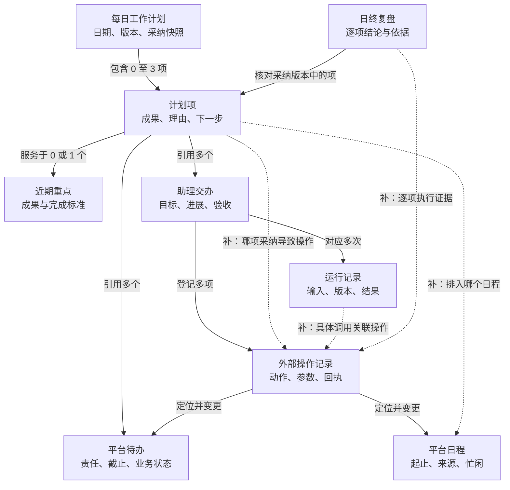
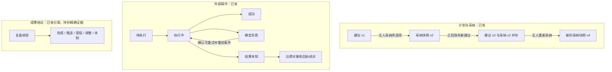

# 24私助最小本体模型设计草案

设计日期：2026-11-08（Asia/Shanghai）。状态：供讨论的模型 v0.1，尚未实现或写入正式产品基线。

源码基线：本地 `main` / `55d7c1205abe5bc74927a7386091139565eca5f1`；本轮核查涉及的 `packages/24pa/src` 相对上一轮 `6799191f8df2264cccca11a72172894bfe178ff4` 无变化。当前工作区的周期服务一致性与参数页规格修订按各自范围保留。本模型不依赖旧计划迁移或导航改版。

本模型围绕一个问题：**今天要推进什么成果，如何安排和授权执行，之后凭什么判断完成、明天怎样承接？** 最小范围为 7 类业务对象与 2 类执行记录；复用已有记录，新增内容集中在关系含义、精确版本引用和结果证据。

图例：**已有**＝源码中已有相应数据或行为；**补齐**＝本草案提出的增量；**派生**＝从现有字段计算的读取结果，不增加可独立修改的业务状态。已有不代表已通过真实账号和模型质量验收。

## 对象关系图

实线表示已有引用或关联；虚线表示待补齐的明确关系。箭头表示关系方向，不表示执行顺序。

图中的“引用交办”还需细分为“实现成果”“安排时间”“提供背景”。例如“替我写完方案”和“替我把写方案排进日历”均可形成交办，但只有前者的合格交付能证明写作成果。当前 `references` 只有 `kind/id`，不表达这种用途。

跨日关系另行固定到历史版本：

读取昨日计划与复盘已经实现；虚线增量是逐项、带版本的承接关系。跨日关联不代表自动延期或自动采纳。

## 九类对象及最小属性

下列属性使用中文解释，括号保留必要的现有技术标识。`?` 表示可缺失，不以推测补齐。

| 对象 | 最小属性与权威来源 | 状态设计 | 已有与补齐 |
|---|---|---|---|
| 近期重点 `WorkFocus` | 编号、标题、期望成果/完成标准、适用截至日?；来自主人确认的 FocusSet 版本。 | 适用/已过期可按截至日派生；没有现成的“重点已完成”状态。 | 已有字段及主人确认；复用 `focusId + focusRevision` 解释历史，不新增独立目标系统。 |
| 每日工作计划 `DailyWorkPlan` | 工作日、时区、版本、0–3 项建议、工作时段、待决定事项、容量证据、采纳快照?。 | 建议与采纳可以并存；分别读取当前建议版本和有效采纳版本。 | 已有保存、采纳、修订与容量检查。 |
| 计划项 `WorkPlanItem` | 编号、标题、成果、优先理由、下一步、重点引用?、待办/交办引用、估时?、建议起止?。 | “建议项/已采纳项”从所属快照派生；成果状态来自对应复盘项。 | 已有基础字段；补日程关系、引用用途、证据引用、跨日承接。 |
| 平台待办 `Todo` | 现有 objectId、平台/原生 ID、标题、负责人及本人角色、截止?、原平台状态、来源位置、核验时间、新鲜度。 | 使用原平台与适配器的实际状态；当前聚合使用 open/completed 等值。取消/删除依平台语义，不能充当完成。 | 已有聚合、角色、写操作及来源证据；增加计划项侧的关系含义即可。 |
| 平台日程 `CalendarEvent` | 现有 objectId、原生日程及实例定位、标题、起止、时区、全天/重复、忙闲、来源位置、核验时间。 | 当前查询有忙/闲、位置是否有效、新鲜度；过去/未来只表示时间关系。原平台状态按实际返回保留，不新增“工作完成”状态。 | 已有查询与写回；补计划项直接排期关系。 |
| 助理交办 `WorkItem` | 编号、原指令、目标/完成标准、职责、发起入口、固定回传位置、进展、结果、执行状态、验收要求及状态。 | 执行状态与验收状态独立，见下文。 | 已有多次运行与外部对象关联；补计划项关系的成果/排程用途。 |
| 运行记录 `Run` | 原编号及记录种类、所属交办、触发来源、输入/Skill 版本快照、起止及等待、执行状态、工具调用、结果、投递状态。 | 保留 WorkerRun/SkillRun 的原状态及来源；执行与投递分列。 | 已有统一运行查询；补具体调用到 operationId 的结构化关联，保留历史缺失。 |
| 外部操作记录 `ActionOperation` | 操作编号、所属交办、动作、冻结参数/来源目标、状态、回执、错误、时间。 | pending / running / succeeded / failed / unknown。 | 已有登记、去重、结果未知保护；补计划项快照、授权证据与具体运行调用的关联。 |
| 日终复盘 `DailyWorkReview` | 工作日、时区、复盘版本、采纳版本、逐项结果、调整建议、关键问题?、观测时间、缺失说明。 | 每项为 completed / progress / blocked / changed / unknown；一份复盘可包含不同结论。 | 已有逐项结论和来源类别；补可回查的具体证据以及相关业务状态的观测快照。 |

本体对象不要求对应新增数据库表。计划项继续嵌在每日计划聚合内，复盘项继续嵌在复盘内；通过带版本的引用查询。Run 继续适配既有 WorkerRun 和 SkillRun，ActionOperation 表示外部操作实例，和模型工具调用、动作类型定义分别处理。

## 四种共用结构

| 结构 | 最小内容 | 存在情况与约束 |
|---|---|---|
| 对象引用 `ObjectRef` | 工作区、对象类型、原编号、快照版本?；外部对象附可用来源/实例定位。 | 各类 ID 和来源定位已有；统一的类型化表达待补。它仅用于定位，服务端仍验证工作区和权限。 |
| 采纳快照 `AcceptedWorkPlan` | 采纳版本、采纳时间、选中项快照、主人完整指令及来源、已解决取舍、当时证据。 | 已有。沿用其不可变修订历史，不另建同义 Decision 表。 |
| 行动授权依据 | 可信主人输入引用、具体动作/参数范围、所选目标、授权及执行时核验结果。 | WorkOwnerInput、SourceTarget 和动作参数已分处保存；补本切片的关联及统一读取。采纳依据不能被任意复用为所有写操作授权。 |
| 证据引用 `EvidenceRef` | 所证明的对象/属性、来源记录、观测时间、来源版本或必要值快照、事件发生时间?、完整性及缺失说明。 | 源观测、回执、主人说明已有；逐计划项/复盘项的精确引用待补。事件时间未知就保持未知，不用同步时间填充。 |

工作区、主人、已登记来源和实际平台身份属于已有的范围与权限基础。最小模型从这些服务读取，不为每个对象复制一套用户、凭据或来源配置。长期记忆、文档资料可作为有权限的补充上下文；它们各自的维护和审核规则继续有效。

身份规则：

- 近期重点历史引用用 `workspaceId + focusRevision + focusId`，不拿当前标题解释历史计划。
- 每日计划用现有 `day:<timeZone>:<date>`；计划项的精确身份为 `workspaceId + planId + planRevision + itemId`。采纳项引用绑定包含该采纳快照的版本，不能只靠标题或一个裸 itemId。
- 复盘项用 `workspaceId + reviewId + reviewRevision + itemId`，并校验其 `acceptedRevision`。
- 外部对象复用 `sourceObjectId(domain, platform, identityKey, nativeId)`；一个对象可有多个来源位置。重复日程保留实例定位，不用标题合并。
- 跨日延续建立 `continuedFrom` 引用，不把昨天和今天的计划项改成同一个可变对象。

## 关系及基数

| 关系 | 基数与含义 | 现状 |
|---|---|---|
| 每日计划包含计划项 | 每个建议或采纳快照 0–3 项；每个项快照属于一个明确计划版本。 | 已有。采纳动作目前要求至少选一项。 |
| 计划项服务于近期重点 | 每项 0–1 个重点；一个重点可对应多个日期/计划项。 | 已有 `focusId` 及聚合 `focusRevision`。 |
| 计划项引用待办/交办 | 两侧均可为多个；不因引用自动创建或执行对象。 | 已有 `references`；关系用途待补。 |
| 计划项由对象实现成果 | 0–N 个待办或交办，关系明确 `fulfills` 及对应完成标准。 | 补齐：与 context、schedules 分开。模型猜测的关系先作为候选，经核实后才参与完成判断。 |
| 计划项排入日程 | 每项 0–N 个实际日程/实例；单一日程也可支撑多个成果。 | 补齐 `scheduledIn`。关联只证明已安排时间。 |
| 采纳项对应外部操作 | 每项 0–N 项操作；首轮每个计划来源的单目标操作关联 1 个精确采纳项；普通操作可无计划来源。 | 补齐 `planItemRef`；一批选中项逐项登记，不把一项授权扩大成整批授权。 |
| 交办对应运行及操作 | 一个交办 0–N 次运行、0–N 项外部操作；记录各有唯一所属交办。 | 已有。 |
| 运行调用关联外部操作 | 一个调用可涉及多个操作，一个操作可在后续调用中被核对或复用；整体为多对多。 | 调用日志已有；统一 `runId/callId ↔ operationId` 关联待补。复用同一回执不算第二次外部写入。 |
| 操作影响平台对象 | 对本切片采用单目标操作；创建成功后补原对象引用，结果未知时目标身份可以尚不完整。 | 目标与回执已有；统一读取适配待补。 |
| 复盘核对采纳项 | 一份复盘绑定一个采纳版本，每个选中项恰有一个结果。 | 已有。 |
| 复盘项有证据 | 每项 0–N 条；完成结论至少有一条足以证明相应成果的有效证据。 | 已有来源类别/主人说明；精确对象及观测快照关系待补。 |
| 今日项承接此前项 | 首轮每项 0–1 个此前采纳项，同一历史项可有多个后续项；需要合并多个来源的复杂分解留待后续。 | 补齐 `continuedFrom` 和原复盘项引用。 |

一个计划项有多个 `fulfills` 对象时，首轮按“全部满足对应完成标准”判断；需要任选其一的替代方案先明确本次采用的对象，不让模型暗中切换 AND/OR。背景引用和排程引用不参与成果完成判断。主人对成果的明确说明仍可按现有可信输入规则作为证据。

## 状态分别归属对象

三条主线各自变化，不能压成一个从“建议”一路到“完成”的总状态。

图中的 v1–v4 是示例版本号；真实版本由现有账本生成。保存建议保留原采纳快照。未选中项只是未被此次采纳，不能自动说成主人明确拒绝。

- **助理交办执行状态（已有）**：accepted、queued、running、waiting_input、completed、failed、stopped、needs_reconciliation。
- **助理交办验收状态（已有）**：none、pending、accepted、returned；`completed + pending` 表示执行结束但交付待验收。
- **运行状态（已有）**：按原记录种类保留 pending/running/waiting/stopping/completed/failed/stopped/timed_out/needs_reconciliation 等实际值，以及 Worker 入口拒绝等独有结果；不强造一个可写“统一状态”。投递状态另列。
- **外部操作结果未知（已有）**：禁止直接重发。已有可信远端回执时修复本地关联；证据不足保持未知。核对本身不是再次执行原写操作。
- **来源状态（已有）**：完整、部分、失败、未核验、停用等属于观测或来源状态；不能覆盖待办的业务状态。
- **派生状态**：近期重点是否在适用期、计划项是否属于采纳快照、日程是否已过去，由对应字段计算，不另开写入口。

## 动作目录

“动作”是可调用的业务契约；“外部操作记录”是动作产生的一次外部副作用。保存规划使用现有修订账本，外部写入使用现有操作账本，不要求所有动作都写 ActionOperation。

| 动作及现有入口 | 输入对象与关键条件 | 结果 | 已有/补齐 |
|---|---|---|---|
| 查看计划/对象；显式核验来源 | 普通查看读已保存快照；需要当前平台事实时显式走现有查询/核验。两者都验证工作区与可见范围。 | 对象、关系、来源时间及缺失。 | 已有分域读取；补统一类型化查询与关系解析。注意 `planning_context` 会刷新业务来源，不能冒充普通面板只读。 |
| 确认或调整近期重点 `focus_update` | 主人可信输入、当前重点版本、最多 3 项；由获准交互式 calendar Worker 办理。 | 新 FocusSet 版本。 | 已有。 |
| 保存今日建议 `daily_plan_save` | 计划版本、重点版本、最多 3 项、可核验引用；时间块满足已确认工作时段和容量。 | 新建议版本，保留原采纳快照。 | 已有；补关系用途、证据及跨日引用。后台 Skill 只能在既定范围内保存建议。 |
| 采纳所选计划 `daily_plan_confirm` | 主人完整消息依据、精确版本、选中项、已解决取舍；重新检查引用与可用容量。 | 新采纳快照。 | 已有；该动作本身不写日历、不启动替主人完成业务。 |
| 为选定项安排/调整日程 `plan_adopt`、`calendar_update` | 具体时间/来源、有效写授权、当前权限与冲突核验；来自计划时额外核对采纳项及参数一致性。 | 外部操作、原日程、回执和排期关系。 | 实际写入已有；补 `planItemRef` 与 `scheduledIn`。保留直接办理普通日程的能力。 |
| 委托助理办理 / 更新原待办 | 明确目标和授权；分别沿既有交办、`task_create/update/complete/cancel` 等入口执行，遵守原对象与平台语义。 | 交办/运行或原待办变更及回执。 | 已有；补“实现成果/安排时间/提供背景”的关系分类。创建待办本身不证明成果完成。 |
| 核对外部结果 | 原操作身份、原目标、可验证的远端回执/读回结果。 | 沿既有核对路径补关联或保留未知，不重复成功动作。 | 已有分域恢复；补从计划项定位到核对对象的关系。 |
| 保存日终复盘 `daily_review_save` | 当前采纳版本、每项结论及可证明的依据；未知与受阻原因按原规则处理。 | 新复盘版本及调整建议。 | 已有；补逐项证据引用和按关系用途判断完成。 |
| 形成次日承接建议（扩展现有保存） | 原采纳项/复盘项、当前重点和来源；说明延续或调整理由。 | 今日新建议项及 `continuedFrom`。 | 昨日读取和新建议已有；精确承接关系待补。不是新增自动延期动作。 |

每个动作至少描述：输入类型、允许角色、授权依据、前置条件、业务变化、返回证据、重复/未知处理、契约版本。可查询描述应复用现有处理器与校验器，实际执行时再次检查。关系可读不等于对象可写，Skill 的描述也不能扩大权限。

## 一个实例与六个约束

以下对象和时间均为设计示例：近期重点 F1 是“形成可评审的方案”；每日计划中的 I1 是“完成风险章节”，关联待办 T1。主人采纳 I1 并明确要求安排 14:00–15:00，形成排程交办 W1、运行 R1、外部操作 O1 和日程 E1。O1 成功只证明 E1 已按要求建立，W1 完成只证明排程交办完成；I1 是否完成仍需风险章节成果的证据。若主人另行委托助理撰写章节，则产生实现成果的交办 W2，它与 I1 的关系为 fulfills。

1. **同名不等于同一对象**：按工作区、类型、原身份和实例定位；不跨身份静默合并。
2. **不同版本互不冒充**：旧采纳、复盘、回执保持其原关联；新建议不能覆盖已采纳内容。
3. **授权与采纳有具体范围**：主人一次明确授权采纳和写日历时沿用该依据，不重复询问；仅采纳时不增加外部动作。
4. **执行成功与成果完成分别取证**：排程、提醒、创建待办、投递成功都不能自动满足写作/交付成果。
5. **缺失与未知保持可见**：来源失败不能报空闲；外部未知不能报失败后直接重发；观测时间不能冒充完成时间。
6. **关联由可信流程落账**：模型可以提议关系；服务端验证目标、版本、可见性和证据。执行关联与对应本地回执在现有事务能力内一致保存，远端写入继续遵守未知恢复边界。

## 最小补齐范围与验证

第一批实现建议集中在五处：

1. 计划项引用的用途，以及日程和原采纳项的精确引用。
2. 采纳项到外部操作、原平台对象的关联；普通非计划操作仍可无此关联。
3. 具体运行调用到外部操作的关联；恢复复用保留原操作身份。
4. 每项复盘的证据快照与满足成果的判断；历史缺项显示未知，不回填猜测。
5. 类型化对象/关系查询与动作描述；桌面既有详情能够展开上述事实。

验收至少包含：新建议与旧采纳并存、同名跨平台对象、一个项多次排期、仅排程交办完成、成果交付待验收、远端成功但本地断连、同一操作被后续运行核对、来源权限收紧、昨日复盘版本与当前计划不同、次日承接无自动写入。必须分别检验引用正确性、权限、回执、成果证据和真实使用价值。

范围保持在“今日工作”闭环。项目、联系人、资料审核、长期记忆、Skill 和定时任务均保留现有能力与身份；当后续用例需要时再将其纳入更完整的本体。这里的最小建模范围不代表功能退役。

## 核查依据

- [统一术语](../../GLOSSARY.md)、[会话与权限 ADR](../adr/0001-workspace-session-boundaries.md)。
- [工作方法契约](24PA-工作方法-实施计划.md)、[晨报衔接](24PA-晨报重构-实施计划.md)、[周期服务最新范围](24PA-Ontology前置减法-SPEC.md)。
- [规划对象类型](../../packages/24pa/src/work-planning-model.ts)、[规划服务与完成校验](../../packages/24pa/src/work-planning.ts)、[不可变规划修订](../../packages/24pa/src/repo/work-planning.ts)。
- [来源对象身份及观测](../../packages/24pa/src/repo/source-projection.ts)、[待办聚合](../../packages/24pa/src/source-todo.ts)、[日历聚合](../../packages/24pa/src/source-calendar.ts)。
- [交办与操作状态](../../packages/24pa/src/repo/work.ts)、[Worker 运行及调用](../../packages/24pa/src/repo/worker-run.ts)、[Skill 运行](../../packages/24pa/src/repo/skill-run.ts)、[统一运行读取](../../packages/24pa/src/repo/run-history.ts)。
- [日历采纳写入](../../packages/24pa/src/daily-planning.ts)、[外部操作恢复](../../packages/24pa/src/external-operations.ts)、[可信主人输入](../../packages/24pa/src/work-owner-input.ts)、[来源目标与核验](../../packages/24pa/src/source-registry.ts)。
- [上一轮 Palantir 官方方法研究与链接](../research/2026-11-07-palantir-ontology-methodology.md)。
