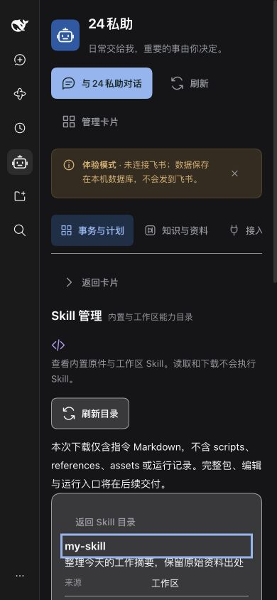

# Manticore M01a 实施与验收

2026-10-20。对应 [#213](https://github.com/benz-ai-x/dsh-24-PA/issues/213)，父跟踪 [#212](https://github.com/benz-ai-x/dsh-24-PA/issues/212)。固定基线 `67172733b0405718edd78e19d114a5ef6adc4db7`；主实现 `cbd5607`。本票交付目录、来源明确的详情及指令 Markdown 导出，完整包、版本与运行属于 #214。

## 验证环境与结果

Node.js 26.4.0；宿主源码 `1600d8a1`，实际 `bootHost` Loader、文件 provider、注册表和面板 RPC；SQLite 隔离工作区、体验模式、FakeFeishuTransport，无模型及真实平台账号调用。依赖通过固定 lockfile 安装，宿主 peer 通过仓库已有 prepare 脚本链接。

在 `packages/24pa` 运行：

| 检查 | 命令 | 结果 |
|---|---|---|
| 构建 | `npm run build` | 通过 |
| 管理契约与面板边界 | `npx vitest run tests/unit/skill-management.test.mjs tests/unit/skills.test.mjs tests/unit/client.test.mjs tests/unit/panel-rpc.test.mjs` | 36 项通过 |
| DOM 操作与配置回归 | `npx vitest run tests/unit/skill-panel.test.mjs tests/unit/config-editor.test.mjs` | 14 项通过 |
| 真实宿主读取与导出回读 | `PA24_E2E_STORAGE=sqlite npx vitest run tests/e2e/manticore-skill-catalog.e2e.mjs` | 1 项通过 |
| 窄屏修正后的受影响回归 | `npx vitest run tests/unit/skill-panel.test.mjs tests/unit/client.test.mjs` | 17 项再次通过，计入上面的 50 项，不重复累计 |

合计 51 项不同测试。真实 Loader 验证内置与工作区来源、persona／向导查看、带声明的导出文件能被 provider 重新解析、旧绑定拒绝及 WorkItem/outbox 无增量。未声称全仓库回归或整个 Manticore 已验收。

集成复核：同步 `origin/main@893831826a177d376fcdc51993cd9046ca908a0a`（#223/#224，含 #208/#209 修复），合并提交 `3837ac2`。README 追加段落冲突按上下游均保留处理；运行时代码自动合并。随后构建、全部 50 项相关测试及 1 项真实 Loader 测试再次通过。其他已合并修复的历史验证不计入本票测试数量。

## T20 浏览器走查

使用实际 dsh 客户端及插件，在临时目录创建验收 Skill；浏览器结束后关闭临时服务。全部数据仅用于隔离验收。

- 深色与浅色下可查阅来源、类型、指令、声明、运行限制和关联计划提示；SVG 配有文字。
- 真实 390 × 844 CSS 视口下，Skill 区域 `clientWidth = scrollWidth = 297`；80 字符英文名、140 字符无空格描述和 180 字符连续正文不会横向撑破。刷新按钮独立换行，保持横排可读。另观察过 300px 更窄视口。
- 使用 Enter 打开选中项后焦点进入详情标题；Tab 可继续到声明区和下载。内容按纯文本显示。
- 31 项目录展示真实总数；第二页 11 项，末页“下一页”禁用；从第二页搜索时重置页码。来源筛选、无匹配提示正确。
- 断网后显示 `Failed to fetch` 和宿主连接异常；重试期间显示“正在读取 Skill 目录…”且刷新禁用；恢复网络后恢复目录，不把失败显示为零条。
- 通过真实浏览器下载 `my-skill.md`，核对 frontmatter 的名称、描述、工具声明及正文均属于选中的工作区 Skill。内容变化拒绝旧导出、工作区迟到响应由 DOM 行为测试验证。
- 工作区不可用、发现不完整与逐项加载失败由管理契约测试覆盖；正常产品始终含内置目录，未为截图人为移除内置项。

## Standards

初审：0 项明确规范违反，0 项可操作代码异味。实现复用公开注册表与工作区只读边界，管理查询与执行权限分开；领域、规格和索引已同步。

`cd7f6dd` 增量复审通过：0 项新增规范违反，0 项可操作代码异味。样式仅作用于 Skill 组件；三张截图确认换行、横排操作、明暗主题与焦点。前次 T20 证据缺口已补齐。

## Spec

初审：2 项 P2，均来自 SPEC §13 的窄屏可读要求：长名称／描述溢出，以及刷新按钮被压成逐字竖排。已在真实客户端复现，新增只作用于 Skill 组件的换行与操作行布局，390px 再验收通过。其他 #213 要求无实质缺失，#214 的完整管理能力不算本票交付。

`cd7f6dd` 复审通过：2/2 项 P2 已清偿，0 遗留，未发现新增问题；核对增量代码、验收记录和三张截图，范围未扩大。

## 边界

本票无数据库迁移、不新增外部权限；回退插件即可撤销此只读入口。内容指纹是当前读取快照的冲突保护，不是持久版本；既有计划按 Skill 名关联，界面明确提示同名项共享关联信息。执行就绪、完整资源包、编辑、运行及真实平台结果仍由后续票验收。本轮尚未部署。
