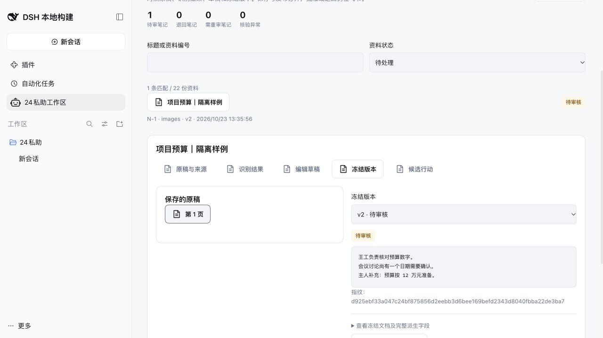
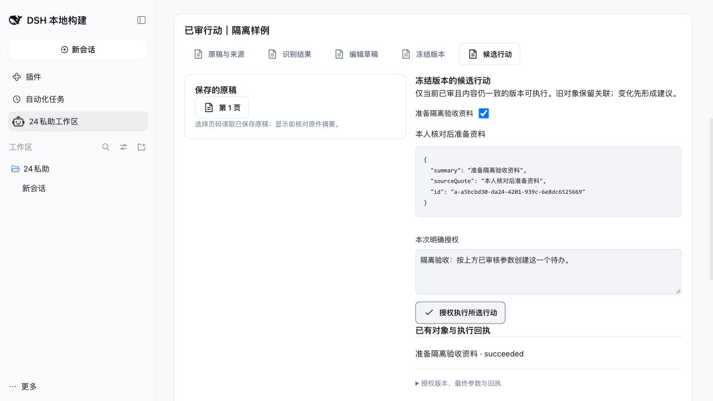
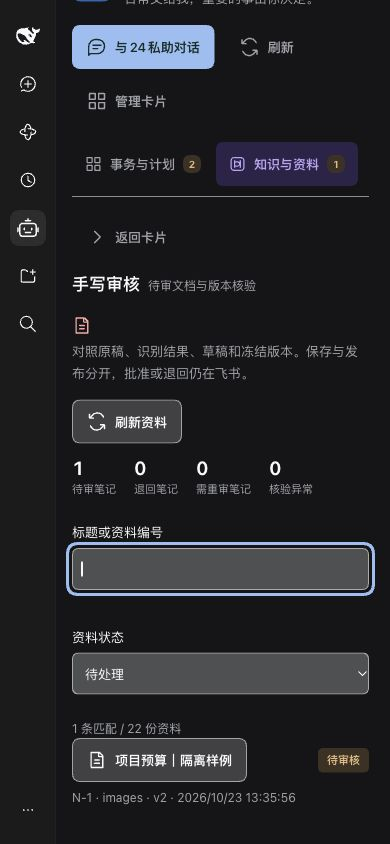
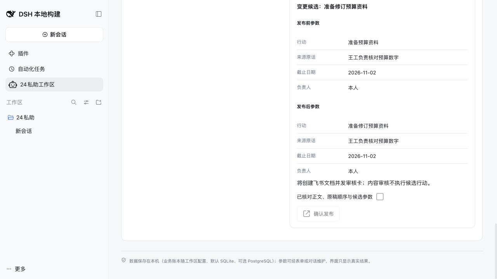
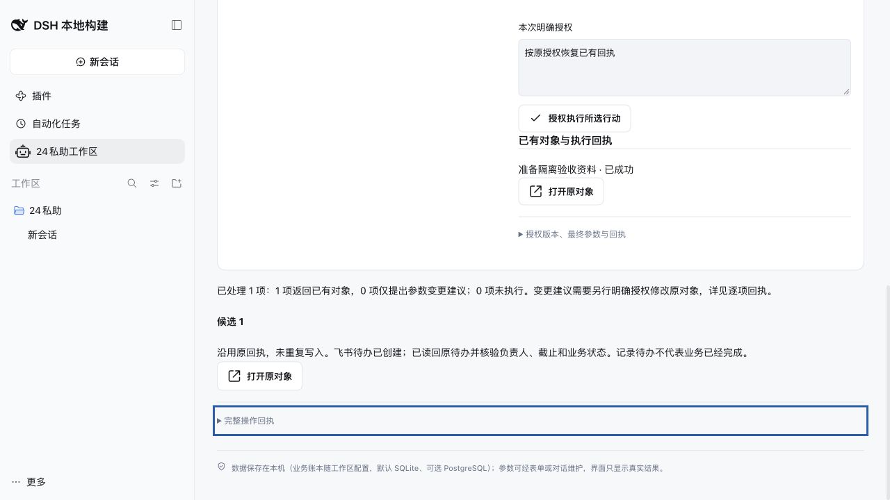

# Manticore M05：资料审核与听记实施验收

对应 #218，基线 `51b5603`。复用 #208/#209 的整稿核验、发布恢复、精确版本裁决和旧外部操作恢复，研究见 [资料草稿与审核](2026-10-23-Manticore-M05资料草稿与审核.md)。宿主固定为 dsh `1600d8a1e140dcde43a1a0941940a0480712c011`，Node 26.4；所有外部平台和模型调用使用隔离替身。

## 已实现与验收映射

| 定稿要求 | 实现与证据 |
|---|---|
| 原稿、识别结果、草稿、冻结版本分开 | `note_material` 保存独立草稿和识别副本，单调 revision；`note_version` 保存不可编辑审核快照。原稿按路径归属、文件类型、大小和摘要读取。 |
| 保存不等于发布；保留手工修改 | CAS 保存只写本地；发布前显示正文、页序、疑点及候选差异。人工保存或远端人工修订后的再次识别只新增对照结果。双账本测试覆盖并发保存冲突。 |
| 当前版本和身份审核 | 原稿资源、正文、草稿 revision、当前主人均核验。面板只看、编辑、核验、发布和重发；批准／退回仅飞书不透明令牌。旧卡、过期卡和旧主体不能覆盖新内容。 |
| 重发与失败恢复 | 同版本重发只登记投递意图；重复 requestId 去重。草稿发布按 revision＋内容关联原发布，即使换请求或在外部文档创建后失败，仍恢复同一文档与版本。 |
| 稳定候选及单独授权 | 候选 ID 独立于排序和文字；授权保留主人、版本、候选、原话、指令、参数摘要。外部操作保留实际解析后的身份、目标和最终请求；新版本已成功候选只关联原对象并给变更建议。保存／发布／批准与行动执行使用同一笔记门限。 |
| 完整数量、分页和错误状态 | 全量 SQL 统计待审、退回、重审、核验未知；详情保留历史。54 份资料测试不会被旧的 50 条最近列表截断。失败保留上次数据，跨绑定响应不会进入新工作区。 |
| 听记本地范围与真实来源 | 仅本地会话、当前获准工具、唯一成功真实 tool/call + tool/result；导入文字必须出现在回执，引用须在参数或回执出现。强制声明 transcript／minutes／quick-note，保留来源、callId 和摘要；无图片时不伪造手写页。 |
| 挂载不等于可读 | 使用 agent 已记录的实际工具放行结果；未解析为未知。仅记录实际本地调用的成功／失败和时间；普通刷新不创建会话或调用 MCP，旧配置的回执不作为当前证据。 |
| 听记接续边界 | 主人明确选取后才保存单篇草稿；发布、本人内容审核、候选行动授权分开。不修改源听记、不全库同步、不自动写入或确认结构化记忆。 |

## 验证结果

- 新资料契约：`manticore-materials.test.mjs` **15 项**，覆盖 SQLite／PostgreSQL。包括失败后换请求恢复、执行期间保存门限、旧主人授权拒绝、远端人工修改保护、听记真实回执、原稿摘要及完整计数。
- 实际 React 面板：`material-panel.test.mjs` **7 项**。覆盖 390px 浅／深主题、纯文本显示、按页读原稿、保存／预览／发布、逐项授权、完整变更回执、失败保留旧结果、切换绑定丢弃迟到响应，以及听记刷新不调用 MCP。另 `client.test.mjs` **14 项**通过。
- 相关回归：知识行动恢复 **56 项**、发布恢复 **24 项**、笔记信任 **12 项**、手写纯函数 **12 项**、手写域边界 **3 项**、工具放行 **11 项**、面板 RPC **4 项**、提示词 **18 项**通过。合计上述独立单元／交互测试 **176 项**。
- 实际 Loader：新增 `manticore-materials.e2e.mjs` 在 SQLite／PostgreSQL **各 3 项**通过，公开 RPC 从图片、草稿、冻结发布、真实会话身份、精确版本审核、候选对象，到 Host 重启后的关联／变更建议闭环。F06 原图收集／视觉 Worker／审核／修改失效／失败恢复 **各 8 项**通过。两种账本共 **22 项**宿主测试。
- TypeScript 构建、`node --check client.js`、`node scripts/sync-preset.mjs --check`、`git diff --check` 通过。未安装依赖，未改宿主，未操作共享浏览器。Node 26.4 的 SQLite 原生备份完成回调使用既有测试进程唤醒 workaround；不进入产品代码。

真实 Loader 发现并修正两个单位替身未揭示的问题：宿主服务上下文不能直接读取 agent tools，改读实际解析快照；Host 重启后测试须等待工作区正式绑定再发带 binding 的请求。听记新编号也已纳入严格的审核状态段语法。

## 总集成接口与迁移顺序

- 迁移 **29** 增加 `note_material`、`note_action_link`、`material_read_evidence`，必须在 M02 的 **27** 和 M04 的迁移集成后统一排序升级。此树跳号生成的测试库不能作为主分支升级样本。
- `runtime.ts changeMaterial()` 是面板入口；`notesTool()` 的 detail/save_draft/publish_draft/resend/import_minutes/adopt_actions 是对话入口。资料原稿读取与列表均带工作区 binding。
- `materialMutation()` 用真实发起会话和 requestId 建 `pa24-material-<hash>` 事项，instruction 保存固定操作意图。发布／候选执行成功结算 completed，候选部分失败或异常结算 failed，结果在 `result_ref.materialResult`；不调用模型、不启动假 Worker。重复已完成请求返回缓存。
- 保存、核验、重发不建 Worker。发布与候选各自的 `action_operation` 独立保存外部结果；即使进程中断也可核对后恢复，成功对象不重做。
- M02 集成负责把这些直接工具事项纳入运行档案及崩溃后未结算展示；不能将其记为已运行模型 Worker。
- M04 接续使用 `taskCreate` 的 sourceId/company/project/assigneeIds 与固定 `_operationId`，完整 `_authorization` 保留。M03 使用 `calendarWrite` 原入口。此树已验证旧兼容路径；M04 新多来源接口须在根分支完成集成验收。
- `external-operations.ts` 只补旧候选恢复的授权字段名单。`prompts.ts` 的审核／听记段独立改动，公共版本同 M04 为 1.11.0、业务段版本 6。未改总 TODO、定稿或总 README。

## 共享浏览器验收清单

根集成统一控制 CUA。可在已构建的集成树 `packages/24pa` 运行：

```sh
DSH_BIN=/Users/pc2026/DSH-Space/deepseek-harness/apps/cli/lib/bin.js node scripts/manticore-material-ui.mjs
```

脚本生成独立临时 profile／工作区和 22 份合成原稿，以测试 CLI 和 fake 飞书运行，输出只属于该进程的启动 URL；Ctrl-C 仅清理该样例。`--smoke` 自动清理，已验证启动成功并正常清理。样例不是实际识别准确率或真实账号证据。

1. 桌面查看「手写审核」全量数量；详情对照原稿／识别／草稿／冻结版本，确认历史审批和状态同步可见，面板无批准按钮。
2. N-1 原稿、正文修订和候选参数差异；修改正文→保存→预览→勾选核对→发布，确认保存不发文档，发布创建单一新版本。
3. 选择全部资料翻页；断开回环请求，确认失败提示与上次内容并存，再恢复重试。
4. N-2 切换到候选，选一项并明确授权；查看对象回执。再次选择应返回原对象，改文并审核新版本后仅出变更建议。
5. 窄屏 390×844、浅／深主题、Tab 键和焦点；原稿按页读取，长文本及 JSON 不横向撑破页面。
6. QwenNote 详情如实显示未配置（若另行配置则区分放行／挂载／调用证据）；刷新无 MCP 调用，跳转本地对话和资料审核入口正确。

浏览器截图由根集成归档；本记录不把 HappyDOM 当成真实视觉验收。

## 仍需真实账号与最终集成验收

- 当前账号 QwenNote 授权、实际资料类型／标题／时间和读取工具回执；导入后内容、原话和资源引用的人工核对。
- 飞书真实文档权限、图片资源、审核卡点击、主人身份切换和投递；企微／飞书候选最终落点需连同 M04 来源配置验收。
- 30–50 页真实原稿，人名／数字／日期／否定／勾选、图示及可靠区域的质量，不能以合成图片替代。
- 双轴代码评审、共享浏览器走查、M02 直接动作运行档案、迁移顺序和根分支全回归由总集成协调；完成前不单独合并本树。

## 2026-10-23 主线集成与真实浏览器验收

合入 `db5b425`（M02/M04/M06/M07），合并记录 `c6610be`。迁移实际顺序为 21–29，不再是原研究树的跳号环境。新多来源待办接口使用 `task tasks create`；更新旧 CLI 断言，保留原回执恢复和最终参数的验证。

发布/候选执行现在落入独立运行档案，冻结原父会话、请求与操作，保存工具结果；明确标注 `material-action`、未启动模型，没有伪造 Worker 输入或成本。成功与部分失败的同一 requestId 返回原回执，异常重放不继续执行；重启中断标明待核对，不能被迟到回执覆盖，也不能通过通用交办按钮启动 Worker。

真实浏览器发现并修复：宿主复用空白会话后可能改变预设，显式资料操作必须调用现有 `openLocalSession` 重验并建立正确入口；390px 时刷新按钮需允许头部换行且不压缩文字。

浏览器使用隔离合成原稿、测试 CLI 与假飞书，逐项验证：22 份全量列表、第二页 2 条；原稿摘要检查；草稿保存不发布；差异确认后发布 v2；历史 v1 不可重发当前审核；已审候选单独授权、再次执行返回同一对象；故障注入真实 XHR 后保留旧内容并可重试；浅/深主题、390px 无横向溢出、键盘焦点；QwenNote 未配置如实显示、刷新无读取、可接续资料审核；统一运行档案标注直接操作。浏览器覆盖不会代替真实授权与识别质量验收。






本次两库资料单元新增至 **21 项**；界面与客户端 **21 项**通过。真实 Loader 的资料与 F06 回归 SQLite/PostgreSQL **各 11 项**通过。旧 F06 错误路径改查持久工具回执：M02 在未知结果后阻断下一模型回合，因此不能用下一次模型请求是否带错误作判断。错误与权限拒绝仍被断言，未知档案和人工核对边界一并验证。

完整回归首轮共 1339 项，1333 通过、6 项揭示同一个集成差异：重新表述“按原授权恢复”被多来源待办视为替换授权。现保留原行动的授权指令与发起入口，同时仍核验当前主人、版本、候选和参数；渠道偏好变化只恢复原对象，不新建。对应旧恢复测试继续验证两平台、两账本及拒绝改澄清。修复后复验与双轴结论将在下方记录。

## 2026-10-23 串行独立评审后的修正

固定比较 `db5b425...4fcf6b9`：Standards 发现 2 项（页签键盘契约、完整 JSON 默认展示），Spec 发现 3 项（远端人工修订保护、升级前行动首次关联、发布实际差异）。按用户要求，两轴由独立代理逐一执行。

- 资料页签补齐 tab/tabpanel、方向键、Home/End、焦点和单一 Tab 入口；默认展示业务参数、状态和对象链接，完整候选、输入与回执按需展开。
- 发布预览展示正文、页序、疑点及候选参数的前后值，确认前仍不发布；保存与发布继续分离。
- 重识别先核验最新飞书版本；已变化或无法核验时仅保存新的识别结果，不替换草稿、发布新版本或作废原版本。既有远端原文入口保留，人工修订须另行核对发布。
- 升级前缺少 `note_action_link` 的行动从原操作、原版本及原授权恢复关联；新版本只返回已有对象或变更建议，不扩展原授权、不重新写入。旧版待办和日程同版本恢复、跨版本恢复、错误资料归属均有双数据库测试。
- 先前阶段全量：83 文件、1,339 项通过。修正后相关测试 121/121；追加核验未知、旧行动同版本恢复及最终 UI 复验 49/49。构建、client 语法、预设同步、diff 检查通过。后续全量与真实 Loader 结果另记。
- 真实 dsh 浏览器复验：方向键/Home/End 改变焦点与选中；候选授权创建后，更换措辞“按原授权恢复已有回执”仍只返回原对象；完整 JSON 默认折叠。390px 的 viewport/scrollWidth 同为390，无横向溢出。





以上仍为隔离工作区、合成原稿和 CLI/飞书测试替身。未触碰真实账号或生产部署，未将其记为真实 QwenNote 或手写准确率验收。
