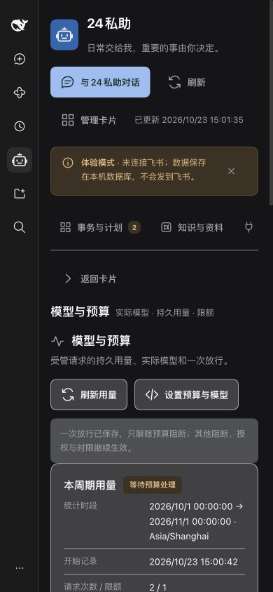

# Manticore M08 预算与输入恢复契约

基线：产品定稿「健康与预算」、SPEC 2.13/故事154、#221、ADR-0001。固定宿主 `1600d8a1e140dcde43a1a0941940a0480712c011`，Node 26.4 / dsh rc.1；宿主源码只读。复用 M02 调度、计时和交办档案研究。

## 已核验宿主接口

- `packages/core/agent-loop/src/agent.ts:267–288`：pre-step 先 claim inbox，再执行 waterfall；reject 不归还已 claim 输入。必须在该边界持久保存完整 id/source/content，不能只存 instruction 或 execution 标记。
- 同文件 `405–445,570–685`：每次尝试（包括宿主内部 retry）都执行 agent/request，随后 prepareCall、user/message 和 request/header，再派发 stream。一次许可仅在 agent/request 原子消费，pre-step 只判断并保存；工具不得消费同一模型许可。
- `assistant/message` 带实际 source.provider/model 与可选 usage；缺失表示未知。失败/取消可能只有 assistant/attempt，其 stream 中可有 usage chunk。request/header 保存实际 adapter 配置。按 Session 持久 seq 去重，不按进程内 attemptId 计量；收到请求意向但没有用量的窗口保持未知。
- 原生 user/message 与 consumedTurn/turnHasModelInput 才证明输入采用。inbox received/consumed 是接纳/认领证据。未采用才可恢复原消息 ID；采用后只沿原历史继续，先核对未决工具和平台动作。
- 公共 subagents.sendMessage 负责原 Worker 冷激活。预算内部控制唤醒必须绑定原 Work/Run、父子会话与授权凭证；不得借普通补充建立新的 execution。终态拒绝迟到许可，等待不占模型/工具执行时限。

- `packages/llm/token-meter/src/index.ts:71` 与 `packages/llm/llm-deepseek/src/translate.ts:159`：宿主将非缓存输入、缓存读取、缓存写入、输出分桶，四者互不包含。Token 合计与费用都相加；不能再次从 inputTokens 扣缓存。缺 usage、未知桶价格、实际路由无报价都不按零估算。

## 实施选择

新增预算账本，覆盖本工作区受管 Skill 运行及普通 Worker，展示明确覆盖时段；顶层自由对话、外部 CLI 模型、TTS 和供应商账单不伪装纳入。原生事件补录实际路由与 usage，并保留派发后未结算窗口。配置支持请求次数、token 和有价格依据的估算费用限额；价格由主人配置且保留每次计算依据，不把估价称为账单。未知 usage/价格时有对应限额则阻断后续受管请求，允许显式一次放行。

预算阻断与 input/authorization/dependency 分项保存。一次放行限定原 Run/Work 和被阻断会话的下一次模型派发，并持久记录消费；重试也重新核验。放行不清其他阻断，不延长运行时限。已发请求和工具可结算、结果与 outbox 可保存投递；日历原生提醒不依赖此门禁。

真实 Loader 和 SQLite/PostgreSQL 验证结果在实施后补录；本记录是已核源码的契约依据，不替代测试或真实账号验收。

## 子会话及补充接缝

同一个 Run 的主会话和原生子会话可以分别等待预算；迁移 30 以 `(run_id, session_id)` 保存等待，控制阻断按会话区分。一张许可仍只绑定一个会话、下一次请求，不能被兄弟会话抢用。另一个会话的预算等待不撤销已派发请求或工具的收尾权限；独立 input/authorization/dependency、终态和累计时限仍阻止继续。

普通交办的许可消费另存当时 execution_id。完成核对只有在原会话存在该次已消费许可时，才越过先前预算拦截的 blocked/error 回合，不把旧许可套用到后续人工补充。Skill 预算控制唤醒的真实消息身份入原运行输入账本，原输入的 id/source/content 原样恢复，控制信号不另建交办。

## 界面验收

隔离夹具 `scripts/manticore-budget-ui.mjs` 运行实际 Loader，模型为本地桩，没有真实平台写入。CUA 验证了用量／实际路由与未知价格、按原运行预览并明确勾选放行、使用键盘操作、放行后请求从 1→2 且限额保持、0 限额和价格依据保存并重载、断线报错及重试恢复。390px 明暗两种主题可操作，文档宽度与视口同为 390px，无横向溢出；完整记录默认折叠。分页、校验失败保留草稿及工作区迟到响应另由 React DOM 测试覆盖。

全量单元首次 85 文件1363项中1362通过，`runtime-channels` 一项既有 CLI 超时；未改代码定向复测该文件6项全部通过，不能把首次运行记为全绿。构建、客户端语法、预设同步通过。真实 Loader SQLite 预算7项、交办／计划／运行控制30项通过；PostgreSQL 同一组4文件37项全部通过。价格和真实账单核对、实际日历 App 提醒及生产部署单列，不由本地桩替代。
