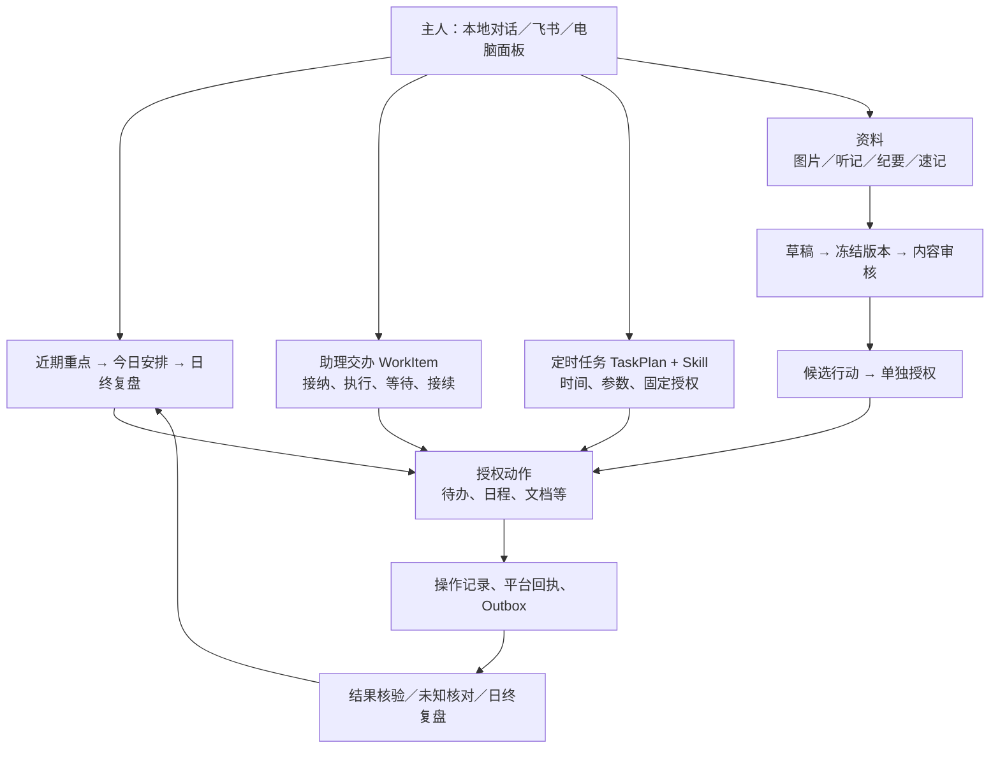

# 24私助产品现状与减法 Issue 审查

日期：2026-11-07。源码基线：`3d7c7064683e613bf9b2698bf563a4a5f96923e6`，包版本 `0.2.2-rc.1.2`。审查对象：总规格 [#269](https://github.com/benz-ai-x/dsh-24-PA/issues/269)、F49 `#270`（已删除）、F50 [#271](https://github.com/benz-ai-x/dsh-24-PA/issues/271)、F51 `#272`（已删除）。现行已确认规格仍为 2.17，修订建议写入 2.18-draft；本轮没有修改产品代码或运行实例。

## 当前结论（用户确认后的范围）

主人已明确：语音是最喜欢的功能，管理计划与寻找常用功能目前没有实际困扰；本轮只调整 #271 为对话与面板一致性改进，不强制迁移旧计划，并删除 #272。语音退役原工单也已删除。以下源码事实用于定位具体差异，不能从代码复杂度推导删除功能。

| 事项 | 当前决定 | 用户价值与证据边界 |
|---|---|---|
| #269 | 仅跟踪周期服务一致性 | 不再作为本体前置减法或整体改版计划。 |
| 原语音退役工单 | 已删除，功能保留 | 原故事 126 已明确听晨报的价值；维护面存在不足以支持删除。 |
| #271 / F50 | 仅做对话与面板一致性 | 旧对话控制会拒绝通用计划（digest-service:174）；旧创建默认固定模板（:127），面板默认智能规划（client:1735）。改善同一计划跨入口操作和默认选择，不声称主人已遭遇问题。 |
| 原桌面改版工单 | 已删除，现有布局保留 | 卡片数量、闲置组件和本地读取不构成整体改版的用户价值依据；没有测得导航困难或性能瓶颈。 |

#271 复用已有通用计划服务，对旧计划保留兼容管理；升级、查询、改期、暂停/恢复不隐式迁移，也不要求先迁移。原生调度、语音、Skill 和历史按各自契约保留，自愿迁移仅在主人明确选择后办理。当前详细契约与 PC-01–10 见[一致性规格](../planning/24PA-Ontology前置减法-SPEC.md)。

此前判断错误是将工程复杂度推成低价值，再主要审查“怎样安全删除”，没有先验证是否值得删除。旧快照、重试、模板与密钥兼容风险是退役假设的后果，不是删除理由。下文保留技术追踪与当时方案分析，全面退出旧计划、四入口重构及独立代码清理均已退出当前实施范围。

## 当前产品实际由哪些部分构成

这是职责示意，不表示所有入口都使用同一运行表。旧简报发生记录、助理交办运行和通用 SkillRun 仍有不同身份与历史。

| 产品部分 | 源码确认的当前行为 | 对减法的含义 |
|---|---|---|
| 工作规划 | `WorkPlanning` 区分建议和已采纳计划；复盘引用确定日期与采纳版本。采纳内部安排并不自动创建平台日程。 | 是下一阶段业务主线，应保留；不要把 DailyPlan 和定时执行的 TaskPlan 合成一个“计划”。 |
| 持续交办 | WorkItem 有独立运行、授权、等待、停止和恢复；停止并不撤销已发生的平台操作。 | 交办不是平台待办，也不是一条聊天消息；减少视图时应保留这些边界。 |
| Skill 与定时任务 | 已有目录、包版本、试运行、参数与权限预览、不可变运行快照；通用计划已有草稿、确认、原地迁移和原生调度恢复。 | 不再另建统一计划系统；高级包编辑与日常使用可以分层。 |
| 待办与日程 | 外部平台是业务权威；本地记录来源、身份、范围、观察和动作回执。普通面板查询与主动平台核验分开。 | 合并接入页面不能合并账号权限或扩大查询范围。 |
| 资料与审核 | 名为“手写审核”的页面实际处理图片、听记转写、纪要、速记；草稿、冻结版本、内容批准与行动授权分别记录。 | 可讨论减少图片/OCR 专用投入，不能整体删除资料审核。 |
| 长期记忆 | 工作区 JSON 是唯一可编辑权威；写入有预览、修订、冲突、审计和恢复。 | 可整理入口，不应顺带新增自动整理或改用另一套权威存储。 |
| 可靠性 | 外部操作先登记意图；已有平台回执优先补账；未知结果不能盲重试。预算和运行控制独立于投递结算。 | 这些代码支撑可信执行，不是可因“看起来复杂”删除的边角。 |
| 运行维护 | SQLite 默认、PostgreSQL 可选，共享迁移契约；备份恢复先进入隔离目标，完整性通过不等于可直接接管生产。 | 双后端是否退出需要实例分布和恢复迁移依据，本轮不作结论。 |

主要依据：[工作规划](../../packages/24pa/src/work-planning.ts)、[规划账本](../../packages/24pa/src/repo/work-planning.ts)、[交办生命周期](../../packages/24pa/src/work-item-lifecycle.ts)、[运行控制](../../packages/24pa/src/run-control.ts)、[外部操作](../../packages/24pa/src/external-operations.ts)、[来源登记](../../packages/24pa/src/source-registry.ts)、[资料处理](../../packages/24pa/src/handwriting-pipeline.ts#L73)、[资料可信性](../../packages/24pa/src/note-trust.ts)、[记忆](../../packages/24pa/src/memory.ts)、[恢复](../../packages/24pa/src/backup-restore.ts#L209)、[运行时首页](../../packages/24pa/src/runtime.ts#L474)。

## `#270`（已删除）：已撤回提案的技术影响（保留审查记录）

本节描述退役假设下的兼容工作，现不进入实施。以下风险不得被解释为现有语音功能的故障证明或删除理由。

现有旧简报与通用计划都把完整文本和音频意图一起入账。音频行保存的是待合成文字，音频文件主要在发送时临时生成；没有证据要求做一个庞大的历史媒体迁移系统。

真正需要补齐的是下面六个缺口：

1. **旧快照仍能产生音频。** `PlanResultRepo.notice` 使用 Run 的不可变计划快照；修改当前计划不覆盖退役前已接纳的运行、迟到完成和原配置重跑。退役能力应约束结果生产及最终发送，历史快照保持原样。
2. **失败重试仍能复活音频。** 现有 repair 能把 failed 行重新设为 pending。核对未知结果可以保留，退役音频的补投必须阻断。有平台消息 ID 时仍须允许只补本地回执。
3. **旧辅助音频并不都能通过现有修复 UI 找到。** `digest:<occurrence>:voice`、`tts-test:*` 不一定关联通用计划投递或 WorkerRun，需要有原身份的核对/退役处置入口，不能伪造 SkillRun。
4. **已处置不等于送达，也不应永远告警。** text sent + audio 明确未发退役，应显示音频未发送、问题已处置；audio unknown 仍待核对；text failed 仍待修复。列表、首页统计、筛选和恢复使用同一规则。
5. **删一句模板文案也会影响旧版本。** 固定模板按正文匹配当前内置模板；清理语音说明可能使合法旧模板副本/历史快照被拒绝。须兼容可信旧版本，不自动转智能 Skill。
6. **删密钥白名单可能连带清空旧值。** 密钥库读取后整体保存；退役前需保留旧 TTS 密钥的识别、脱敏和显式清除，不能把保存其他密钥变成隐式删除。

正常路径复用已存在的全文；异常孤立音频先保留证据并核对，不默认新增自动补全文系统。完整证据和文件清单见[语音专项审查](2026-11-07-pruning-audit-voice.md)。

## #271 历史分析：迁移已存在（全面退出目标已撤回）

当前只实施对话/面板一致性，不要求旧计划迁移或旧执行分支退出；下文原迁移方案用于追溯，不是当前实施清单。

当前新旧计划共用 `digest_plan` 表、计划身份及 `PlanLifecycle`。迁移在原行添加通用配置与授权，保留同一 Schedule ID / generation。新引擎接管同一 Schedule 是正常结果，因此旧规格“旧 Schedule 不再产生有效触发”应改为“纳入范围的计划不再被旧执行分支认领”。

旧 `DigestPlanRow` 没有固定收件人和投递授权；旧发送读取当时工作区配置。迁移时固定的是主人明确确认的当前目标，还会新增执行时限等参数。可以保证保留已有事实，不能保证无损恢复从未存储的数据。

需要实现的新增部分集中在：

- 对话仍通过 reminders Worker 的 `digest_enable/control/list` 创建和控制旧计划，通用计划管理主要在面板 RPC。关闭旧动作前，让对话复用通用草稿、预览、确认和权限服务，保持“对话开启周期服务”的用户目标。
- 存量按可直接迁移、原 Skill 契约/放行不足、来源/会话/调度待核对、在途未决、明确停用分类。旧自定义 agent Skill 不一定满足新后台契约，不得为通过迁移偷偷换 Skill 或扩权。
- 已明确停用但未迁移的旧唤醒仍可能进入 Lead。应按真实计划与调度证据程序处置；不能仅删掉 Worker action。混合批次中的正常对话、等待跟进和会前准备继续处理。
- 退役按实例分阶段切换：停止旧式新建，列明存量，明确迁移或停用，再退出独占准入。未完成核对的记录有可达入口；不能把全体用户都迁完作为首个版本不可验证的门槛。

`DigestService` 的模板渲染、事实组装、等待跟进和会前准备，以及 `PlanLifecycle` 都有保留用途，不能按文件名整块删除。完整迁移时序、引用与测试落点见[计划专项审查](2026-11-07-pruning-audit-plans.md)。

## 原桌面方案历史分析（工单已删除，不实施）

当前不是散落的 16 个独立系统，而是**首页 + 四分类下的 16 张能力卡**。新定时任务页面已经替换旧主页面，旧页面保留在“兼容与历史”；QwenNote 和 Wiki 本来就在接入设置分类。

建议用四入口作比较方案，先走通六个任务：安排今天、执行一个 Skill、暂停周期服务、审核一份资料、处理未知投递、修改接入参数。记录导航前后的操作步骤、入口可发现性及阻断信息，再冻结布局。候选分工为：

| 候选入口 | 应直接服务的操作 |
|---|---|
| 今日工作 | 重点、今日安排、复盘；常用 Skill 执行、定时任务和待处理异常直达。 |
| 工作对象 | 待办、日程、资料与审核、记忆查阅；不改变原对象权威。 |
| 运行记录 | 执行、交办、未执行事件三视图，保留停止、接续、核对和结果核验。 |
| 设置 | 接入与文档落点、默认参数、工作区、预算、备份；高级 Skill 包管理。 |

应纳入本票的可核实减法：

- `WorkDetail`、`ActivityDetail` 只有定义，没有活跃挂载；实际使用的是 `TodoDetail`、`RunHistoryDetail`。复核引用后删除旧组件，调整仅检查旧函数名称的测试。
- `useExtra` 读取的 `roles` 只被闲置的 `WorkDetail` 消费，可以随之去掉客户端读取。不能据此删除后端其他调用者所需能力。
- 隐藏/移动卡片目前不会停止 `minutes / memory / health / budget / roles / reminders / digests` 的首页补充读取。完整设置详情应按需加载，首页保留实际需要的摘要和阻断；不声称尚未测量的性能收益。
- 所谓“旧深链”实际是 React 内部跳转、对象 ID、筛选和配置锚点；持久显隐偏好在浏览器 localStorage。保护这些现有行为即可，不借机新增 URL 路由或服务器偏好系统。

QwenNote 是本地听记读取工具及明确选材导入，Wiki 是输出文档落点；当前 `SourceDomain` 仅 `calendar | todo`。本票不扩展通用连接器模型。完整 16 卡落点和源码依据见[界面专项审查](2026-11-07-pruning-audit-ui.md)。

## 仍应保留或另行判断的内容

| 内容 | 本次建议 | 理由与下一步证据 |
|---|---|---|
| 图片录入/OCR 专用路径 | 暂保留，另作 D01 | 没有使用数据；若退出，应只针对专用输入/识别，保护通用资料审核、历史原稿和候选行动。 |
| 默认编程能力 | 暂保留，另作 D02 | 主要复用宿主工具和本地会话权限，不是一套独立编程产品；删除白名单未必显著减少维护量。 |
| 可选 PostgreSQL | 暂保留，另作 D03 | 双后端在所有权、持久恢复和迁移中有真实契约；须先核对部署分布及迁移办法。 |
| 旧规划辅助方法 | 后续针对性梳理，不并入三票 | 新 WorkPlanning 和旧 `plan_today/preview/adopt/overview` 同时存在；`plan_adopt` 仍承接实际日程写入，不能仅凭新名称删除。 |
| 术语与职责漂移 | 记录，随对应功能修订 | “手写审核”已超出手写；GLOSSARY 的听记“不落业务账本”需区分默认按需读取与明确选材后保存草稿。本轮不未经决策改写 ADR。 |

## 实施组织（当前）

仅 #271 / F50 保留，一个主 PR，按 PC-01–10 验证同一计划的双向管理、默认选择、真实结果、旧计划不迁移可用以及权限/恢复/语音回归。旧计划数量或迁移完成率不作为交付门槛，不并入桌面重构及代码清理专项。

原语音退役和桌面改版工单均按主人要求删除；其他工单状态、标签、负责人及评论保留。相关 SPEC、父规格增量、设计与索引已收窄；产品代码与实例配置没有修改，仓库文档尚未提交。下面的测试结果是此前代码审查的基线记录，不代表本次新行为已实现或验收。

## 阅读范围与证据限制

建立了全部 **139 个 `src/*.ts` 递归生产文件、28,666 行**的文件清单；客户端另有 `client.js` **3,851 行**。采用按入口追踪到领域服务、存储、恢复和界面的方式。下面区分全文阅读与关键段阅读；没有把全库文件清单或关键词搜索说成每个文件都已逐行审查。

| 链路 | 主要阅读文件 | 阅读方式 |
|---|---|---|
| 入口、角色与装配 | `index.ts`、`roles.ts`、`local-tool-access.ts`；`tools.ts`、`runtime.ts` | 前三者全文；工具与运行时读公开入口、权限、工作区激活、规划、计划、投递、恢复、资料及记忆关键段。 |
| 工作规划 | `work-planning.ts`、`work-planning-model.ts`、`work-planning-validation.ts`、`repo/work-planning.ts`；`daily-planning.ts` | 前四者全文；旧规划读建议、采纳、批次写入与回执恢复。 |
| 交办及可信执行 | `work-item-lifecycle.ts`、`work-owner-input.ts`、`work-completion.ts`、`run-control.ts`、`external-operations.ts` | 读取生命周期、原始输入证据、持久完成、时限和外部意图/回执路径；未对所有适配器逐行安全审计。 |
| 通用与旧计划 | `task-plan-*.ts`、`task-plan.ts`、`digest-service.ts`、`digest-trigger.ts`、`digest-supervision.ts`、`digest-period.ts`、`plan-lifecycle.ts`、`schedule-bridge.ts`、`schedule-message.ts`、相关 repo | 详见计划专项报告的全文文件清单；追到旧对话入口、原生消息消费和历史兼容。 |
| 投递及语音 | `tts.ts`、`spoken-result.ts`、`outbox-delivery.ts`、`plan-results.ts`、`repo/outbox.ts`、`repo/plan-result.ts`、`repo/run-history.ts`、`repo/health.ts`、`secrets.ts` 等 | 专项报告列明全文文件及运行时、Skill 重跑、模板、配置的关键段；未检查生产音频存量。 |
| 来源与对象权限 | `source-registry.ts`、`source-config.ts`；`source-access.ts`、运行时 todo/calendar 与主动核验入口 | 前两者全文；其余关键段与调用关系。 |
| 资料与记忆 | `note-trust.ts`、`note-document.ts`；`handwriting-pipeline.ts`、`material-draft.ts`、`note-derivation.ts`、`memory.ts` | 前两者全文；其余重点读取明确听记导入、草稿/版本、内容与行动授权、JSON 写入恢复。 |
| 存储、预算与恢复 | `db-schema.ts`、`repo/index.ts`、`pg.ts`、`backup-service.ts`、`model-budget.ts`；`db.ts`、`sqlite.ts`、`backup-restore.ts`、`model-budgets.ts` | 前五者全文/导出索引；其余相关迁移、隔离恢复和预算关键段，不宣称每条历史 migration 已重审。 |
| 桌面 | `panel.ts`、`skill-management.ts`、`source-config.ts`；`client.js` | 前三者全文；客户端导航、16 卡注册、核心详情、Skill 执行、加载、首页及内部跳转关键段。 |
| 契约与测试 | 产品基线、GLOSSARY、ADR-0001、工作方法/晨报/五卡规格；计划、投递、首页、Skill、资料等测试 | 区分测试源码阅读与实际执行；各专项报告列出已读测试及后续验证落点。 |

### 代码审查阶段的基线验证

- `npm run build`：通过。
- `npm run preset:check`：通过，宿主预设基线匹配 `0.2.2-rc.1`。
- 文档检查：原审查阶段检查过相对链接、代码围栏及当时的 RED-01–18。当前范围修订后重新检查主审、三个专项和一致性规格的相对链接与围栏，验收编号改为 PC-01–10；本次未重跑产品测试，未修改产品源代码。
- `npm run test:unit`：退出码 1，99 个测试文件中 95 通过、4 失败；1,689 个用例中 1,673 通过、15 失败、1 跳过，耗时 1,085.33 秒。首次沙箱执行因本地端口 `EPERM` 无法建立隔离 PostgreSQL/HTTP 桩而中止，本结果来自允许本地端口后的完整重跑，不把沙箱限制记为产品失败。
- 未运行生产实例、真实平台账号操作、完整 Loader 集成套件或桌面人工验收；没有生产使用频率与实例迁移统计。现有能力的真实效果和一致性规格的验收均不由本次静态阅读替代。

专项报告中的“未执行测试”描述该专项的静态核查；本节单独记录主审实际运行的基线验证。

### 额外发现：公共工具测试与本机链接宿主的执行器契约未对齐

15 个失败全部在业务 handler 前报 `ToolExecutorUnavailableError`：`jobs-tool` 8 个、`todo-public-tool` 3 个、`work-tool-schema` 2 个、`worker-run` 2 个。测试创建 `Context` 后只加载 `SystemPrompt` 和 `ToolRuntime`；当前链接的 `ToolsService.execute()` 首先选择已注册 executor，未注册即抛错。因而本轮没有实际验证这 15 项的业务断言，不能据此宣称 15 个业务功能都已损坏，也不能把整套回归写成通过。

依据：[jobs-tool 测试装配](../../packages/24pa/tests/unit/jobs-tool.test.mjs#L22)、[Worker 测试](../../packages/24pa/tests/unit/worker-run.test.mjs#L134)、[工具 schema 测试](../../packages/24pa/tests/unit/work-tool-schema.test.mjs#L47)、[公开待办工具测试](../../packages/24pa/tests/unit/todo-public-tool.test.mjs#L26)、[开发依赖链接脚本](../../packages/24pa/scripts/link-peer.mjs#L19)。本机 `@deepseek-ai/dsh-tools` 实际指向相邻 `deepseek-harness/packages/core/tools`，包字段为 `0.2.2-rc.1`，宿主 checkout HEAD 为 `66491b05e3f05ad35bcdd4f6cd7ed26041d9e3db`；`packages/core/tools` 的受检查源码工作树无变更。该开发链接的现态不等于已验证的发布宿主制品。

实施一致性改进前，应固定受支持宿主及开发测试装配，按真实 executor/工具调用接口恢复这四组测试，再验证原业务断言；不能用跳过测试、弱化断言或假执行器掩盖。此项属于验证基线问题，记录到 #269 的实施准备，不构成删除功能的依据。本轮没有修改测试、宿主或产品代码。

完整测试输出保存在本机临时日志 `/private/tmp/24pa-code-audit-unit-unrestricted.log`；临时日志不是长期制品，本节的版本、失败分类与最终计数作为仓库留证。
