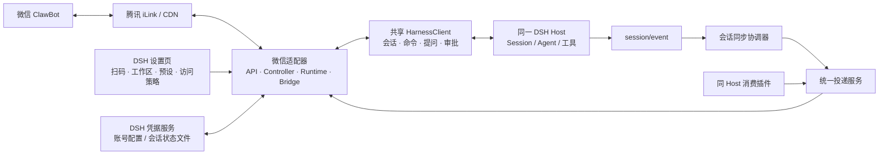
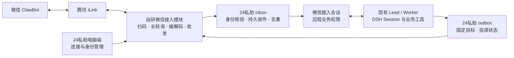

# dsh-im 实现研究与24私助自研 IM 接入方案

研究日期：2026-11-07（Asia/Shanghai）。研究对象：[xmanrui/dsh-im](https://github.com/xmanrui/dsh-im)。

## 结论

**已确认的方向：24私助自行实现 IM 接入，dsh-im 只作为实现研究对象，不作为运行依赖。** 本文第 1–7 节解释参考项目怎样实现，第 8 节给出24私助自研方案。首个通道按当前对话中的微信 ClawBot 设计；其他 IM 平台不因“IM 接入”一词自动进入首期范围。

dsh-im 提供的主要参考是扫码状态机、iLink 长轮询、会话路由、交互转发和恢复处理。[S1] [S2] [S3] 自研应以腾讯公开协议及客户端源码核对微信行为，并连接24私助现有收件记录、DSH 调度、业务权限和发送账本。已有能力的复用对象是24私助自身与 DSH 宿主，微信传输和接入逻辑由本项目实现。[T1] [P8] [P9] [P10]

当前24私助会把多数同工作区的 pa24 顶层会话判为本地角色，交办来源、通知渠道和固定回传位置也没有微信类型。自研微信入口必须显式登记远程身份与业务权限，不能只把微信文字提交给一个普通 pa24 会话。[P1] [P2] [P5] [P6]

本次只完成固定版本的源码与测试用例静态检查，没有安装 dsh-im、扫码、发送微信消息、运行其代码或完成真实账号联调。下文“已实现”表示该提交存在相应实现，不表示已通过24私助生产验收。

## 研究版本与证据边界

| 对象 | 本次核对值 | 解释 |
|---|---|---|
| dsh-im 默认分支 | main | 读取时固定到下列提交 |
| dsh-im 提交 | `fc2ceab217309f8973afa03c58cdd8ff3e900130` | 提交时间 2026-11-07 05:03:12 UTC |
| npm 包声明 | `@xmanrui/dsh-im@5.10.0` | 来源是该提交的 package.json；未另行证明 npm 已发布内容与该提交一致 |
| Node.js 声明 | `>=22.19` | 插件运行门槛 |
| 显式 DSH 兼容声明 | `0.2.0-rc.2`、`0.2.1-rc.2` | 不能据此直接证明与24私助当前 `0.2.2-rc.1` 宿主兼容 |
| 24私助核对基线 | `97cc04731b3fdf4c145aabb6d132ac4d80529cc1`；插件 `0.2.2-rc.1.2` | 只读当前仓库源码，未读取或更改生产实例 |

版本来源：[package.json][S1]、[固定提交](https://github.com/xmanrui/dsh-im/commit/fc2ceab217309f8973afa03c58cdd8ff3e900130)、[24私助包声明][P3]。提交说明中的测试数量和人工验证属于上游自述，本次没有重复运行，不能写作本次验收结果。

## 1. 产品与架构：通信层和宿主能力分开

dsh-im 是 DSH 原生 Cordis bundle，包含 Host 端、Web 设置页、共享会话与投递能力，以及各渠道适配器。安装入口是一个包，设置入口是“IM机器人”；每个机器人可配置工作区、模型、预设和访问策略。微信只是其中一个渠道，此外还覆盖飞书、企微、钉钉、QQ、Telegram 等；它没有要求另起 OpenClaw 来驱动模型。[S1] [S2] [S6]

它采用“统一语义核心 + 渠道原生适配”：共享的是消息、引用、会话、交互、产物、进度等语义；具体呈现仍由渠道决定。例如飞书能用卡片，微信主要发送完整文字并分段，不能因为公共层有某个方法就推断微信具备相同能力。[S6] [S7]

Host 对 DSH 的适配将 `session.create/prompt/follow/page` 等能力连接到宿主公开服务，并订阅 `session/event`；微信生产控制器使用这条连接，不在自身实现模型推理或业务 Agent。配置显式远程 `harnessBaseUrl` 时是另一种部署路径，当前本机会话同步能力不覆盖该路径。[S8] [S3]

## 2. 微信登录与凭据

实际链路是：

1. 设置页请求 Host 开始绑定，Controller 创建一次扫码尝试。
2. API 向 `ilink/bot/get_bot_qrcode` 请求二维码，再以 `get_qrcode_status` 长轮询扫码状态。
3. Controller 处理等待、已扫码、配对码、重定向、过期和确认等状态。
4. 确认后读取 `bot_token`、`ilink_bot_id`、`ilink_user_id` 和服务地址。
5. 由 bot 身份派生稳定 `botId` 与凭据引用，token 交给 DSH 的 `ctx.credentials` 保存；普通配置只保存引用、账号和主人标识。
6. 启动 Runtime；写凭据、写配置或启动失败时尝试恢复之前配置与凭据，并记录回滚结果。[S9] [S10] [S11]

微信源码将请求中的客户端 `channel_version` 固定填为 `2.4.6`，使用二维码基址 `ilinkai.weixin.qq.com` 和微信 CDN；该版本字段不能当作服务端完整协议版本的证明。它在自己的客户端实现协议调用，无需安装 OpenClaw；收信由客户端发起长轮询。[S9] [T1]

默认配置目录是 `$DSH_HOME/integrations/dsh-weixin/`：账号配置、每 bot 的 `accounts/<botId>/state.json`、工作区设置分开。配置/状态写入采用写临时文件后 rename，目录与文件分别请求 0700/0600 权限；token 实际如何存储仍由 DSH 凭据服务决定。[S11] [S12] [S13] [S23]

## 3. 消息怎样进入 DSH 并回复微信

Runtime 用 `getupdates` 做长轮询，携带持久化游标 `get_updates_buf`。返回消息排序后交给 Bridge；Bridge 过滤机器人自身消息、检查消息 ID 与重复记录，再做发送者和命令权限判断。每个私聊按 `p2p:<sender>` 映射会话，同一对话串行处理，默认可配置排队或允许文本插话。[S12] [S14]

Bridge 的主流程是：整理文本/引用/附件 → 解析确定性命令 → 查找或建立会话 → 调用 Harness → 处理提问/审批 → 取最终回答 → 发文字和明确登记的产物。命令在本地识别和执行，不先交给模型猜测。[S14]

新会话创建前可先写入选定的 Session ID，再创建 DSH Session，使身份查询能在首次提示词装配时找到来源。若创建失败，会撤回该预绑定或恢复旧绑定。会话和工作区切换使用绑定锁与版本检查，防止并发切换把正在处理的消息送进旧工作区。[S4]

微信回复不逐 token 编辑消息；等待过程中用 typing 接口显示输入状态，完成后按默认 1,800 字符分段发送。这个数字是该插件默认切分值，不能写成微信平台永远固定的接口上限。[S9] [S14]

## 4. 预设、已有会话、权限和审批

| 能力 | 参考项目的源码行为 | 对24私助自研的启示 |
|---|---|---|
| 选择 Agent Preset | 每 bot 保存预设；创建新会话时透传 `agentPreset` | 自研入口仍可使用 pa24 预设，但须独立核验远程角色权限 |
| 绑定已有会话 | `/session` 可选择已有普通 Session；宿主核验其目录/工作区归属，并拒绝子 Agent 会话 | 首期建议创建固定微信接入会话；通用会话切换不是必要前置 |
| 工作区切换 | 机器人默认目录与对话覆盖目录分别保存；换目录会处理会话映射 | 需约束为主人的已授权助理工作区，不能仅依赖目录字符串 |
| 来信访问 | 微信初始策略为白名单；扫码得到的 owner 是特权发送者，额外用户和命令权限另设 | 自研采用明确的主人身份绑定，先校验再提交业务 |
| 提问和审批 | 支持文本选项回答；Web 与 IM 可竞争提交同一审批，先提交者生效，绑定变化后旧交互不能继续提交 | 参考交互归属与过期处理；仍使用24私助业务授权和人工审核契约 |

来源：[预设与会话实现][S4] [S5] [S8]、[访问策略][S15]、[审批与问答][S16]。

重要差异：dsh-im 的“谁能聊天/执行内置命令”与24私助的“这个角色能调用哪些业务工具”是两层规则。即使只允许主人从微信使用，也不能自动授予本地工作区维护、Shell、任意文件与额外 MCP 权限。[S15] [P1] [P5]

`ctx.dshIm.describeConversation(sessionId)` 和同步版本可返回渠道、botId、对话键、私聊发送者等信息；同时有 `dsh-im/session-pre-bind`、`dsh-im/session-unbind` 事件。这些实现说明来源识别必须覆盖会话创建前、绑定变化和恢复过程；自研时由24私助维护自己的入口登记，不调用这些 dsh-im 接口。[S3] [S17] [S25]

但这些方法来自当前会话映射，查找会返回第一个匹配项；同步方法只能读取已载入的状态，无法判断时返回 null。因此 null 不能当作“已证明本地可信”，返回值也不是主人授权凭证；同一 Session 多处绑定、解绑/换绑和启动先后顺序都要纳入适配验证。[S17]

## 5. 图片、文件与语音的具体实现

- 入站图片和文件由 iLink 消息项提供 CDN 参数和密钥；客户端下载后做 AES-128-ECB 解密，图片经过共享图像输入处理后交给宿主。原图和模型副本限制属于插件/宿主策略，不等于微信平台规格。[S9] [S2]
- 语音读取的是 `voice_item.text` 中平台给出的转写；这不证明它有独立的语音识别服务，也不证明每条语音均有转写。[S9]
- 出站文件/图片先申请上传参数，加密上传 CDN，再发送对应原生消息项。正文里的文件路径不会自行触发发送；必须由工具明确登记产物并绑定 Session/Turn。[S9] [S6]
- dsh-im 产品选择不额外限制出站文件的来源目录等，主要沿用宿主工具批准和渠道能力。24私助自行实现文件回传时，须保持自己的工具白名单与获准资源范围，传输能力不构成业务角色的发送授权。[S2] [P1]

本次只确认文字、图片、文件相关执行路径和语音转写读取；没有据 iLink 协议的全部消息类型推断该项目已完整支持所有视频/语音出站能力。

## 6. 主动投递、会话同步和延迟交付是三种机制

### 主动投递

参考项目向同一 Host 的消费插件提供 `ctx.dshIm.listBots/listTargets/createTarget/send`，用稳定 `botId + targetId` 发送文字。Connection RPC 与 HTTP 入口复用投递核心。这说明传输可以放在小接口之后；24私助自研时直接连接自己的 outbox 与微信发送实现，不以这些接口作为依赖。[S3] [S18] [P8]

微信 Runtime 从已保存目标取 `toUserId`，从当前 bot 的状态取该用户最新 `context_token`，分段调用发送接口。context token 按登录凭据 hash 与用户归属保存，重新登录凭据变化时清空旧 token，并防止迟到消息覆盖更晚的 token。[S12] [S13]

“机器人在线/轮询正常”只表示连接状态；它不证明当前主动消息一定可发送。发送仍取决于平台、登录状态和该用户上下文。上游官方协议也明确客户端行为不是完整服务端契约；本研究不推断固定的 24 小时窗口或消息次数额度。[S18] [T1]

### 会话双向同步

启用后，协调器观察宿主 `session/event`：可镜像 Web 用户文字，并在完成的回合中发送最终助手文字；按 rpcId 识别来自本 IM 的输入，避免再次镜像本来就由 Bridge 回复的回合。内部 notice 和 schedule 不作为用户文字发送，但其完成回合可以触发最终答案投递。[S19]

因此，后台任务或子任务之后**只要产生可识别的完整宿主回合**，就存在返回微信的代码路径；不能笼统断言只能回复当前微信请求。反过来，一条账本结果或任意 notice 也不自动等价于完整可同步回合。[S19]

已有目标的同步默认关闭，并随聊天当前绑定的 Session 移动。24私助要求某项交办保留最初发起入口与固定回传目标，两者语义不同。24私助本地 outbox 会向 Session 再提交提示词，是否会被识别为 Web 输入、产生重复文字或再次触发模型，需要联调确认。[S18] [S19] [P2] [P7]

### 超时后的延迟交付

微信 Bridge 默认等待回复 600 秒。超时后可保存 Session、消息/回合定位和原目标，后续读取历史找回对应回合最终结果；重启后可继续。明确发送失败有次数限制，未知结果停止自动重发；不会重新执行原业务任务，也不会重放审批或文件工具调用。[S12] [S20]

这不是24私助业务账本的替代物：延迟交付跟随当前绑定检查，绑定改变会撤掉相应补发记录；任务业务成功、平台接受和主人实际收到仍是不同状态。[S20] [P2]

## 7. 恢复、重试与幂等边界

| 层次 | 实际已有处理 | 不能推断的保证 |
|---|---|---|
| 连接恢复 | 短期轮询失败退避，连续失败退出；Supervisor 周期检查并重建断开的 Runtime | 登录凭据失效会自动恢复有效 |
| 入站去重 | 最近 1,000 个已见消息 ID、会话映射和轮询游标持久化 | 所有崩溃时间点均保证事务式“恰好一次”业务执行 |
| 主动投递公共接口 | 目标检查、渠道错误归类；不提供业务级幂等键/投递历史 | `send` 可以安全无限重试，或充当持久 outbox |
| 微信文本发送底层 | network-error 最多三次尝试，间隔 400/1,200 毫秒，同一分段复用 client_id | 服务端按 client_id 保证去重；源码反而明确存在重复可能 |
| 超时/HTTP/平台拒绝 | 文本底层不会按 network-error 策略重发；未知结果须保留不确定性 | 没拿到成功回执就一定没有送达 |
| 延迟结果补发 | 单独持久化待补发记录、读取原回合、限制明确失败重试 | 等价于业务执行回滚、订单/日程写入幂等或完整事务恢复 |

来源：[连接][S12] [S21]、[状态][S13]、[投递说明][S18]、[文本重试][S9]、[延迟交付][S20]。

微信 Runtime 在异步交给 Bridge 后推进轮询游标，Bridge 在提交模型前记录消息已见；这有避免重复执行的意图，但不是同24私助业务账本在一个事务里提交。正式接入需要故障注入核对“已收消息、已提交任务、已发送结果”各阶段，不能把单元测试存在写成这条联合链路已验收。[S12] [S14]

延迟补发记录在发送成功后删除，发送前没有持久化占用标记。由此推断，进程若在平台接受后、删除记录前崩溃，重启后存在再次发送的窗口；这是源码可见的故障场景，尚未在真实平台复现。[S20]

## 8. 24私助自主实现方案

自主实现已由用户明确；下面的模块划分、首期范围与验证顺序是设计建议，尚未作为已交付能力或全部定稿的产品规格。

### 8.1 首期用户流程

在24私助电脑端打开微信接入 → 展示二维码 → 主人用微信完成平台授权 → 显示绑定身份与连接状态 → 主人向 ClawBot 发送文字 → 24私助办理并将进展/结果送回原微信私聊。

首期建议覆盖单工作区、单主人、一个微信绑定、文字对话、业务交办、异步结果、断线与重启恢复。平台扫码授权不意味着新增手机端管理界面。图片/文件、语音、通用会话切换及更多 IM 平台后续分项安排；时钟型提醒仍沿用现有日历渠道契约，微信消息入口不改变日程和待办的数据归属。

### 8.2 模块职责与连接位置

| 模块 | 自研职责 | 复用本项目或宿主的能力 |
|---|---|---|
| 微信接入 | iLink 请求、扫码状态、登录失效、长轮询、上下文、分段发送、生命周期 | 扩展现有工作区密钥库及脱敏机制；使用通用 HTTP/二维码库不改变自研接入方向 |
| IM 入口登记 | 渠道、账号、主人、工作区、会话及绑定版本，首次接入和恢复时均核验 | DSH `sessionController`；现有预设与角色工具白名单 |
| 收件与处理 | 批量入站持久化、去重、游标提交、业务准入与恢复 | `InboxRepo`、`InboxLifecycle` 与已有会话调度 |
| 结果投递 | 保存原发起目标、分段状态、平台接受/拒绝/未知结果，换绑后阻断旧目标 | `OutboxRepo`、`OutboxDelivery`、交办与运行记录 |
| 连接管理 | 扫码/过期/已连接/需重登状态、重新绑定、停止连接、独立收发核验 | 现有电脑端面板、配置保存与诊断模式 |

仓库已有 `FeishuTransport`，但其入站结构含 `senderOpenId/appId/tenantKey` 等飞书专属字段，不能直接将微信数据填入同名字段。新增微信实现时，仅在飞书与微信确实共有的收件、身份、路由和投递位置提取接口；各自保留卡片、CDN 等平台能力，不预先复制一个全渠道管理平台。[P9] [P10] [P11] [P12]

### 8.3 必须明确的实现契约

1. **身份与会话。** 微信绑定必须显式记录主人平台 ID、bot ID、助理工作区和绑定版本。扫码身份不得按昵称或手机号与飞书身份自动合并。入口登记须先于 Agent 工具挂载，权限查询失败时不能落入本地角色。初期采用固定微信接入会话，保留原发起会话与结果目标。[P1] [P5]
2. **凭据与上下文。** 登录 token 扩展现有密钥机制；`context_token` 是与 bot 登录和用户相关的敏感回复上下文，单独受控保存，不进入普通 inbox 正文、模型提示或日志。账号换绑使旧上下文失效，旧交办保留旧绑定身份，不自动迁移给新账号。[T1] [P12]
3. **收件与游标。** 对同一轮返回消息先完成接纳/拒绝记录，再推进游标；建议将批次入站记录和下一游标放在同一数据库事务内。事件去重键覆盖渠道、账号/绑定及原平台消息 ID；没有可靠 ID 时按异常处理，不临时造随机 ID 当作去重依据。重启从已提交 inbox 恢复，不能将“轮询看见”当作“业务已接纳”。[P9] [P10]
4. **发送与回执。** 所有业务结果统一进入现有 outbox，目标保留渠道、账号绑定版本和收件人快照。微信成功响应未必提供平台消息 ID，因此发送结果须区分本地投递标识、平台接受和真实平台消息 ID；需要调整当前强制返回 `messageId` 的接口，不能伪造微信消息 ID 适配。每段分别记账，已接受段不重发；已发请求的超时/网络异常按未知处理，未经核对不盲重试。[T1] [P8] [P13]
5. **异步结果。** 普通回答、Worker 完成与周期服务都经原交办/运行定位同一投递流程。首期不增加另一套全局会话镜像，以免内部通知、多端聊天和正常回复重复发送。是否向微信投递周期服务由计划明确选择，并验证真实平台发送条件。[P2] [P6] [P7]
6. **能力区分。** 微信作为消息入口不会新增“微信日程/微信待办”来源。实际业务仍通过已登记的飞书或企微来源办理；手写审核的具体版本凭证与平台通用工具审批也不合并。[P14]

### 8.4 实施顺序与验证结果

| 顺序 | 实施范围 | 应看到的结果 |
|---|---|---|
| 1 | 对齐微信 iLink 第一方契约，定义账号、会话、收件和回执模型；同步微信入口产品范围 | 每项接口有依据，待核验平台行为列明，现有飞书/本地对象保持原身份 |
| 2 | 实现扫码、凭据、长轮询和持久收件 | 绑定可恢复；非主人消息不进入模型；重复批次不会重复交办；游标前后的崩溃可恢复 |
| 3 | 接通受限微信会话与文字回传 | 在微信交办 → 现有业务工具办理 → 结果回原微信；无法调用本地专属工具 |
| 4 | 接通异步结果与投递账本 | 重启、长任务、部分分段成功、结果未知、账号换绑均有可核实状态 |
| 5 | 完成电脑端管理和真实账号验收 | 扫码及状态页面可用；真实消息往返通过；主动推送可用条件与限制有实证 |

验证覆盖真实 DSH `0.2.2-rc.1` Loader/Session、SQLite 与 PostgreSQL、消息重复/乱序、收件事务中断、发送结果未知及工作区切换。离线测试与真实微信账号验证分别记录，不能互相替代。主动推送的时间窗口和额度依平台实测确认，不按客户端示例臆定。

现行规格将第二聊天平台收信排除在范围外，自研微信入口进入正式实施时需要同步规格、ADR-0001、配置/迁移和相关验收。用户已明确自研方向；仍待细化的是首期功能和技术契约，不是是否采用 dsh-im。[P4] [P14]

## 证据索引

所有 dsh-im 链接固定到本次提交，避免 main 后续变化混淆结论。

[S1]: https://github.com/xmanrui/dsh-im/blob/fc2ceab217309f8973afa03c58cdd8ff3e900130/package.json#L1-L134
[S2]: https://github.com/xmanrui/dsh-im/blob/fc2ceab217309f8973afa03c58cdd8ff3e900130/README.md#L94-L194
[S3]: https://github.com/xmanrui/dsh-im/blob/fc2ceab217309f8973afa03c58cdd8ff3e900130/plugin-src/host/index.mjs#L100-L173
[S4]: https://github.com/xmanrui/dsh-im/blob/fc2ceab217309f8973afa03c58cdd8ff3e900130/src/channels/shared/workspace-session.mjs#L94-L207
[S5]: https://github.com/xmanrui/dsh-im/blob/fc2ceab217309f8973afa03c58cdd8ff3e900130/src/channels/shared/bot-workspace-store.mjs#L2325-L2500
[S6]: https://github.com/xmanrui/dsh-im/blob/fc2ceab217309f8973afa03c58cdd8ff3e900130/docs/adr/0001-semantic-core-native-channel-adapters.md
[S7]: https://github.com/xmanrui/dsh-im/blob/fc2ceab217309f8973afa03c58cdd8ff3e900130/README.md#L251-L259
[S8]: https://github.com/xmanrui/dsh-im/blob/fc2ceab217309f8973afa03c58cdd8ff3e900130/plugin-src/host/modern-harness-api.mjs#L231-L382
[S9]: https://github.com/xmanrui/dsh-im/blob/fc2ceab217309f8973afa03c58cdd8ff3e900130/src/channels/weixin/weixin-api.mjs
[S10]: https://github.com/xmanrui/dsh-im/blob/fc2ceab217309f8973afa03c58cdd8ff3e900130/src/channels/weixin/weixin-controller.mjs#L429-L599
[S11]: https://github.com/xmanrui/dsh-im/blob/fc2ceab217309f8973afa03c58cdd8ff3e900130/src/channels/weixin/config-store.mjs
[S12]: https://github.com/xmanrui/dsh-im/blob/fc2ceab217309f8973afa03c58cdd8ff3e900130/src/channels/weixin/weixin-runtime.mjs#L130-L431
[S13]: https://github.com/xmanrui/dsh-im/blob/fc2ceab217309f8973afa03c58cdd8ff3e900130/src/channels/weixin/state-store.mjs#L120-L301
[S14]: https://github.com/xmanrui/dsh-im/blob/fc2ceab217309f8973afa03c58cdd8ff3e900130/src/channels/weixin/weixin-bridge.mjs#L395-L1055
[S15]: https://github.com/xmanrui/dsh-im/blob/fc2ceab217309f8973afa03c58cdd8ff3e900130/plugin-src/host/channels/shared/access-policy-production.mjs#L44-L150
[S16]: https://github.com/xmanrui/dsh-im/blob/fc2ceab217309f8973afa03c58cdd8ff3e900130/plugin-src/host/modern-harness-api.mjs#L534-L914
[S17]: https://github.com/xmanrui/dsh-im/blob/fc2ceab217309f8973afa03c58cdd8ff3e900130/plugin-src/host/delivery-adapter.mjs#L224-L299
[S18]: https://github.com/xmanrui/dsh-im/blob/fc2ceab217309f8973afa03c58cdd8ff3e900130/PROACTIVE_DELIVERY.md
[S19]: https://github.com/xmanrui/dsh-im/blob/fc2ceab217309f8973afa03c58cdd8ff3e900130/plugin-src/host/session-sync-coordinator.mjs#L15-L322
[S20]: https://github.com/xmanrui/dsh-im/blob/fc2ceab217309f8973afa03c58cdd8ff3e900130/src/channels/shared/deferred-delivery-coordinator.mjs#L22-L190
[S21]: https://github.com/xmanrui/dsh-im/blob/fc2ceab217309f8973afa03c58cdd8ff3e900130/plugin-src/host/channels/weixin/connection-supervisor.mjs#L3-L133
[S22]: https://github.com/xmanrui/dsh-im/blob/fc2ceab217309f8973afa03c58cdd8ff3e900130/plugin-src/host/delivery-service.mjs#L624-L735
[S23]: https://github.com/xmanrui/dsh-im/blob/fc2ceab217309f8973afa03c58cdd8ff3e900130/plugin-src/host/channels/weixin/production.mjs#L41-L49
[S24]: https://github.com/xmanrui/dsh-im/blob/fc2ceab217309f8973afa03c58cdd8ff3e900130/plugin-src/host/delivery-adapter.mjs#L402-L427
[S25]: https://github.com/xmanrui/dsh-im/blob/fc2ceab217309f8973afa03c58cdd8ff3e900130/plugin-src/host/channels/shared/binding-events.mjs
[P1]: https://github.com/benz-ai-x/dsh-24-PA/blob/97cc04731b3fdf4c145aabb6d132ac4d80529cc1/packages/24pa/src/runtime.ts#L1686-L1706
[P2]: https://github.com/benz-ai-x/dsh-24-PA/blob/97cc04731b3fdf4c145aabb6d132ac4d80529cc1/packages/24pa/src/runtime.ts#L2274-L2298
[P3]: https://github.com/benz-ai-x/dsh-24-PA/blob/97cc04731b3fdf4c145aabb6d132ac4d80529cc1/packages/24pa/package.json
[P4]: https://github.com/benz-ai-x/dsh-24-PA/blob/97cc04731b3fdf4c145aabb6d132ac4d80529cc1/docs/24PA-v1-SPEC.md#L568
[P5]: https://github.com/benz-ai-x/dsh-24-PA/blob/97cc04731b3fdf4c145aabb6d132ac4d80529cc1/packages/24pa/src/local-tool-access.ts#L15-L42
[P6]: https://github.com/benz-ai-x/dsh-24-PA/blob/97cc04731b3fdf4c145aabb6d132ac4d80529cc1/packages/24pa/src/config.ts#L48-L55
[P7]: https://github.com/benz-ai-x/dsh-24-PA/blob/97cc04731b3fdf4c145aabb6d132ac4d80529cc1/packages/24pa/src/runtime.ts#L233-L259
[P8]: https://github.com/benz-ai-x/dsh-24-PA/blob/97cc04731b3fdf4c145aabb6d132ac4d80529cc1/packages/24pa/src/repo/outbox.ts#L5-L55
[P9]: https://github.com/benz-ai-x/dsh-24-PA/blob/97cc04731b3fdf4c145aabb6d132ac4d80529cc1/packages/24pa/src/repo/inbox.ts
[P10]: https://github.com/benz-ai-x/dsh-24-PA/blob/97cc04731b3fdf4c145aabb6d132ac4d80529cc1/packages/24pa/src/runtime.ts#L1915-L1981
[P11]: https://github.com/benz-ai-x/dsh-24-PA/blob/97cc04731b3fdf4c145aabb6d132ac4d80529cc1/packages/24pa/src/feishu.ts#L11-L35
[P12]: https://github.com/benz-ai-x/dsh-24-PA/blob/97cc04731b3fdf4c145aabb6d132ac4d80529cc1/packages/24pa/src/secrets.ts
[P13]: https://github.com/benz-ai-x/dsh-24-PA/blob/97cc04731b3fdf4c145aabb6d132ac4d80529cc1/packages/24pa/src/outbox-delivery.ts#L5-L100
[P14]: https://github.com/benz-ai-x/dsh-24-PA/blob/97cc04731b3fdf4c145aabb6d132ac4d80529cc1/docs/24PA-v1-SPEC.md
[T1]: https://github.com/Tencent/openclaw-weixin/blob/874637a0dbc24050f72d1385add4fc6170a2d726/docs/protocol.md
