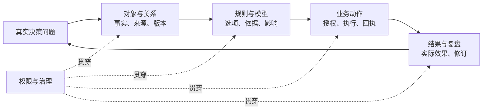

# Palantir Ontology 实施方法研究及 24私助应用边界

研究日期：2026-11-07（Asia/Shanghai）

状态：研究建议，未形成产品定稿或实施授权。方法论依据 Palantir 官方文档，24私助现状依据仓库基线与源码。动态官方文档没有统一产品版本号，结论以本次查阅内容为准。

24私助核查基线：本地 `main` 提交 `6799191f8df2264cccca11a72172894bfe178ff4`，插件 `0.2.2-rc.1.1`。源码核查用于判断可复用能力，不代表生产实例或真实模型验收。

## 研究结论

对 24私助最有价值的迁移，是把既有「近期重点—每日建议—主人采纳—执行—日终复盘」做成可查询、可核验、可复用的决策闭环。方法论应用不以采购 Foundry、接入 Palantir MCP、采用图数据库或复制企业平台为前提。后一句是本研究的架构建议，不是 Palantir 的产品承诺。

Palantir 将运营决策拆为数据、逻辑、行动和安全四个部分：数据提供事实与决策上下文，逻辑评估选项，行动落实选择，安全约束整个过程。它强调保存决策过程中产生的数据及其来龙去脉，而非只保留最终状态。[官方：Why create an Ontology?](https://www.palantir.com/docs/foundry/ontology/why-ontology)

上图是本研究归纳的实施闭环，并非 Palantir 官方规定的一套固定阶段流程。

## 官方机制及实施含义

| 官方机制 | 经核验的事实 | 对实施的含义（本研究推导） |
|---|---|---|
| 语义与行动 | Ontology 同时包含 objects/properties/links 等语义元素，以及 actions/functions/dynamic security 等行动元素。[概览](https://www.palantir.com/docs/foundry/ontology) | 领域词表和对象图只完成一部分；对象还需要可执行动作、约束和反馈。dynamic security 是动态治理能力，不能误作另一个图数据库层。 |
| 领域建模 | 对象应代表真实领域实体，避免直接复制数据表、API 结果和部门视角；自动数据变换用管道，人的或 agent 的决策用 action。[设计实践](https://www.palantir.com/docs/foundry/ontology/ontology-best-practices) | 先定业务概念、身份和关系，再映射来源；一张来源表可能包含多个实体，多个来源也可能描述同一实体。 |
| 共享接口 | Interface 声明共享属性、关系及动作约束；接口不可直接实例化，一个具体类型可实现多个接口。[Interfaces](https://www.palantir.com/docs/foundry/interfaces/interface-overview) | 抽象共同能力，保留具体类型与原平台差异，避免将所有工作对象塞入一个万能类型。 |
| 业务动作 | Action type 声明一组对象、属性和关系变更，也可定义副作用；同一动作逻辑可供不同应用使用。[Action types](https://www.palantir.com/docs/foundry/action-types/overview) | 以「采纳计划」「调整安排」等业务意图定义动作，再接已有工具；接口规范应包含输入、前置条件、目标状态和结果。 |
| 事实与编辑合并 | 源数据与用户编辑共同形成对象状态，平台提供用户编辑优先或按时间比较的冲突策略。[编辑应用规则](https://www.palantir.com/docs/foundry/object-edits/how-edits-applied) | 必须逐字段确定权威来源、时间语义与冲突处理；不能把导入、同步、本地编辑、真实完成混为一谈。 |
| 权限与提交条件 | 动作可提交性取决于对象可见性和 submission criteria 等条件；条件可结合用户、参数、对象状态和执行环境。[权限](https://www.palantir.com/docs/foundry/action-types/permissions)、[提交条件](https://www.palantir.com/docs/foundry/action-types/submission-criteria) | 可读取不代表可执行，UI 隐藏不等于权限控制；权限和状态应在执行时重验，不能仅靠提示词。 |
| 事务与外部写回 | Ontology 内部编辑有事务保证，但原子性不涵盖通知、webhook 或函数外部调用。[一致性](https://www.palantir.com/docs/foundry/action-types/consistency-guarantees) | 分开记录内部状态变更与外部执行结果，避免用一次“成功”覆盖所有层次。 |
| 跨系统边界 | Writeback webhook 先调用外部，失败则不改本体；但外部已成功、本体更新失败仍可能发生。Side effect webhook 在对象变更后执行。[Webhooks](https://www.palantir.com/docs/foundry/action-types/webhooks) | 跨系统仍需去重、核验、重试边界和恢复设计，不能宣称本体天然提供跨平台原子执行。 |
| 决策日志 | Action log 将成功动作记录为对象，支持分析决策者、时间和上下文；它不覆盖失败，也不覆盖绕开 action 的编辑。失败指标与对象编辑史各有独立用途。[Action log](https://www.palantir.com/docs/foundry/action-types/action-log) | 决策链、执行尝试、对象历史应关联但分工；成功日志不能替代完整审计。 |
| AI 工具面 | 对象查询工具可限定类型及属性，支持过滤、聚合和关系遍历；动作工具可配置自动执行或确认后执行。[Chatbot tools](https://www.palantir.com/docs/foundry/chatbot-studio/tools) | 将具体对象及受控动作提供给模型，避免把全部数据和任意写工具无差别开放。 |
| 反馈复用 | Logic FAQ 推荐保存建议、依据、人工反馈和核准决策，再查询相似历史建议辅助后续判断。[Logic FAQ](https://www.palantir.com/docs/foundry/logic/faq) | 先做可追溯反馈检索；“从反馈学习”不必意味着自动微调或自动改写长期记忆。 |
| 变更与验收 | Ontology 支持分支、proposal、冲突与合并检查。[分支](https://www.palantir.com/docs/foundry/ontologies/branching-ontology)；官方另要求以真实业务问题测试人和 agent 的可用性。[验证](https://www.palantir.com/docs/foundry/ontology/ontology-design-validation) | 结构、动作契约和权限变更都应版本化；结构校验通过仅证明技术一致，不能证明工作可完成。 |

## 可迁移的实施顺序

以下六步是基于官方机制的工程归纳，不冒充 Palantir 的唯一实施标准。

| 顺序 | 具体工作 | 最小产出与退出条件 |
|---|---|---|
| 1. 选决策切片 | 选一个高频、结果可观察、有明确决策人的问题，写出用户目前如何判断和行动。 | 一页决策卡：触发、问题、必要事实、可选动作、决定人、结果指标、异常情况。 |
| 2. 固定语义 | 定义最少必要对象、唯一身份、关系含义、基数、状态和名称；核对既有模型能否复用。 | 对象/动作契约与真实样例能对应；每个新增概念服务于该决策。 |
| 3. 映射真实数据 | 声明每个字段/关系的来源、更新时间、缺失/部分状态、权威范围和同步冲突处理。 | 不同来源同名对象不会误合并，失效数据不会被描述成当前事实。 |
| 4. 封装受控动作 | 统一业务输入、授权依据、执行前检查、外部回执、重复提交及未知结果处理。 | 真实执行与内部记录可以核对；重放、超时或并发不会重复产生外部副作用。 |
| 5. 接入 AI 与反馈 | 模型只读取完成决策所需的对象、关系和规则；保存建议、采纳/拒绝及实际结果。 | 同一建议能追到证据、决定和结果；下一次建议能引用经过核验的历史经验。 |
| 6. 验证再扩展 | 用真实问题、异常样本、新使用者与 agent 演练；在隔离数据中验证动作后置状态。 | 正确率、完成时间、人工纠正、未授权动作、重复副作用均可统计；通过后扩第二个切片。 |

步骤 1、2、6 分别借鉴官方的业务问题验证和领域设计原则；步骤 3、4、5 是对前述编辑、动作、权限、工具和反馈机制的工程化组织。所有阶段都应保留明确取舍，避免一次性建立“完整世界模型”。

## 24私助的应用建议与边界

24私助已定义近期重点、每日工作计划、日终复盘、待办、日程、助理交办、候选行动、行动授权和结构化记忆等概念；待办、助理交办、运行记录有不同语义，不能为了图结构统一而合并。[仓库术语表](../../GLOSSARY.md)

现有工作方法契约已经区分建议与采纳、采纳与日历写入、业务完成与时间过去，并要求主人依据、版本核验、复盘证据和跨日延续。晨报也已复用这条闭环；这些是后续提案的基础，不应写成待从零补建的能力。[工作方法实施计划](../planning/24PA-工作方法-实施计划.md)、[晨报重构实施计划](../planning/24PA-晨报重构-实施计划.md)

建议第一切片：**“今天哪些安排最能推进近期重点；发生变化后如何调整；明天如何利用真实结果继续推进？”**

1. **共同对象契约**：围绕现有身份与引用补齐可复用的对象解析、关系查询和来源证据契约。先验证「近期重点→计划项→待办/助理交办→结果」的跨模块路径；保留待办、日程及平台自己的语义和权威。
2. **共同动作契约**：把既有采纳、执行和回执流程关联到具体计划版本/计划项，明确建议、已采纳、外部已执行、效果已核验四种证据边界；具体状态命名须再与现有实现对齐。
3. **跨日决策证据**：复盘和次日建议沿对象身份与计划版本复用核验结果，保留人工调整理由；以此发现“哪些建议有效、哪些反复受阻”，不能自动把一次采纳升级为长期偏好。
4. **桌面验收视图**：在既有今日工作与运行记录里呈现依据、决定、执行结果和未知项，先把真实问题解释清楚，再判断是否需要独立关系图。

这些是增量设计方向，不是已经缺失的能力清单，也不是已验证产品效果。现有工作区、会话、角色和本地/飞书入口权限边界继续成立；共同契约不能扩大 Worker、Skill 或来源对象的可见/可写范围。[ADR-0001](../adr/0001-workspace-session-boundaries.md)

不建议在首轮同时引入通用本体编辑器、全领域知识图谱、图数据库迁移、自动长期记忆整理和全自治动作。它们对上述切片的必要性尚未证明，且可能放大现有边界复杂度。这是本研究的优先级判断，不是对这些技术本身的否定。

## 当前实现与建议增量

以下缺口限定于所列契约，不把分散实现误判为整项能力不存在。

| 已核查的实现 | 已有能力 | 建议增量 |
|---|---|---|
| [WorkPlanning 模型](../../packages/24pa/src/work-planning-model.ts) | 近期重点已有完成标准；计划项已有理由、下一步、focusId、待办/交办引用；采纳与复盘均绑定版本。 | 为需要按日程定位的计划项补日程引用；为重要判断补逐项证据引用及观测时间。复用现有计划项承载建议，避免再建一套同义的 Suggestion。 |
| [WorkPlanning 服务](../../packages/24pa/src/work-planning.ts) | 读取对象、校验引用与容量、验证主人输入、确认采纳、核对完成依据，已实现明确昨日及复盘版本读取。 | 给跨日延续增加显式的原日期/版本/计划项引用，便于查询为何保留、改变或放弃。现有 previousDay 继续提供昨日上下文。 |
| [来源投影](../../packages/24pa/src/repo/source-projection.ts)与[来源注册](../../packages/24pa/src/source-registry.ts) | 已有平台/身份/原生 ID 组合身份、来源成员关系、完整/部分/失败观测、实际能力与核验时间。 | 通过按类型适配的查询接口返回这些证据；保留身份与权限，避免重新生成一套平行对象 ID。 |
| [DailyPlanning](../../packages/24pa/src/daily-planning.ts) | plan_adopt 已检查冲突、保存日历写入操作身份、核对未知结果并复用成功回执。 | 当前 blocks 主要提取标题与起止时间；为来自每日计划的写入显式关联已采纳版本及 itemId，再关联 operationId 与实际日程对象。 |
| [RoleRegistry](../../packages/24pa/src/roles.ts)与[工具参数](../../packages/24pa/src/work-tool-schema.ts) | 角色已有允许动作；参数公开定义与业务校验分工；执行入口保持强制校验。 | 为本切片动作增加可查询的参数、前置条件、影响对象与结果契约；描述应引用已有处理器和校验器，避免形成第二套权限判断。 |
| [ExternalOperations](../../packages/24pa/src/external-operations.ts)与[规划版本库](../../packages/24pa/src/repo/work-planning.ts) | 外部回执、未知结果禁止盲重试、规划不可变修订和重复提交复用已经存在。 | 把两侧记录通过计划项关联起来，使“当时依据什么决定、实际执行了什么”可沿同一条路径查询。 |
| [ProjectRepo](../../packages/24pa/src/repo/task.ts) | 已有项目、目标与 project_task 关系。 | 第二个切片再验证项目依赖与重点关系，复用现有项目身份；首轮无须另造项目管理模型。 |

本体定义可以先由版本化的类型、关系说明及动作契约表达；运行事实仍由领域服务读取。现有 SQLite/PostgreSQL 保存规划、执行与关联，外部平台拥有实际待办和日程，工作区 JSON 继续拥有长期记忆。文档供人理解，运行时查询/校验才使这些定义可执行；向量索引仅在资料检索确有需要时补充。[现行数据边界](../24PA-整体设计方案.md#8-业务账本与主动工作)

## 下一阶段的三个增量

顺序以每步形成可验收结果为准，暂不估算排期。

| 增量 | 具体交付 | 验收问题 |
|---|---|---|
| 1. 统一对象语义与查询 | 固定“近期重点、每日计划及计划项、待办、日程、助理交办、运行、复盘”的最小模型；复用既有 ID、对象读取和来源证据。明确“服务于重点、引用待办、占用日程、由交办执行、依据结果复盘”等关系。 | 对任一已采纳计划项，能否找到所属重点、相关对象及核验时间？来源缺失能否如实说明？不同平台同名对象能否保持正确身份？ |
| 2. 关联决定与动作 | 为来自计划的业务动作串联计划日期/时区、采纳版本、计划项、可信授权依据、交办/运行、操作回执及原平台对象；原权限与恢复流程继续执行。 | “把已采纳的方案写作安排进日历”执行后，能否从计划项打开准确日程与回执？重复请求或超时恢复是否沿原操作核对？ |
| 3. 在桌面验证跨日效果 | 在“今日工作”展开每项的依据、采纳记录、执行结果和复盘；次日引用前一天的明确进展、改动原因及仍未知的部分。 | 临时会议挤占工作时，能否指出受影响的具体成果？调整后次日能否解释承接理由？主人的安排耗时和无效追问是否下降？ |

每一步使用同一组脱敏业务案例。增量 1 就开始记录现状基线，增量 3 完成连续五个工作日真实试用。已交付的工作方法与晨报文档仍将真实账号/模型质量和实际使用效果列为另行验收，本轮没有将隔离验证当作这项完成证据。[工作方法验收范围](../planning/24PA-工作方法-实施计划.md#交付状态)

动作契约中的授权必须表达具体作用范围：采纳每日计划与创建日程分别记录；主人一次指令明确授权两者时沿用该依据，不重复索要确认。建议只读的影响预览使用当前快照，执行时重新核验。外部平台若不提供原子版本条件，写前回读和本地锁仍不能消除远端并发窗口，应保留冲突与未知结果处理。[现行权限及外部动作边界](../24PA-v1-SPEC.md#5-工作区leadworker路由与并行)

反馈保存的是可核实事实、所选方案和主人给出的调整理由。一次拒绝、一次采纳均不自动升级为长期偏好；新的建议也不自动覆盖已采纳安排。

## 验证方法与尚待回答的问题

Palantir 的任务验证要求用真实且陌生的业务问题观察正确性、耗时、查找路径与求助点，并同时观察人和 agent；应用预设路径可能掩盖底层模型缺陷，不能仅验证一张预制看板。[官方验证方法](https://www.palantir.com/docs/foundry/ontology/ontology-design-validation)

AIP Evals 提供输入/期望结果、评估函数、模型/版本比较和多次运行方差检查；涉及 Ontology 编辑的 Logic 测试可以在模拟状态中核对创建、修改和删除后的对象。[Evals](https://www.palantir.com/docs/foundry/aip-evals/overview)、[编辑评估](https://www.palantir.com/docs/foundry/aip-evals/ontology-edits)

24私助建议在同一批真实脱敏工作样本上对比现有流程与增量模型，先记录基线再设阈值：

- 事实与引用正确率：是否能回到有效来源、正确对象、对应计划版本。
- 行动可靠性：是否获得授权、是否真实落地、是否出现重复执行、是否诚实标记未知。
- 决策效用：主人修正次数、完成决策所需时间、重点推进证据；采纳率仅作辅助，不能等同业务成功。
- 跨日连续性：昨天未完成项为何保留/调整/放弃，是否能引用证据而非重新猜测。

首批建议设 20 个场景，覆盖正常安排、无截止的重要成果、来源部分失败、日程变化、旧版本采纳、重复提交、外部成功但回执保存失败、权限收紧、无完成依据和跨日承接。具体数量是实施建议，不是已有测试结果。

硬性验收要求：样本内未授权写入与重复副作用为零；每项成功写入都能追到真实回执及原对象；每项完成结论都有业务状态或主人说明；过期/部分来源不能变成确定空闲。效果指标比较安排耗时、主人的实质修正和无效追问，先测基线再定改善幅度，采纳率不单独决定是否成功。契约版本、Skill 版本和评估样本版本应随每次候选版本留存，避免把模型或数据变化误归因为本体改进。

仍需实施前核验：当前对象引用覆盖率；跨来源身份的实际碰撞和歧义；执行回执与计划项关联的完整性；真实模型输出及真实账号写入覆盖；场景规模是否已产生关系查询性能瓶颈。本研究未执行真实平台写操作、生产部署或模型质量验收。

## 最值得先读的官方资料

1. [Why create an Ontology?](https://www.palantir.com/docs/foundry/ontology/why-ontology)：数据、逻辑、行动、安全与决策上下文。
2. [Ontology design: Best practices](https://www.palantir.com/docs/foundry/ontology/ontology-best-practices)：领域建模、接口复用、增量演进。
3. [Ontology design: Validation](https://www.palantir.com/docs/foundry/ontology/ontology-design-validation)：真实问题与人/agent 验证。
4. [Interfaces](https://www.palantir.com/docs/foundry/interfaces/interface-overview)：共享形状、能力和具体对象的区别。
5. [Action permissions](https://www.palantir.com/docs/foundry/action-types/permissions)：读取、提交与写入控制的边界。
6. [Webhooks](https://www.palantir.com/docs/foundry/action-types/webhooks)：本体编辑与外部系统写回的一致性限制。
7. [AIP Logic FAQ](https://www.palantir.com/docs/foundry/logic/faq)：建议、反馈、核准决策的复用模式。
8. [AIP Evals](https://www.palantir.com/docs/foundry/aip-evals/overview)：非确定性模型的持续评估。
