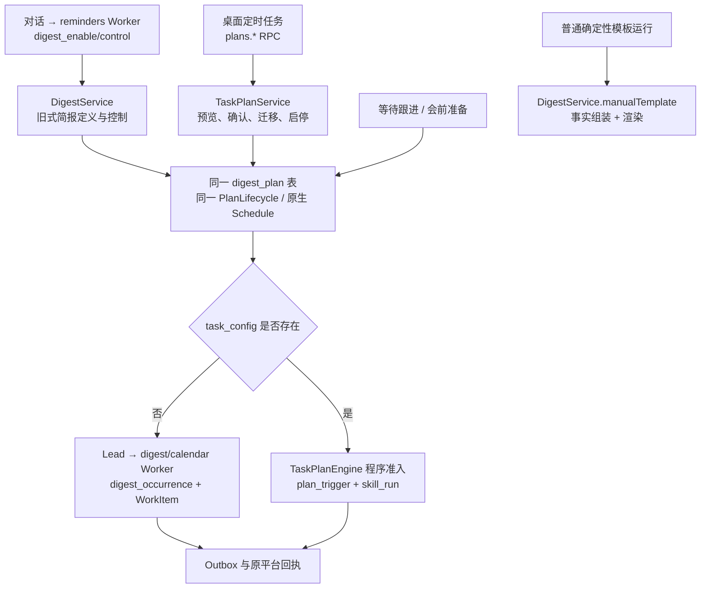

# 24私助减法审计：旧简报、通用定时任务与执行恢复

> **2026-11-07 当前范围更新：** 主人反馈管理周期服务和寻找功能没有实际困扰，确认 #271 只做对话与现有面板的一致性改进；旧计划不强制迁移，语音保留。桌面改版事项 `#272` 已按要求删除。下文涉及旧计划全面退出、强制迁移门槛、四入口重构或闲置代码专项的建议均不属于当前实施范围，只保留历史分析。当前契约见[一致性规格](../planning/24PA-Ontology前置减法-SPEC.md)。

> **2026-11-07 决策纠正：** 主人明确语音是最喜欢的功能，F49 / `#270`（已删除） 退役提案已撤回，现有语音合成与播报保留。本文涉及“如果退役”的分析仅作历史技术推演，不证明语音价值低，也不是当前删除指令；F49 退出及与其相关的升级顺序不再属于实施范围。当前要求以[修订后的减法规格](../planning/24PA-Ontology前置减法-SPEC.md)为准。

日期：2026-11-07。源码基线：`3d7c7064683e613bf9b2698bf563a4a5f96923e6`，包版本 `0.2.2-rc.1.2`。审计对象：2.18-draft 总规格 #269、F50 / #271，兼顾 F49/F51 的依赖。此文只记录源码与现有测试的静态核查，不代表已执行测试、已核查生产存量或已验证实际使用频率。

## 判断

F50 的方向合理，但应从“建设迁移能力”收窄为“利用现有迁移能力，停止旧式简报的新建与扩展，完成存量处置后退出独占执行入口”。旧简报与通用定时任务已经共用计划身份、数据库表与原生调度生命周期；不是两套完全独立的调度系统。已有的迁移、防重、权限和历史能力应作为基线回归，不要重做。

当前草案必须调整三条：保留同一原生 Schedule 是现有正常迁移路径；旧计划没有持久固定的投递授权，不能无条件承诺原渠道/收件人；关闭旧对话动作之前必须明确对话创建周期服务的替代流程。F49 → F50 是可选交付顺序，不是源码证明的硬依赖。

## 当前链路

依据：[`runtime.ts:754`](../../packages/24pa/src/runtime.ts#L754)、[`runtime.ts:779`](../../packages/24pa/src/runtime.ts#L779)、[`runtime.ts:939`](../../packages/24pa/src/runtime.ts#L939)、[`runtime.ts:977`](../../packages/24pa/src/runtime.ts#L977)、[`task-plan-engine.ts:100`](../../packages/24pa/src/task-plan-engine.ts#L100)。

### 已经具备，F50 应复用的行为

| 能力 | 当前实现依据 | 对 Issue 的含义 |
|---|---|---|
| 原地迁移 | `TaskPlanRepo.migrate` 在原 `digest_plan` 行上加 `task_config`、授权与迁移原始快照；保留 ID、Schedule ID、generation、时间规则与历史。 | 不另建迁移系统，不复制计划。 |
| 当前目标明确确认 | `TaskPlanMigration.preview` 核对会话、Skill 来源、时区和原生调度，准备当前投递身份；`change(migrate)` 比较 fingerprint 并要求 confirm。 | 旧计划缺少的授权字段由明确确认补齐，不能假称从旧配置完整恢复。 |
| 迁移与旧窗口竞争互斥 | 迁移、旧 claim 均锁同一计划；迁移前未结束/待核对工作会阻止升级。 | 在途处理应补充处置入口，不重复写一个防重协议。 |
| 已升级的旧路径排除 | `DigestRepo.claimRun` 两次拒绝 `task_config` 计划；`recordWorkSource` 拒绝再次委派；旧监督显式跳过已升级计划。 | 草案相应条目是回归要求，不能算新功能收益。 |
| 旧窗口跨引擎去重 | `legacyTriggerHandled` 用迁移前原 Schedule ID、原时区与日/周窗口核对旧发生；新触发事务保存 skipped 事件，不伪造运行。 | 必须保留迁移桥接记录和旧发生读取。 |
| 通用准入与恢复 | 同一触发 ID = 计划、generation、occurrence；计划 revision、固定授权、暂停、过期、重叠均受程序校验；从原生会话事件恢复。 | 不重建调度器，不把恢复变成模型判断。 |
| 共享原生变更恢复 | `PlanLifecycle` 先保存意图，未知创建从 catalog 找唯一回执；未知/歧义不重建；删除失败保留原 ID。 | 该模块服务所有计划，不能作为旧简报代码删掉。 |

精确来源：[`repo/task-plan.ts:95`](../../packages/24pa/src/repo/task-plan.ts#L95)、[`repo/task-plan.ts:106`](../../packages/24pa/src/repo/task-plan.ts#L106)、[`task-plan-migration.ts:19`](../../packages/24pa/src/task-plan-migration.ts#L19)、[`task-plan-service.ts:139`](../../packages/24pa/src/task-plan-service.ts#L139)、[`repo/digest.ts:142`](../../packages/24pa/src/repo/digest.ts#L142)、[`repo/digest.ts:192`](../../packages/24pa/src/repo/digest.ts#L192)、[`digest-service.ts:660`](../../packages/24pa/src/digest-service.ts#L660)、[`repo/plan-trigger.ts:28`](../../packages/24pa/src/repo/plan-trigger.ts#L28)、[`plan-lifecycle.ts:173`](../../packages/24pa/src/plan-lifecycle.ts#L173)。

### 必须保留的共享部分

- **`digest_plan` 表及 `DigestRepo` 的计划读写**：`TaskPlanRepo.save/get/list`、通用运行、Skill 引用关系、备份和停止流程都沿用此身份。改表名或重建计划表不属于本次减法。见 [`repo/task-plan.ts:67`](../../packages/24pa/src/repo/task-plan.ts#L67)、[`repo/task-plan.ts:221`](../../packages/24pa/src/repo/task-plan.ts#L221)。
- **`PlanLifecycle`、Schedule 方言桥和代次识别**：既用于旧简报，也用于新计划、等待和会前准备；当前兼容旧宿主与 0.2.2 的 timing/edit 方言。见 [`schedule-bridge.ts:6`](../../packages/24pa/src/schedule-bridge.ts#L6)、[`runtime.ts:3139`](../../packages/24pa/src/runtime.ts#L3139)。
- **`DigestService.manualTemplate/checkTemplate/planningFacts/renderDigest`**：新通用 Skill 的确定性模板仍在此生成结果；删旧计划执行不等于删晨晚周模板。见 [`runtime.ts:749`](../../packages/24pa/src/runtime.ts#L749)、[`digest-service.ts:442`](../../packages/24pa/src/digest-service.ts#L442)。
- **等待检查点的旧式专用上下文**：`waiting_followup` 仍由 `WaitingFollowups` 建立一次原生计划，`digest_build` 返回等待事实，`digest_deliver/completeRun` 原子消费检查点并投递一次；改期、收到回复、免打扰均有独立边界。见 [`waiting-followups.ts:13`](../../packages/24pa/src/waiting-followups.ts#L13)、[`waiting-followups.ts:92`](../../packages/24pa/src/waiting-followups.ts#L92)、[`digest-service.ts:395`](../../packages/24pa/src/digest-service.ts#L395)、[`repo/digest.ts:230`](../../packages/24pa/src/repo/digest.ts#L230)。
- **会前准备的原会议来源核验**：`meeting_prep` 独立绑定会议、来源、指纹、scope；调用相同 `PlanLifecycle`、`claimRun`、`deliverPrepared`，不能套用无会议上下文的普通模板迁移。见 [`runtime.ts:3168`](../../packages/24pa/src/runtime.ts#L3168)、[`runtime.ts:3214`](../../packages/24pa/src/runtime.ts#L3214)、[`digest-service.ts:514`](../../packages/24pa/src/digest-service.ts#L514)。
- **工作规划与人工确认所用辅助逻辑**：`WorkPlanning` 从此取得缓冲偏好及旧后台来源，`calendar` Worker 仍使用 `plan_today/preview/adopt/overview`；这些不是简报投递的独占代码。见 [`runtime.ts:567`](../../packages/24pa/src/runtime.ts#L567)、[`runtime.ts:968`](../../packages/24pa/src/runtime.ts#L968)。

## 对草案的具体发现

### P1：Schedule 退役门槛与原地迁移矛盾

草案一方面要求保留同一 Schedule，另一方面以“旧 Schedule 不再产生有效触发”作为删除门槛。现有迁移不调用 native create/delete，完成后同一 Schedule 用原 ID/generation 被新引擎消费，这是预期行为。`task-plan-service.test.mjs:127–149` 明确断言原生目录不变、只创建过一份 Schedule、旧窗口跳过而新窗口正常准入；Loader 测试亦覆盖同一 Schedule 在重启后只产生一份模板结果。

**建议改为**：“迁移后的原 Schedule 由通用运行入口唯一消费；仅停用或替换的 Schedule 必须停止并核验。删除旧分支前，确认其不再认领纳入范围的计划；保留的同一原生身份不作为遗留故障。”

来源：[`repo/task-plan.ts:106`](../../packages/24pa/src/repo/task-plan.ts#L106)、[`task-plan-engine.ts:112`](../../packages/24pa/src/task-plan-engine.ts#L112)、[`tests/unit/task-plan-service.test.mjs:127`](../../packages/24pa/tests/unit/task-plan-service.test.mjs#L127)、[`tests/e2e/manticore-task-plan.e2e.mjs:73`](../../packages/24pa/tests/e2e/manticore-task-plan.e2e.mjs#L73)。

### P1：不能把不存在的旧投递授权描述成可无损保留

`DigestPlanRow` 没有投递渠道、收件人或授权快照字段；旧 `deliverReport` 每次从工作区配置与 `ownerNotification` 取目标。迁移显式说明“旧计划未保存固定投递授权”，并从当前配置核验后固定目标。其迁移默认也新增了执行时限、补执行/投递 TTL、`mode=always` 与 `overrideQuiet=false`，这些都不应描述成“原参数原样搬迁”。

**建议改为**：“保留原计划里确实存储的字段和历史回执；缺失的投递授权、运行参数和时限在预览中单列为待确认值，展示核验后的身份、渠道与收件人。没有足够证据时不猜旧目标、不自动改投；用户明确确认的是后续运行目标，历史仍保留实际目标。”

来源：[`repo/digest.ts:13`](../../packages/24pa/src/repo/digest.ts#L13)、[`digest-service.ts:481`](../../packages/24pa/src/digest-service.ts#L481)、[`task-plan-migration.ts:33`](../../packages/24pa/src/task-plan-migration.ts#L33)。

### P1：旧对话创建与新面板计划管理之间缺少已实现的等价入口

当前 Lead 提示语明确教模型通过 `digest_enable/control/list` 管理服务；reminders Worker 注册这些动作。通用定时任务的 `draft/preview/change/migration-preview` 则经面板 RPC，公开工具里没有等价的通用计划管理工具。`pa24_jobs` 管的是助理交办，并不是定时任务。单纯关闭旧动作后，“对话里开启/调整周期服务”会变成引导主人去面板，属于产品行为变化。

**建议**：F50 明确保留对话的用户目标，让对话与桌面复用新计划草稿、预览、确认、权限和幂等服务；不能从模型直接写数据库或绕过 fingerprint。若本轮选择只提供面板管理，必须把对话可完成范围收缩写成明确取舍，不写“原能力均保留”。无论选择哪种，提示词、Worker action、旧 RPC/按钮均须同步，旧请求有明确指引，不能靠模型反复调用报错动作。

来源：[`runtime.ts:977`](../../packages/24pa/src/runtime.ts#L977)、[`runtime.ts:812`](../../packages/24pa/src/runtime.ts#L812)、[`panel.ts:141`](../../packages/24pa/src/panel.ts#L141)、[`tools.ts:92`](../../packages/24pa/src/tools.ts#L92)、[`prompts.ts:70`](../../packages/24pa/src/prompts.ts#L70)。

### P1：存量分类须包含不能直接迁入新后台契约的 Skill

旧 `requireSkill` 可以接收没有完整参数/完成标准/业务 action 契约的 agent Skill。新 `SkillRuns.prepare` 必须有 contract、明确 tools、business 模式与工作区放行；`TaskPlanAccess` 进一步只允许有确定授权范围的动作。因此“保留原 Skill 后迁移所有旧计划”不一定可直接完成；不能默认生成新智能 Skill、偷偷扩权或改正文来通过检查。

**建议**：盘点输出至少分为“可直接迁移、需补齐原 Skill 契约/放行、来源/会话/原生关联待核对、在途未决、明确停用”五类。补契约是显式的 Skill 修改与版本确认，不是后台自动迁移。不可迁移计划须能查看、暂停、核对与保留历史。

来源：[`digest-service.ts:418`](../../packages/24pa/src/digest-service.ts#L418)、[`skill-runs.ts:143`](../../packages/24pa/src/skill-runs.ts#L143)、[`task-plan-access.ts:36`](../../packages/24pa/src/task-plan-access.ts#L36)、[`tests/unit/digest-service.test.mjs:125`](../../packages/24pa/tests/unit/digest-service.test.mjs#L125)。

### P1：停用后的迟到旧唤醒需要程序消费，不能只移除 Worker 动作

当前 `TaskPlanEngine.consume` 只截获 `task_config` 存在的计划。旧记录没有该字段时，原生唤醒继续进入 Lead；其 prompt 要求委派 digest Worker。仅删除旧创建/执行 action，不会自动让旧排队消息失效。迁移过的计划有保护，但“明确停用而未迁移”的记录与恢复进来的旧备份需要另行处理。

**建议补验收**：“纳入范围且已退役的旧触发被程序识别、保留可核对处置结果，不唤醒模型、不新增运行/交办/投递；混合批次中的普通对话、等待跟进与会前准备保留原处理。未知 ID/损坏触发如实报待核对，不伪造成功。”不要求为拒绝事件创建假的 SkillRun。

来源：[`task-plan-engine.ts:100`](../../packages/24pa/src/task-plan-engine.ts#L100)、[`schedule-message.ts:31`](../../packages/24pa/src/schedule-message.ts#L31)、[`prompts.ts:190`](../../packages/24pa/src/prompts.ts#L190)、[`runtime.ts:779`](../../packages/24pa/src/runtime.ts#L779)。

### P2：发布门槛应按实例与阶段定义，不能依赖全世界存量“全部迁完”

源码是可分发插件，不提供所有用户实例的统一存量清单。草案“全部迁移/停用后删除独占分支”是合理安全目标，但未说明新版本遇到未迁移实例怎么办，也未说明迁移等待期是否继续旧执行。现有 migration 会拒绝未结算 work、缺失 generation、生命周期变更未结算等状态。

**建议**：先停止新建与扩展，并提供每个工作区的迁移/阻断清单；退役切换必须对尚未迁移的活跃旧计划显式处置并验证原生停止结果，不能静默停止。对仍有未决记录的实例保留必要核对和历史读取。首个功能交付的完成条件以可验证的实例升级行为定义；最终独占实现清除可在兼容退出条件满足后进行，不能把维护全部旧引擎无限期当作完成。

来源：[`repo/task-plan.ts:95`](../../packages/24pa/src/repo/task-plan.ts#L95)、[`plan-lifecycle.ts:87`](../../packages/24pa/src/plan-lifecycle.ts#L87)、[`runtime.ts:1238`](../../packages/24pa/src/runtime.ts#L1238)。这是交付范围建议，不是当前已存在的实例统计结论。

### P2：不要让三项功能的顺序成为不存在的技术硬阻塞

迁移代码今天就支持 `voice=true`，新计划与旧计划各自已有文本/语音路径。F50 可以先保留迁移原值，再由 F49 统一实施退役策略；F49 也可以独立覆盖两类计划后再做 F50。两者的真正共同契约是“历史原值不可改写、当前版本生效的投递能力一致、重复升级不复活语音”，而不是必须先删语音才能迁移计划。

**建议**：移除 #271 对 `#270`（已删除） 的硬阻塞，保留推荐串行合并以减少 `task-plan-migration.ts` 和测试冲突；明确两种升级次序均验收。F51 是导航变更，当前已存在新旧计划管理与历史查询，不需要迁移完成后才能设计/实现路由。若某个最终入口只在 F50 落地后成立，则把依赖限制到该入口切换，不将整个 F51 阻塞。

来源：[`task-plan-migration.ts:39`](../../packages/24pa/src/task-plan-migration.ts#L39)、[`task-plan.ts:90`](../../packages/24pa/src/task-plan.ts#L90)、[`tests/unit/task-plan-service.test.mjs:133`](../../packages/24pa/tests/unit/task-plan-service.test.mjs#L133)。

## 建议给 F50 的精确范围

建议标题：**收口旧简报入口，复用现有迁移完成存量处置**。

1. 仅针对 `task_config IS NULL` 且 kind 为 `morning/evening/weekly/once` 的旧式普通简报；`digest_plan` 表和通用计划不退役，专用 `waiting_followup/meeting_prep` 不纳入自动转换。
2. 复用现有 `TaskPlanMigration`、`TaskPlanService`、`TaskPlanRepo`、`PlanLifecycle` 与 `TaskPlanEngine`，补足实际缺口；已有回归作为底线。
3. 收口旧对话、面板 RPC、提示词及旧链接的新建/启用/扩展路径；先明确对话新流程，不悄悄降低服务可达性。
4. 按五类存量状态提供可操作清单；迁移预览区分原值、新确认值、缺失值。模板保持确定性，agent 保持原身份，补契约须明确确认。
5. 同一计划与同一 Schedule 原地转轨；新旧运行记录分别保存，通过原计划关联查看。旧发生、旧回执不是新 SkillRun，不迁写成“已执行新系统”。
6. 关闭旧准入时保留在途结算、未知核对与退役触发处置；不能按文件名整块删除共享功能。
7. 语音退役仅遵循当前版本能力与 F49 的共同兼容约定，不以 F49 作为固有前置。

## 验收增补与现有测试落点

| 场景 | 必须观察到的结果 | 已有基线／新增重点 |
|---|---|---|
| 活跃旧模板原地迁移及重启 | ID、Schedule ID/generation、时区、Skill、历史不变；新触发走通用 Run；旧已完成窗口不再执行。 | 复用 `task-plan-service.test:127`、`manticore-task-plan.e2e:73`。 |
| 暂停、停止、已过期一次性计划 | 保留处置意图；不能通过迁移清除暂停/停止或复活错过的安排；再次启用须明确可执行规则。 | 现有 151–179 覆盖 paused/未决/并发；补 stopped/过期 once 状态矩阵。 |
| 旧投递字段缺失、当前主人或渠道已变 | 预览标明来源与新增授权，旧确认失效，不猜历史目标、不自动改投。 | 复用 151–158；补“旧配置不足”与目标来源呈现。 |
| 没有 contract 的自定义 agent、未放行 Skill | 明确阻断原因、可回到原 Skill 修订，不能悄悄换轨/扩权。 | `digest-service.test:125` 证明旧允许面；新迁移测试需覆盖。 |
| 对话开启与调整周期服务 | 与面板共享预览/确认和幂等；旧指令得到可完成的新流程，无“已开启”假象。 | 现有 e2e 通过 reminders Worker 建旧计划；改为新入口正向/旧入口兼容验证。 |
| 已退役未迁移计划的迟到唤醒、混合批次 | 无模型、无新交办/投递；仍保留其他计划/普通输入；处置可追溯。 | 现有 `task-plan-service.test:414` 明确保留旧 envelope；新增退役分类。 |
| 原生创建/删除结果未知、升级后恢复 | 同一身份核对、无重复创建；停止失败保留原 ID 与待处理状态。 | `plan-lifecycle.test` 双后端；`schedule-bridge.test` 新旧宿主方言。 |
| 等待与会前准备、手工确定性模板 | 等待只询问一次/免打扰正确；会议改期取消联动；模板不调用模型。 | `followup-lifecycle.test`、`f10.e2e`、`digest-reliability.test:241`、`manticore-task-plan.e2e:95`。 |
| F49/F50 以任意顺序升级，旧备份恢复 | 当前投递策略一致，原值/历史保留，不复活旧音频或重复运行。 | 新增兼容矩阵，不能只测一次正常迁移。 |

实施时建议在 `packages/24pa` 下先 `npm run build`，再运行受影响的 `task-plan-service`、`plan-lifecycle`、`digest-reliability`、`followup-lifecycle`、`schedule-bridge` 单元集，以及 SQLite/PostgreSQL 的 `manticore-task-plan`、`manticore-plan-delivery`、`f10` Loader 集成场景。本文未执行这些命令，也未把现有测试文本当作本轮通过证据。

## 阅读覆盖

全文读取：`task-plan-migration.ts`（53 行）、`task-plan-service.ts`（192）、`task-plan-engine.ts`（154）、`task-plan-access.ts`（95）、`task-plan.ts`（107）、`schedule-bridge.ts`（37）、`schedule-message.ts`（38）、`digest-trigger.ts`（44）、`digest-supervision.ts`（44）、`digest-period.ts`（35）、`plan-lifecycle.ts`（225）、`digest-service.ts`（736）、`repo/task-plan.ts`（254）、`repo/plan-trigger.ts`（76）、`repo/digest.ts`（320）、`waiting-followups.ts`（115）。

关键段读取：`runtime.ts`（550–650、700–827、935–1005、1210–1256、1960–2007、3090–3220；并搜索所有 digest/planEngine/taskPlans/recovery 调用）、`skill-runs.ts`（125–225）、`tools.ts`（70–130）、`prompts.ts`（相关管理提示与 190–195 唤醒模板）、`panel.ts`（计划/旧简报 RPC 注册）、`skills.ts`（内置任务 kind/track 与目录解析）。

测试：详细读取 `task-plan-service.test.mjs:127–179`、`digest-service.test.mjs:125–170`、`manticore-task-plan.e2e.mjs:73–96`、`plan-lifecycle.test.mjs:1–64`；检索其余相关用例标题与断言位置。没有声称通读所有产品文件或完成生产验收。
