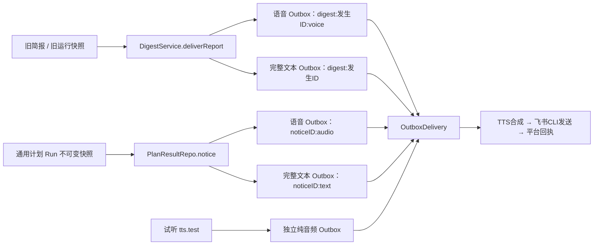

# Ontology 前置减法源码核查：F49 语音退役

> **2026-11-07 当前范围更新：** 主人反馈管理周期服务和寻找功能没有实际困扰，确认 #271 只做对话与现有面板的一致性改进；旧计划不强制迁移，语音保留。桌面改版事项 `#272` 已按要求删除。下文涉及旧计划全面退出、强制迁移门槛、四入口重构或闲置代码专项的建议均不属于当前实施范围，只保留历史分析。当前契约见[一致性规格](../planning/24PA-Ontology前置减法-SPEC.md)。

> **2026-11-07 决策纠正：** 主人明确语音是最喜欢的功能，F49 / `#270`（已删除） 退役提案已撤回，现有语音合成与播报保留。本文涉及“如果退役”的分析仅作历史技术推演，不证明语音价值低，也不是当前删除指令；F49 退出及与其相关的升级顺序不再属于实施范围。当前要求以[修订后的减法规格](../planning/24PA-Ontology前置减法-SPEC.md)为准。

日期：2026-11-07。源码基线：`3d7c7064683e613bf9b2698bf563a4a5f96923e6`。核对对象：[#269](https://github.com/benz-ai-x/dsh-24-PA/issues/269)、`#270`（已删除）及本地 [2.18-draft](../planning/24PA-Ontology前置减法-SPEC.md)。本记录是静态源码与测试内容核查，未运行测试、未查看生产数据库、未删除任何功能。下列行号针对该源码基线。

## 判断

F49 可以作为独立功能退役，但现有草案还不足以直接实施。核心缺口是：退役策略必须覆盖旧运行快照的迟到结算、原配置重跑和补投入口；历史语音的处置需要参与运行汇总；删除内置 Skill 中一句语音说明也可能破坏旧模板执行。

这是一项投递能力退役，不是 Ontology 的技术前置。源码可证实它维护云端和本地两条合成路径，但不能证明实际使用很少。两种引擎未增加独立 npm TTS 依赖；主要专用实现是 `tts.ts`、随包 Python 脚本及若干配置/界面/投递分支，真实节省应按这些维护面衡量。[引擎](../../packages/24pa/src/tts.ts#L1)、[随包文件](../../packages/24pa/package.json#L15)

## 当前执行链

- 旧简报仅在 `voice=true`、飞书通知且引擎非 `none` 时把音频和全文放进同一事务；语音先入队，全文随后。引擎未配置只生成文本并打印降级告警。[digest-service.ts:481–509](../../packages/24pa/src/digest-service.ts#L481)、[repo/digest.ts:220–243](../../packages/24pa/src/repo/digest.ts#L220)
- 通用计划依据当次 `run.snapshot.plan.configuration.delivery.voice` 生成文本、语音两组件，不读取当前工作区 TTS 是否启用；正文、比较基准、通知意图在结果结算事务中持久化。[repo/plan-result.ts:47–109](../../packages/24pa/src/repo/plan-result.ts#L47)
- 真正合成只在飞书 audio 发送分支进行。TTS 关闭时该音频行失败，文本是另一个 Outbox 行，不需要重新运行业务来获得“降级文本”。[runtime.ts:269–284](../../packages/24pa/src/runtime.ts#L269)
- 通用计划文本成功、语音失败会保存业务 `completed`、投递 `partial`；这已被单元及 Loader 测试明确要求。[plan-results.test.mjs:105–114](../../packages/24pa/tests/unit/plan-results.test.mjs#L105)、[manticore-plan-delivery.e2e.mjs:69](../../packages/24pa/tests/e2e/manticore-plan-delivery.e2e.mjs#L69)
- 音频 Outbox 内容是口播文本，不是持久音频文件；实际 ogg 在合成和发送临时目录使用后清理。退役不需要为每条历史音频做媒体文件迁移。[tts.ts:104–132](../../packages/24pa/src/tts.ts#L104)、[lark.ts:78–101](../../packages/24pa/src/lark.ts#L78)

## 必须补进 F49 的要求

### V01 · 高：迁移当前计划不足以关闭全部新音频生产路径

当前 `PlanResultRepo.notice()` 用不可变运行快照决定语音组件；`SkillRuns.prepare()` 的“原配置重跑”也会继续取旧快照的计划配置。旧简报 `digestDeliver()` 在存在 `plan_snapshot` 时覆盖当前计划的属性。因此只把 `digest_plan.voice` 或 `task_config.delivery.voice` 改成 false，仍可能在升级后产生新的 audio 行。[repo/plan-result.ts:90–109](../../packages/24pa/src/repo/plan-result.ts#L90)、[skill-runs.ts:123–167](../../packages/24pa/src/skill-runs.ts#L123)、[digest-service.ts:527–543](../../packages/24pa/src/digest-service.ts#L527)

建议写入规格：

> 退役版本的投递能力约束同时作用于新请求、旧运行迟到完成、重启恢复、原配置重跑/接续、结果重新结算及最终发送；旧快照和原始语音意图保持可查，不能因旧快照仍为 voice=true 而新建或发送音频。原完整文本、通知模式、收件人、时效及免打扰仍分别按原证据办理。

验收必须包含“退役前已接纳但尚未结算的语音 Run，退役后完成/重启结算”与“从历史运行选择原配置重跑”，不能只测新建计划。

### V02 · 高：补投与未知结果核对是另一条复活音频的入口

`PlanResultRepo.repair()` 目前允许任意 `failed` 且无消息 ID 的行变回 `pending`；unknown 核对为未送达后变为 failed，再可重试。桌面 `PlanDeliveryControls` 同样按状态显示补投按钮，不区分退役格式。[repo/plan-result.ts:137–166](../../packages/24pa/src/repo/plan-result.ts#L137)、[client.js:1820–1848](../../packages/24pa/client.js#L1820)

建议写入规格：

> 旧音频仍可核对真实平台结果；确认已送达只补本地回执，确认未送达进入明确退役处置。退役音频不能通过 `plan.delivery retry`、旧页面或重复请求重新进入合成/发送；“补投全文”不得借用音频行而改变 kind、目标、幂等键或历史回执。

已知消息 ID 的本地修复须优先于格式是否仍支持：现有 `OutboxDelivery` 本来就在已有 ID 时跳过发送适配器，F49 应保留这一顺序。[outbox-delivery.ts:61–106](../../packages/24pa/src/outbox-delivery.ts#L61)、[repo/outbox.ts:53–55](../../packages/24pa/src/repo/outbox.ts#L53)

还须补出旧记录的操作落点：现有 `repair()` 只接 `task_plan_delivery` 关联行或 `worker_run.outbox_key`。旧简报辅助音频 `digest:<occurrence>:voice` 和 `tts-test:*` 没有自动建立这两种关系，不能直接声称现有通用计划核对控件覆盖了它们。应明确原记录的只核对/退役处置入口，或带身份、版本和证据的维护操作；不得假建 SkillRun 来包装旧历史。[repo/plan-result.ts:141–146](../../packages/24pa/src/repo/plan-result.ts#L141)、[digest-service.ts:499–503](../../packages/24pa/src/digest-service.ts#L499)、[runtime.ts:3899–3905](../../packages/24pa/src/runtime.ts#L3899)

### V03 · 高：退役处置必须影响汇总和待处理判定，不能永久要求用户修复已删除能力

`aggregate()` 只要部分行 sent 就返回 partial；failed 音频会被 `RunHistoryRepo` 视作投递失败及 unresolved。单纯把旧音频标 failed，或只删掉 TTS 健康卡，仍会使首页/运行记录持续提示待处理。把所有音频标 sent 则伪造送达。[repo/plan-result.ts:22–30](../../packages/24pa/src/repo/plan-result.ts#L22)、[repo/run-history.ts:30–45](../../packages/24pa/src/repo/run-history.ts#L30)、[repo/run-history.ts:118–133](../../packages/24pa/src/repo/run-history.ts#L118)

建议明确行为而不提前规定数据库枚举：

> “功能退役、明确未发”的组件保留原记录并有可追溯的处置，不再作为可补投故障持续进入待处理统计。文本送达事实和未发音频事实分别显示，运行总体不能冒充原音频已送达。结果未知的音频仍算待核对，不能因功能退役被忽略。计数、筛选、详情、导出及恢复使用同一处置规则。

现有草案的“如需扩展状态应区分业务与投递”方向正确，但需增加上述用户可观察结果，尤其是 text sent + audio 未发退役、text failed + audio 未发退役、audio unknown 三种组合。

### V04 · 高：移除内置晨报正文中的语音说明可能破坏旧模板

内置 `digest-morning` 正文含语音行；`DigestService.checkTemplate()` 按正文与当前内置模板完全一致判断是否可执行。它既用于旧简报，也用于通用 Skill 的准备及模板执行。因此清理这句文案会改变内置版本，并可能把旧受管副本/历史快照判成“正文已改变”。[skills.ts:249–259](../../packages/24pa/src/skills.ts#L249)、[digest-service.ts:417–452](../../packages/24pa/src/digest-service.ts#L417)、[skill-runs.ts:136–148](../../packages/24pa/src/skill-runs.ts#L136)、[runtime.ts:749–750](../../packages/24pa/src/runtime.ts#L749)

建议写入规格：

> 内置 Skill 语音说明的清理须兼容此前合法的固定模板版本。退役前保存的内置模板副本、计划及运行快照，在其原权限和其他条件仍有效时继续按确定性模板执行；不自动换智能轨、不改原 Skill/历史正文，不扩大为任意自定义模板可执行。实现前确定受信旧版本识别与迁移办法。

这是可以由源码直接证明的版本兼容风险，不表示当前版本已经发生故障；实际受影响实例数量仍须盘点。

### V05 · 中：TTS 密钥的读取、删除和脱敏需要保留最小兼容

密钥库通过 `SECRET_KEYS` 白名单读取，后续写入会用读取后的整库覆盖；如果直接删掉 `volcTtsKey`，一次保存其他密钥就可能让旧值从文件里消失。诊断脱敏也把 `SECRET_KEYS` 的值加入脱敏清单。旧 TTS 字段还参与配置解析、参数编辑、证据和诊断。[secrets.ts:8–29](../../packages/24pa/src/secrets.ts#L8)、[secrets.ts:39–65](../../packages/24pa/src/secrets.ts#L39)、[runtime.ts:1540–1563](../../packages/24pa/src/runtime.ts#L1540)、[runtime.ts:763–767](../../packages/24pa/src/runtime.ts#L763)、[workspace-config.ts:17–49](../../packages/24pa/src/workspace-config.ts#L17)

建议细化现有“凭据不自动删除”：保留旧位的无值状态查看、显式清除和日志脱敏，不再鼓励配置/写入新 TTS 凭据。新部署说明去掉 TTS 安装；已有 Python、ffmpeg、模型目录和环境变量不由本功能卸载。

### V06 · 中：正常退役不应扩建一套自动补全文系统

旧简报和通用计划都会在事务内把完整文本与音频意图同时入库；试听是独立纯音频。现有草案已经限定“证据完整才补文本”，建议再明确默认路径是复用既有文本，异常孤立音频只列为异常处置；只有实际盘点发现需要且有完整原通知依据时才实现补全文分支。[repo/digest.ts:220–243](../../packages/24pa/src/repo/digest.ts#L220)、[repo/plan-result.ts:94–109](../../packages/24pa/src/repo/plan-result.ts#L94)、[runtime.ts:3891–3907](../../packages/24pa/src/runtime.ts#L3891)

这能避免一项减法变成新增内容合成、目标选择、去重推断能力。旧历史曾存在缺行或手工损坏不能由静态代码排除，须核对实际数据。

## 与 F50 的依赖

F49 的音频生产/发送守卫可以同时覆盖旧简报和通用计划，并不要求先完成 F50。反向也没有结构上的硬依赖：现有 `TaskPlanMigration` 已能迁移语音选择，且保留原计划、Skill 和原始记录；F50 可以按当前投递能力生成配置，F49 后统一退役。[task-plan-migration.ts:19–51](../../packages/24pa/src/task-plan-migration.ts#L19)

因此“F49 → F50”是可选交付顺序和共享文件协作约束，不是源码证明的必需依赖。如果整批版本约定必须纯文本，可以继续按这个顺序合并；但不要让 F49 的尾部凭据/文案清理阻塞 F50 的独立研究、入口停写、迁移核验。建议由总规格区分“实施可并行”和“版本集成次序”。

## 建议补充的验收

| 场景 | 必须观察到的结果 |
|---|---|
| 旧快照 voice=true，升级后运行完成/重复结算 | 新音频不入队；全文一次；旧快照、运行身份不变。 |
| 从历史运行选择原配置重跑/接续 | 仍执行原 Skill；按当前纯文本投递能力输出，不恢复语音。 |
| audio failed 补投、unknown 确认未发后补投、重复请求 | 都不再合成/发送音频；核对记录持久，全文不重复。 |
| audio 有平台 ID 但本地状态待修复 | 修复本地，不调用合成或发送，不因已退役而拒绝回执修复。 |
| text sent + audio 退役未发 / unknown / text failed | 分别显示已处置、待核对、待修复全文；运行计数和筛选一致，不伪造 sent。 |
| 移除内置语音文案后重跑原模板副本 | 仍为合法确定性模板，未换模型轨、未改历史正文；任意改写模板仍被拒绝。 |
| 保存其他参数/密钥 | 旧 TTS 配置兼容读取、旧密钥不被连带清空，日志仍脱敏，可显式清除。 |
| 旧备份恢复，含已发/未发/未知音频及在途 Run | 当前退役规则重新生效；原全文与回执保持身份，未知不被静默处理。 |

可复用测试入口：`tests/unit/plan-results.test.mjs`、`plan-delivery-guards.test.mjs`、`channel-reliability.test.mjs`、`task-plan-service.test.mjs`、`config.test.mjs`、`config-editor.test.mjs`、`secrets.test.mjs`、`manticore-skill-state.test.mjs`，以及 `tests/e2e/manticore-plan-delivery.e2e.mjs`、`f09.e2e.mjs`。其中本次逐行读了 plan-results、plan-delivery-guards、tts 单元测试和 manticore-plan-delivery E2E；其余为调用/相关场景索引，未声称执行通过。

## 文件阅读清单

全文阅读的生产/脚本文件：`src/tts.ts`、`src/spoken-result.ts`、`src/outbox-delivery.ts`、`src/repo/outbox.ts`、`src/repo/plan-result.ts`、`src/plan-results.ts`、`src/task-plan.ts`、`src/task-plan-migration.ts`、`src/task-plan-access.ts`、`src/workspace-config.ts`、`src/secrets.ts`、`src/skill-run-template.ts`、`src/repo/run-history.ts`、`src/repo/health.ts`、`melo/melo_synth.py`（均位于 `packages/24pa/`）。

按相关关键段阅读：`src/runtime.ts`（装配、音频发送、旧入口、模板验证、退出/恢复、参数与密钥、轮询、健康/试听）；`src/digest-service.ts`（创建/控制、模板校验、完成/恢复投递）；`src/repo/digest.ts`（完成事务）；`src/repo/task-plan.ts`（保存与迁移）；`src/skill-runs.ts`（原配置重跑/准备）；`src/lark.ts`（音频临时文件及 CLI 发送）；`src/config.ts`（TTS 校验、默认值、可编辑字段）；`src/skills.ts`（内置模板）；`src/panel.ts`（RPC 注册）；`src/work-tool-schema.ts`（voice 工具参数）；`src/db.ts`（Outbox、语音字段与投递表）；`client.js`（旧/新计划语音设置、参数表单、补投控件、健康字段）。

检索核对的发布/说明面：`package.json` 的依赖和随包文件、`cordis.patch.yml`、根与包 README 的语音介绍、初始化指南语音段、`src/prompts.ts` 的旧简报提示。未把全文检索命中算成逐行审读整个大文件。
