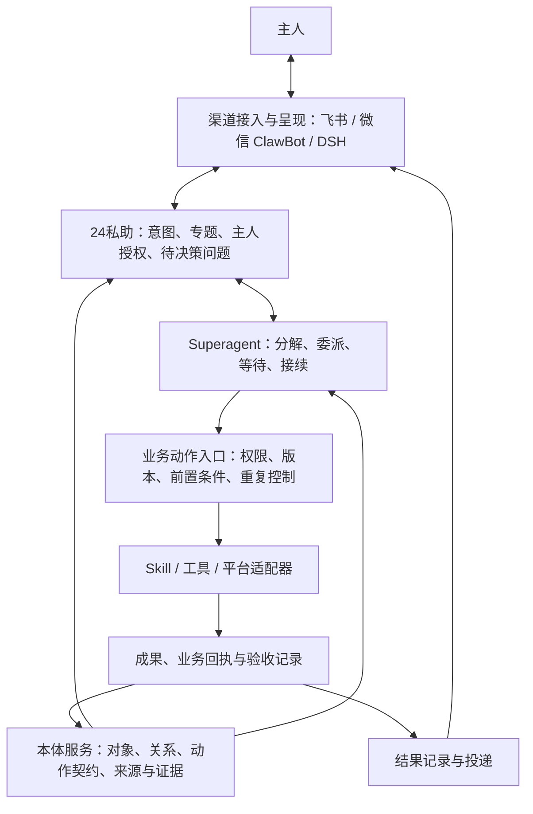

# 24私助：本体、Superagent 与多渠道协作的可行性分析

日期：2026-11-08（Asia/Shanghai）。状态：设计方向分析，尚未确认为产品基线；未安装插件、修改业务代码或操作真实账号。

## 对需求的理解与判断

用户提出的方向是：24私助作为人的长期助理，以本体明确业务世界与可用能力，基于 Superagent 组织任务分解、执行和交付，通过飞书、微信 ClawBot、DSH 对话框等入口与人协作。前述长期专题／项目是这套架构中承载持续目标的业务对象。

判断：**架构成立，可以基于现有24私助和 Superagent 渐进实现。需要补齐的核心是可执行的业务契约、单一执行归属和成果证据，以及多渠道的可信身份与交互，而非只组合三个名称。**

建议将24私助理解为整体产品：它负责主人的目标、授权、专题和业务事实；Superagent 是其中可替换的编排执行组件。本体描述对象、关系、状态和动作，且由真实查询与动作实现支撑。模型规划质量与业务验收仍需独立验证。

## 分工与数据流

本图是职责示意，不要求每个框都是单独服务、进程或数据库。本体服务可从已有账本、业务服务和原平台按权限解析对象；普通页面读取仍使用已保存观察，不能因引入本体而自动触发模型或远端业务操作。[P1][P2]

| 部分 | 负责回答的问题 | 应拥有的事实 |
|---|---|---|
| 24私助产品与交互 | 主人真正希望得到什么，允许做到哪里，哪些选择需要本人决定 | 专题目标、可信指令、授权范围、成果验收、固定回传目标 |
| 本体与能力契约 | 在处理什么对象，它和其他对象有什么关系，目前哪些动作可用 | 类型、身份、关系、业务状态、来源、动作定义及证据关联 |
| Superagent | 怎样将目标推进到可交付结果，哪些工作可以并行，何时等待与继续 | 被交付给它的工作、执行分派、输入消费、进度和恢复状态 |
| 受控动作与工具实现 | 这个动作现在能不能做，怎样执行并证明结果 | 执行时权限和前置条件检查、实际操作、回执及结果未知状态 |
| 渠道适配 | 从哪里接单，怎样提出问题、接收答复、展示和送达结果 | 来源身份、消息引用、交互标识、投递状态和渠道能力 |

24私助交互层和 Superagent 不应各自再为同一目标做一次独立规划并各自派工。建议24私助整理目标、上下文和授权，复杂交办的执行计划由一个编排者负责；简单确定性操作仍可走原业务服务，避免每次查询都增加多代理成本。

## 怎样理解“先以本体定义能力”

建议把本体中的能力落实到**对象上的动作契约**。以“为某份已选定的工作安排日程”为例：

| 契约内容 | 示例 |
|---|---|
| 相关对象 | 计划项、原待办／助理交办、日历来源、日程 |
| 输入 | 精确对象及版本、时间、日历目标、主人授权依据 |
| 前置条件 | 对象可见、日历可写、授权仍有效、必要冲突已核对 |
| 实际实现 | 复用24私助现有日程服务及对应平台适配器 |
| 输出与证据 | 原平台日程定位、操作回执、读回核验与排期关系 |
| 完成含义 | 已安排时间；不据此宣布关联方案、研究或其他工作成果已完成 |

本体定义可组合的业务语义；Skill 提供方法与步骤；工具和业务服务负责实际执行。能力目录还应呈现依赖是否可用、当前角色能否执行、输入输出及契约版本。描述里有一个动作，不表示对应账号、工具和数据已经就绪。

Palantir 的官方方法将数据、逻辑、行动和安全共同纳入决策体系，并单独定义动作的应用权限与提交条件；这里借鉴的是这种可执行契约思路，不要求24私助采用 Palantir 产品。[S1][S2]

现有[最小本体模型草案][P3]已经围绕今日工作定义对象、关系、动作和证据，适合作为一条起步链路。该草案尚未实施，范围也是“今日工作”；长期专题和成果版本需要后续增量设计，不能把草案误作覆盖全产品的现成内核。首期可在现有存储与服务上增加类型化查询和动作描述，没有已证实的图数据库迁移必要性。

## Superagent 可以承担什么、还缺什么

固定提交 `8c32a9dc5d72c033816c6a8110b37f40cf94fba4` 已有事件判断、授权工作 Ticket、执行分派 Assignment、独立执行会话、子代理工具、后续输入、结构化问题以及恢复机制。可直接复用其运行实现，并通过适配连接24私助。[S3][S4][P4]

但需要明确两项区别：

- **编排机制与规划质量不同。** 当前原型的主会话主要接受、附加、忽略和停止工作；执行器借助模型、工具和子代理完成任务。它没有接入24私助本体，不会天然按24私助的动作契约生成可执行计划。可靠拆解、依赖处理、参数映射与成果校验需要适配和真实样例评估。[S3][S4]
- **执行报告与业务成果不同。** 上游 `ready`、PR 合并等终止条件不能普遍代替方案验收、日历写入核验或待办完成判断。计划应关联输入对象与版本、步骤依赖、允许动作、预期结果、结果证据和必要人工决策。[P3][P4]

建议执行前验证计划所引用的对象、动作、参数和依赖；每一步执行时再次检查当前权限和状态。执行中发生变化，记录计划修订与理由，并保留已经发生的动作。模型负责提出方案，确定性校验负责拦住不存在、不可执行或未经授权的动作；两者都不能单独证明方案满足人的真实目标。

同一交办必须只有一个执行所有者。可由24私助保存业务目标与验收、Superagent 保存执行状态，适配层持久关联二者；24私助的状态展示只引用对应执行证据，不能同时启动另一组 Worker 重做这份工作。相同事件也要避免从两个渠道接收路径分别触发执行。

## 多渠道是双向协作界面

用户提到的输出渠道建议同时承接请求、补充、决策和停止操作。任务和成果身份应独立于聊天窗口，业务结果与投递结果分别记录；发送失败只补投，不能重做已成功业务。

| 渠道 | 建议的使用体验 | 当前判断 |
|---|---|---|
| 飞书 | 接单、简报、决策入口、文档链接及已支持的交互卡片 | 24私助已有实现；新增本体／Superagent 结果仍需接到原收发与权限流程。 |
| 微信 ClawBot | 简短交办、进展摘要、带工作标识的问题和结果链接；复杂处理可进入已授权电脑界面 | 自研接入仍未实现；先验证主人私聊文字链路，文件、审核、语音和主动发送分别验收。[P5] |
| DSH 对话与电脑面板 | 详细计划、资料与成果查看、复杂操作和工作区维护 | 当前本地能力可复用；不把本地维护权限自动带给远端渠道。[P1][P2] |

“同一主人”需要显式绑定平台身份，不能按昵称合并。跨渠道回答问题时必须关联工作 ID、问题 ID、所针对的成果版本，并检查身份；可见同一专题不等于自动拥有该专题所有资料或动作的权限。默认结果回发起入口，主人明确选择其他出口后才改投；若新增跨渠道控制语义，应扩展现行 ADR 契约而非暗中改写归属。[P2]

飞书有两个不同角色：聊天与通知渠道、文档／日历／待办等业务后端。微信发起或接收结果，不要求把业务对象搬到微信，也不证明微信用户已获得飞书文档访问权。渠道只根据真实可用能力呈现同一业务结果，不能承诺所有平台具备相同卡片、文件或语音能力。[P5]

## 一个完整使用例子

以下是目标体验，尚未实现：主人在一个已绑定入口说：“根据这个专题里的资料，准备周五方案讨论的会前包，完成后发我。”

1. 24私助定位专题、相关日程、材料与原始授权；无法唯一定位时只问必要问题。
2. 本体服务返回资料版本、已有决定、有关业务对象，以及本次身份可以使用的动作；缺失或旧资料明确标记。
3. Superagent 提出并执行范围内的工作：梳理背景、比较方案、列出风险、形成讨论提纲；独立部分可并行。
4. 资料读取、保存草稿、发布文档与投递分别走对应受控动作。先前授权已涵盖的步骤直接继续；出现新增对外承诺或范围扩大时再请主人决定。
5. 形成会前包版本，关联引用材料、具体交办和执行证据。模型自检、动作成功和主人验收分别记录。
6. 结果以适合当前渠道的形式送达：简短摘要加文档／成果入口，DSH 可显示更完整的依据。渠道不可用时保存结果与真实投递状态。
7. 主人反馈“第二部分换一种方案”，系统定位同一成果及交办，生成新版本，保留旧版本与决定。

这一过程体现本体负责语义与证据、Superagent 负责推进、渠道负责交互，最终判断仍是主人是否获得可用成果。

## 可行性、主要风险与验证顺序

| 维度 | 判断 | 最先验证什么 |
|---|---|---|
| 业务建模 | 可行，现有对象和动作已有基础 | 用一个用例检查输入、状态、关系与完成标准能否完整表达 |
| 插件复用 | 有真实接口，需适配，未做兼容实测 | 提交、补充、停止、结果返回与重启恢复 |
| 本体驱动规划 | 可开发，但不是上游现成功能 | 模型只使用当前可用动作，拆解可完成，有正确结果证据 |
| 多渠道体验 | 设计可行，渠道成熟度不同 | 同一工作身份、原文授权、决策关联与投递恢复 |
| 长期专题 | 可在已有项目／交办上扩展，非现有完整产品 | 跨日保持目标和决定一致，新资料只影响有关工作 |

直接复用原型时还有已知工程限制：启动要求 GitHub 仓库与账号；缺少完整公开的业务执行适配接口；会话具有宽泛 Shell 权限；初始化会修改整个进程的 PATH 和 Git 环境。因而首个复用验证宜使用独立 DSH 进程与受控桥接，业务操作仍在24私助检查；单独进程只能隔开进程环境，文件和凭据仍须按实际执行环境隔离。[P4][S5][S6]

建议按一条完整链路分步推进：

1. **先选一个结果明确的用例。** 如“专题资料 → 会前准备包 → 主人反馈修订”，先用现有 DSH／飞书入口；无需先定义所有领域的完整本体。
2. **为这条链路声明最少对象与动作。** 复用现有专题／项目基础、交办、资料和运行记录，补成果版本与精确引用。动作定义连接实际处理器和权限，不另建一份容易漂移的允许清单。
3. **让 Superagent 实际执行一次。** 适配任务与状态，校验分解、执行和交付；明确哪个组件拥有每份工作及其停止恢复责任。
4. **验证有变化、有失败的情况。** 输入重复、权限收紧、资料更新、外部结果未知、进程重启、需要主人决定、业务成功但发送失败。
5. **再接微信及更多专题。** 接入可信身份、入站与出站，使同一业务能力通过另一渠道使用，再考虑更主动的事件跟进。

验收应记录成果是否可用、人工实质修改、重复说明背景、无效追问、耗时和模型用量；同时逐项核对越权、重复副作用及错误完成声明。先测实际基线，不预设“本体＋多代理”必然提高质量或降低成本。

## 证据与未验证范围

- 本体依据为2026-11-08设计草案与本次读取的 Palantir 官方文档；借鉴方法不等于依赖该平台。
- Superagent 依据固定提交的源码与前两轮调查，本次补读主会话工具、执行器工具和允许工具列表；未启动原型或调用真实模型。
- 24私助补核对隔离快照 `e48983c7d2865890621db4c37b00eb3f3f8c0478` 的入口、主人输入、交办来源和 Outbox 类型；该快照仍无微信类型。快照版本关系见微信研究，本文不以滞后的根目录代码推断全部最新交付状态。[P5]
- 当前正式基线仍采用实际父会话的 Worker 归属、本地与远端权限区分、固定回传入口。外部执行器与跨渠道控制是待设计增量，不已获实施授权，也不自动满足 ADR-0001。[P2]

[P1]: ../planning/24PA-Manticore-产品定稿.md
[P2]: ../adr/0001-workspace-session-boundaries.md
[P3]: ../planning/24PA-最小本体模型-设计草案.md
[P4]: 2026-11-08-superagent-topic-integration.md
[P5]: 2026-11-08-weixin-clawbot-current-code-analysis.md
[S1]: https://www.palantir.com/docs/foundry/ontology/why-ontology
[S2]: https://www.palantir.com/docs/foundry/action-types/permissions
[S3]: https://github.com/deepseek-ai/dsh-superagent-prototype/blob/8c32a9dc5d72c033816c6a8110b37f40cf94fba4/src/app/tools/main.ts
[S4]: https://github.com/deepseek-ai/dsh-superagent-prototype/blob/8c32a9dc5d72c033816c6a8110b37f40cf94fba4/src/app/tools/executor.ts
[S5]: https://github.com/deepseek-ai/dsh-superagent-prototype/blob/8c32a9dc5d72c033816c6a8110b37f40cf94fba4/src/infra/environment.ts#L118-L124
[S6]: https://github.com/deepseek-ai/dsh-superagent-prototype/blob/8c32a9dc5d72c033816c6a8110b37f40cf94fba4/src/app/sessions.ts
