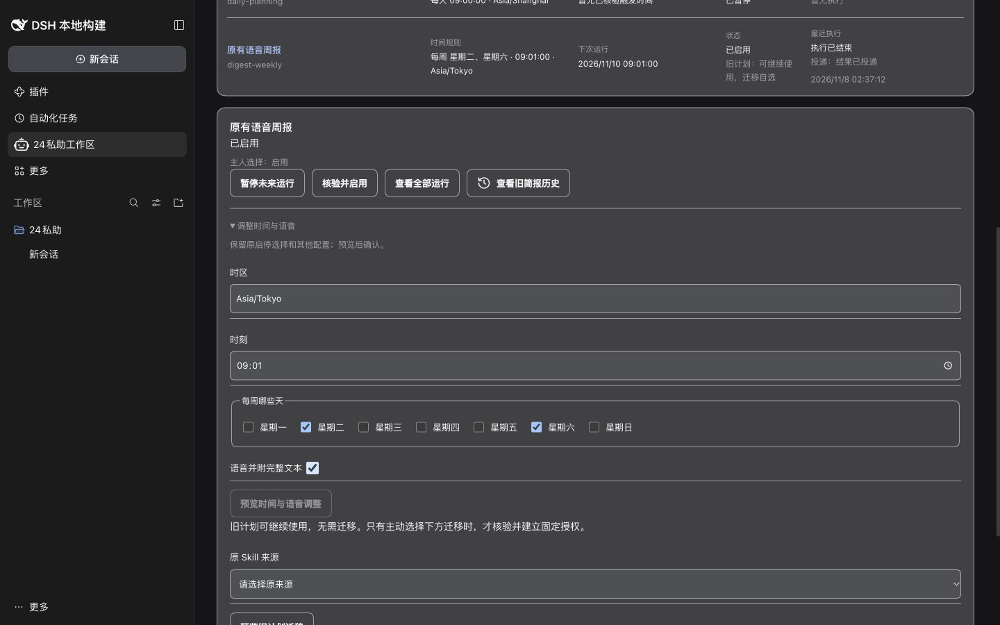

# F50 对话与面板计划管理：接口核验与验收记录

基线：24PA `a5ab22d`（F52 已合并），本地 dsh `66491b05e3`、声明版本 0.2.2-rc.1。范围为 [#271](https://github.com/benz-ai-x/dsh-24-PA/issues/271) 与 [PC-01–10](../planning/24PA-Ontology前置减法-SPEC.md)，不删功能、不自动迁移。

## 已核验的差异

- `runtime.ts` 的对话 `digest_enable/control/list` 直接调用旧 `DigestService`；面板 `plans.*` 调用 `TaskPlanService`。旧控制拒绝 `task_config`，对话新晨报默认 `digest-morning`，面板默认 `daily-planning`。
- 面板 `TaskPlanRepo.recentRun` 仅查 SkillRun；旧对话列表仅查 occurrence。双方都可能把另一种执行误报为空。旧 occurrence 的完成与 outbox 投递须分开读，语音及文本可能部分成功或结果未知。
- 旧时间调整用工作区时区、每周默认周一，可能改掉用户没要求修改的内容。旧计划仍有正常调度、语音、历史和兼容面板，不需要迁移才能解决此问题。

## 可复用接口和实施选择

1. `TaskPlanService` 继续负责草稿、核验、启停与持久操作回执。预设默认值移至服务端，面板和对话共用；新建保存与启用分开，明确智能晨报使用模型、建议未自动采纳。旧计划的普通保存不能隐式写入 `task_config`。
2. 时间和语音调整走同一计划服务，保留计划 ID、主人启停选择、未改参数和历史。`PlanLifecycle` 继续负责原生变更、未知回执及重启恢复；调整意图携带对应配置，原生确认与配置一起落账。无新调度器或数据库迁移。
3. dsh `packages/schedule/schedule/src/index.ts` 的 `catalog()` 为只读目录；现有 24PA 宿主适配的 `update` 使用原记录 `expected` 比较。`update.ts` 保持同一原生 ID，规则变化才重新计算未来时间。继续依赖既有生命周期的唯一指令标识和 CAS，未知结果不盲目重建。
4. 对话适配只接受当前已采用的主人输入（复用 `work-owner-input.ts` 与 Worker 输入回执）。先返回可读预览；启用／设置确认必须来自预览之后的新主人消息，并逐字引用原文。模型参数不构成确认。短期预览绑定工作区、来源、计划版本和授权指纹；重启／过期后重新预览。写入幂等仍使用持久服务回执。
5. 旧计划的暂停、恢复、时间、语音通过同一面板服务兼容分支办理，不补固定授权，不换 Skill；迁移仍沿用独立的显式核验入口。既有等待追踪、会前准备、原生日历提醒及语音执行链保留。
6. 原项目自定义 Skill 没有 `metadata.pa24` 契约时，继续走已有简报执行路径，新增只读预览与主人确认，不借机补契约或退役。目录选择使用真实来源 ID，并从已匹配目录项取得 Skill 名称；确认重新核对定义和通知配置指纹，避免把来源哈希误作 Skill 名。先只读完整定义识别通用契约，有契约立即交还通用授权（含项目工作方法及 `pa24_run`），无契约才使用旧入口校验；不在授权失败时回退。显式 project-dsh 来源即使与内置简报名相同也按实际定义办理，不用名字排除旧能力。
7. 原生 Schedule 的 `create/edit/delete` 接受操作者会话参数。24PA 传入该计划归属会话，避免宿主将自己的调度写入作为外部 `[SCHEDULE CHANGE]` 插入下一轮、误触发模板计划的模型调用。单元桥接测试和真实 Loader 模板零模型断言均覆盖此行为。
8. 兼容创建使用由确认意图派生的稳定计划 ID，并在 `PlanLifecycle` 同一计划串行区内按 `createOnce` 处理：已有行只核对当前意图或读取当前结果；未知回执可恢复，后续主人暂停、停止或改期不会被旧确认重试覆盖。原 `digestEnable` 的既有显式重新开启语义不变。
9. 旧历史查询的 SQLite 相关子查询包含 outbox 表，通用驱动的表名推断不能保证主表 `report` 被解码。投影处显式解析该 JSON，保留敏感字段过滤；PostgreSQL 与 SQLite 的运行历史回归均通过。

## 验证计划

- PC-01–03：共用预设与跨入口同一 ID 操作；真实公开工具、真实 Loader/Session，SQLite/PostgreSQL；语音设置和最近执行一致。
- PC-04–05、09–10：旧计划调整与重启不迁移；旧 occurrence／SkillRun 的执行与投递分开；原自愿迁移、模板及语音降级回归。
- PC-06–08：重试、同名选择、并发版本冲突、过期和伪造确认、工作区和身份变化、原生结果未知及恢复。
- T20：只验收电脑端三种视口、双语、明暗主题、键盘、错误与离线；演示使用隔离工作区，不写真实业务账号。

## 结果

主交付 [PR #275](https://github.com/benz-ai-x/dsh-24-PA/pull/275)，实现 `4b39d64d4a49affe566c088ed071e0be45f04164`，兼容与双语修复 `5cc87ce666dd9c69ae2b533e06ca41adc490358e`。后续补齐同名来源与旧确认重试保护。以下命令均在 `packages/24pa` 执行；最终受测源代码的精确头 SHA 见 PR 双轴复审记录。生产 8010、真实账号和发布版本均未变更。

| 层次 | 命令 / 证据 | 结果与所测范围 |
|---|---|---|
| 构建与预设 | `npm run build`；`npm run preset:sync`；`npm run preset:check` | 通过；宿主声明 0.2.2-rc.1，最终程序内容通过构建；精确头 SHA 见 PR 双轴复审记录。 |
| 完整单元回归 | `npm exec -- vitest run tests/unit --fileParallelism --maxWorkers 2 --minWorkers 1` | 101 文件、1721 通过、1 跳过，533.04 秒。从 `4b39d64` 启动，期间产生审查修复，因此最终变更文件另做下行定向复验，不把这一轮当作最终增量验收。 |
| 最终增量单元复验 | `npm exec -- vitest run tests/unit/task-plan-service.test.mjs tests/unit/plan-conversation.test.mjs tests/unit/digest-service.test.mjs tests/unit/manticore-panel.test.mjs tests/unit/plan-lifecycle.test.mjs` | 本 PR 最终内容，5 文件 162 项通过，覆盖两种数据库、权限变化、伪造/过期确认、重试、旧计划保留与英文预览，另覆盖未知创建回执后的暂停/停止与重启重试不得复活计划。一次受沙箱本地监听限制的尝试未完成 PG 组；按隔离 PG 所需权限重跑后全部通过。 |
| 最终真实 Loader/Session | `DSH_BIN=/Users/pc2026/DSH-Space/deepseek-harness/apps/cli/lib/bin.js PA24_E2E_STORAGE=sqlite npm exec -- vitest run tests/e2e/f09.e2e.mjs tests/e2e/f50-plan-consistency.e2e.mjs`；同命令改 `PA24_E2E_STORAGE=postgres` | 本 PR 最终内容，两后端各 2 文件 11 项通过；含公开对话创建自定义 Skill（含显式选择与内置同名的项目来源）、预览无写入、主人确认、跨入口改期、语音、历史、重启、自愿迁移与真实原生调度。 |
| 既有受影响流程 | `PA24_E2E_STORAGE=postgres` 的 `manticore-task-plan.e2e.mjs`、`f12.e2e.mjs`、`f16.e2e.mjs`，相同 `DSH_BIN`；SQLite 的 `manticore-task-plan.e2e.mjs` | `4b39d64` 对应内容：PG 定时任务 8 项、备份恢复 3 项、企微 4 项通过；SQLite 定时任务 8 项通过。后续兼容创建/预览修复由最终复验覆盖。 |
| 历史与宿主适配复验 | `npm exec -- vitest run tests/unit/run-history.test.mjs tests/unit/schedule-bridge.test.mjs` | 35 项通过，涵盖 SQLite 旧报告过滤与原生操作者参数。 |

PC-01–03 由 `plan-conversation`、`task-plan-service` 与 F50 第一个真实流程覆盖；PC-04/05/08–10 由 F50 第二个真实流程、旧历史/生命周期、F09、F12 与定时任务迁移回归覆盖；PC-06/07 由主人输入、指纹、持久回执与客户端过期响应断言覆盖。F09 的历史行注入只用于旧格式回归；F41 自定义 Skill 创建仍从公开对话走完整预览和确认，没有以直接插库替代。

### 电脑端验收

使用 `node scripts/f50-plan-ui.mjs` 启动独立真实宿主及 SQLite 工作区，替换模型和外部 CLI。原有语音周报（Asia/Tokyo、周二/周六）真实运行生成历史；在页面通过键盘改时、预览、确认并回读，计划 ID、voice、星期、时区和历史均保持。非法时区明确报错；停止隔离宿主后页面提示连接中断；空筛选有空状态，加载和迟到响应由面板测试覆盖。

| 视口与语言主题 | 可核验内容 |
|---|---|
| 1280×800，中文暗色 / 英文亮色 | [旧计划设置](assets/f50/legacy-settings-1280-zh-dark.png)、[列表与历史](assets/f50/legacy-list-1280-en-light.png)，页面宽度 1280，无横向溢出。 |
| 1440×900，中文暗色 / 英文亮色 | [改时后语音与旧计划继续可用](assets/f50/legacy-settings-1440-zh-dark.png)、[智能晨报预设](assets/f50/morning-preset-1440-en-light.png)、[空筛选](assets/f50/empty-1440-en-light.png)、[断连反馈](assets/f50/offline-1440-zh-dark.png)。 |
| 1920×1080，英文亮色 | [设置预览](assets/f50/settings-preview-1920-en-light.png)，英文说明、时间、执行方式、语音、当前投递目标与确认均可读。 |

### 双轴审查与边界

固定基线 `a5ab22dbbc30a6d5c82761250d30115e771b1ac3`，首次审查头 `4b39d64`：Standards 0 项；Spec 2 项 P2（原自定义 Skill 创建兼容、英文预览）。`5cc87ce` 修复两项。`7e5dfdd` 复核追加 Standards 2 项 P2（同名项目 Skill 分流、未知回执后旧确认不得覆盖后续停止），Spec 1 处 Manticore 状态同步遗漏；后续补齐；`31b9435` 复核还发现通用契约在旧守卫前误拦，改为契约优先分流并补三项接口回归，无契约仍须通过旧权限校验。上述最终回归覆盖全部修复。最终头复审结论及确切 SHA 回写 PR，两个轴分别列出，全部清偿且远端头一致才合并。

本轮未发现还需改变产品范围的未决项。隔离桩只替代模型／外部平台，验证了语音选择、发送记录和全文兜底，未把它称为真实模型质量、语音音质或真实平台投递验收。旧计划存在不是缺陷，也不影响本功能完成。
