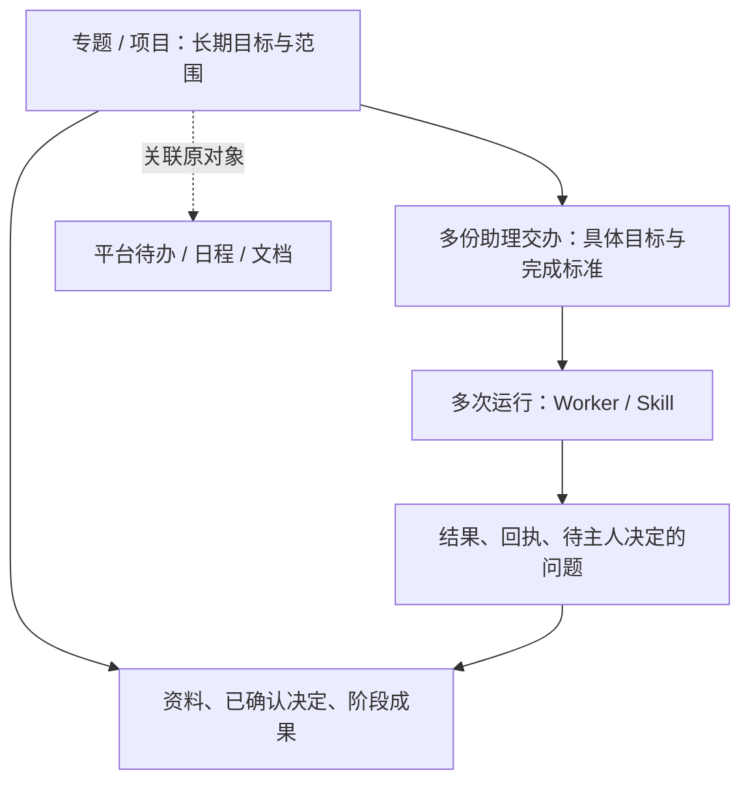

# Superagent 与24私助长期专题结合研究

日期：2026-11-08。状态：研究建议，**不是已确认产品基线，也不表示功能已经交付**。

用户已明确：希望在24私助中做长期“专题／项目”功能。

**建议将专题做成组织目标、资料、决定、交办和阶段成果的长期工作空间，借鉴 Superagent 的事件订阅与工作接续机制，复用24私助自己的执行与权限底座。** 一个专题包含多份助理交办，一份交办可以跨多次运行；不把专题直接等同于上游 Ticket、讨论线程或一个永久运行的 Agent。

24私助已有轻量项目、WorkItem、Skill、运行记录、定时任务和收发账本。此次最有价值的增量是：新资料如何关联原工作、什么时候继续推进、怎样集中呈现需要主人决定的问题。后半部分给出当前能力对照、专题形态、使用场景与分步建议。

后续追问补充：用户关心直接使用插件而非自行重写其能力。源码支持“直接复用 bundle＋24私助适配层”的路线；下文末尾补充真实扩展点、同进程环境影响及验证建议。前文的重实现建议是方案取舍，不表示直接复用不可行。

## 1. 研究范围与证据

- 上游：`deepseek-ai/dsh-superagent-prototype`，默认分支 `main`；本次核对 commit [`8c32a9dc5d72c033816c6a8110b37f40cf94fba4`](https://github.com/deepseek-ai/dsh-superagent-prototype/commit/8c32a9dc5d72c033816c6a8110b37f40cf94fba4)，提交时间 2026-10-31。所有上游链接固定到该版本。
- 包版本 `0.1.0`，声明依赖 DSH `^0.2.1-alpha.2`。这只是上游依赖声明，不证明与24私助现有宿主、插件和运行配置兼容。[package.json](https://github.com/deepseek-ai/dsh-superagent-prototype/blob/8c32a9dc5d72c033816c6a8110b37f40cf94fba4/package.json)
- 方法：读取官方 README、编号设计文档、核心领域、策略、执行器、会话权限、存储、来源、出站投递、管理接口及部分测试源码；未安装、启动原型，未连接真实 GitHub/飞书账号，未执行其测试。下文“已实现”指可在该版本源码中定位实现，**不等于真实环境验收通过**。
- README 明确定位为面向**单个 GitHub 仓库的主动编程代理研究原型**，并声明公开版与内部版、文章描述不完全相同；不能将文章中的未来方向当作本仓库能力。[README](https://github.com/deepseek-ai/dsh-superagent-prototype/blob/8c32a9dc5d72c033816c6a8110b37f40cf94fba4/README.md)

## 2. 最值得复用的能力

原型最有价值的是“外部变化怎样变成一项有依据、可接续、可追溯的工作”的闭环。其结构是：

```text
来源 Source → 变化 Trigger → 判断 Eval → 授权 Mandate
                                     ↓
                              工单 Ticket
                                     ↓
                         一次或多次派工 Assignment
                                     ↓
                         执行器 → 结果／问题 → 原入口
```

`Thread` 是来源中的讨论序列，`Subscription` 将讨论变化送给相关工作；`Ticket` 才是被授权的一份工作。一个讨论可以包含多份工作，一份工作可以订阅多个讨论。[领域模型与规则](https://github.com/deepseek-ai/dsh-superagent-prototype/blob/8c32a9dc5d72c033816c6a8110b37f40cf94fba4/src/core/model.ts)

| 能力 | 源码确认的行为 | 对长期专题的价值 |
| --- | --- | --- |
| 接收变化 | GitHub 接收通知、订阅 Issue/PR、评论、评审及 CI 变化；可开启接收仓库中的全部新事件。飞书接收实时事件、补收历史、轮询订阅讨论。[GitHub Source](https://github.com/deepseek-ai/dsh-superagent-prototype/blob/8c32a9dc5d72c033816c6a8110b37f40cf94fba4/src/sources/github.ts)、[Feishu Source](https://github.com/deepseek-ai/dsh-superagent-prototype/blob/8c32a9dc5d72c033816c6a8110b37f40cf94fba4/src/sources/feishu.ts) | 让专题能感知指定资料与讨论的后续变化，具体业务来源仍需接入。 |
| 先判断再开工 | 来源接收范围、发送者名单、准入表决定请求强度；模型按启用规则研判主动候选。接受时保存范围、依据和策略版本。[policy.ts](https://github.com/deepseek-ai/dsh-superagent-prototype/blob/8c32a9dc5d72c033816c6a8110b37f40cf94fba4/src/policy.ts)、[evals.ts](https://github.com/deepseek-ai/dsh-superagent-prototype/blob/8c32a9dc5d72c033816c6a8110b37f40cf94fba4/src/core/evals.ts) | 把“发现变化”“建议行动”“获准执行”分开。 |
| 原工作接续 | 已订阅讨论的新信息送回原工单；执行器处理范围内跟进，超范围的消息可退回重新分流。上下文订阅不带来新授权。[intake.ts](https://github.com/deepseek-ai/dsh-superagent-prototype/blob/8c32a9dc5d72c033816c6a8110b37f40cf94fba4/src/core/intake.ts)、[tickets.ts](https://github.com/deepseek-ai/dsh-superagent-prototype/blob/8c32a9dc5d72c033816c6a8110b37f40cf94fba4/src/core/tickets.ts) | 同一项交付可持续补材料、改结果，无须每次另开一项重复工作。 |
| 分开协调与执行 | 主 Session 做分流；每个 Ticket 有执行 Session 和工作目录，可准备 git worktree。执行器具有并发槽位、后台命令和子代理生命周期管理。[executor/dsh.ts](https://github.com/deepseek-ai/dsh-superagent-prototype/blob/8c32a9dc5d72c033816c6a8110b37f40cf94fba4/src/executor/dsh.ts)、[background.ts](https://github.com/deepseek-ai/dsh-superagent-prototype/blob/8c32a9dc5d72c033816c6a8110b37f40cf94fba4/src/executor/background.ts) | 将资料整理、研究、方案制作等独立交付分开办理；专题本身无须持续占用一个执行器。 |
| 重启与投递恢复 | SQLite 保存触发、判断、工单、派工、输入、待执行副作用和消息回执；中断工作有恢复路径，出站消息支持重试及按消息 ID 去重。[store.ts](https://github.com/deepseek-ai/dsh-superagent-prototype/blob/8c32a9dc5d72c033816c6a8110b37f40cf94fba4/src/app/store.ts)、[effects.ts](https://github.com/deepseek-ai/dsh-superagent-prototype/blob/8c32a9dc5d72c033816c6a8110b37f40cf94fba4/src/app/effects.ts)、[outbox.ts](https://github.com/deepseek-ai/dsh-superagent-prototype/blob/8c32a9dc5d72c033816c6a8110b37f40cf94fba4/src/app/outbox.ts) | 跨天跨周的工作可恢复，知道哪些结果已投递；业务写入仍须单独核验幂等性。 |
| 明确什么需要人决定 | 执行器用结构化 `human_action` 提出具体问题，报告区分进行中、等待、就绪、受阻、失败等；概览优先显示等待人的事项。[executor tools](https://github.com/deepseek-ai/dsh-superagent-prototype/blob/8c32a9dc5d72c033816c6a8110b37f40cf94fba4/src/app/tools/executor.ts)、[overview.ts](https://github.com/deepseek-ai/dsh-superagent-prototype/blob/8c32a9dc5d72c033816c6a8110b37f40cf94fba4/src/app/views/overview.ts) | 专题首页优先回答“现在要我决定什么”，减少巡查多个对话的负担。 |
| 工作方法可迭代 | 内置与自定义提示、技能内容可编辑、保存版本；升级时识别被覆盖的默认内容变化。[prompts.ts](https://github.com/deepseek-ai/dsh-superagent-prototype/blob/8c32a9dc5d72c033816c6a8110b37f40cf94fba4/src/app/prompts.ts)、[sessions.ts](https://github.com/deepseek-ai/dsh-superagent-prototype/blob/8c32a9dc5d72c033816c6a8110b37f40cf94fba4/src/app/sessions.ts) | 将专题研究、审稿、方案迭代沉淀为可复用 Skill，而不为每个专题写一套执行代码。 |

这些是可以借鉴的机制。表中第三列是面向24私助的推论，原型并未实现对应的长期专题产品。

## 3. 主动性的真实边界

原型有三种接单模式：

| 模式 | 对推断出的主动候选 | 对有效明确请求 |
| --- | --- | --- |
| `off` | 不进入候选 | 仍可接单执行 |
| `observe`，默认 | 研判并记录“本会接受”，不创建执行工单 | 仍可接单执行 |
| `auto` | 命中启用规则后可接单 | 仍可接单执行 |

因此，`observe` **不是全系统只读模式，也不是完全禁止写入的试运行环境**。如需无副作用验证，必须额外禁用真实来源或提供只读替身，并控制执行器工具。来源事件本身不等于行动授权；规则接受必须有相应准入依据。[策略实现](https://github.com/deepseek-ai/dsh-superagent-prototype/blob/8c32a9dc5d72c033816c6a8110b37f40cf94fba4/src/policy.ts#L166-L239)、[接受校验](https://github.com/deepseek-ai/dsh-superagent-prototype/blob/8c32a9dc5d72c033816c6a8110b37f40cf94fba4/src/core/evals.ts#L125-L160)

执行器可持有工具与继续工作，不意味着模型能自行扩大授权范围。原型将具体业务范围主要写成 `Mandate.scope` 文本，再写入执行指令；它并没有把自然语言范围完整编译成逐项业务操作的授权检查。[Mandate 定义](https://github.com/deepseek-ai/dsh-superagent-prototype/blob/8c32a9dc5d72c033816c6a8110b37f40cf94fba4/src/core/model.ts#L126-L134)、[执行指令](https://github.com/deepseek-ai/dsh-superagent-prototype/blob/8c32a9dc5d72c033816c6a8110b37f40cf94fba4/src/executor/dsh.ts#L87-L118)

## 4. 不宜直接搬到24私助的行为

1. **工作目录独立不等于安全隔离。** `Sessions.ensure` 明确设置 `danger-full-access`；执行器以操作者系统用户运行命令。工具名单及工单结束后的工具禁止是真实代码护栏，但 Shell 可以调用其他程序，CLI 包装和不同目录不构成操作系统安全边界。[sessions.ts](https://github.com/deepseek-ai/dsh-superagent-prototype/blob/8c32a9dc5d72c033816c6a8110b37f40cf94fba4/src/app/sessions.ts#L136-L157)、[工具护栏](https://github.com/deepseek-ai/dsh-superagent-prototype/blob/8c32a9dc5d72c033816c6a8110b37f40cf94fba4/src/app/sessions.ts#L293-L320)、[执行边界说明](https://github.com/deepseek-ai/dsh-superagent-prototype/blob/8c32a9dc5d72c033816c6a8110b37f40cf94fba4/docs/003-execution.md)
2. **策略变化不立即撤销进行中的工单。** 上游为避免工作做一半，向受影响工作发送策略变化输入；恢复已结束工作时才重新验证授权。24私助应继续按自身调用时校验、权限只能收紧的边界处理，不能直接继承这个行为。[tickets.policyChanged](https://github.com/deepseek-ai/dsh-superagent-prototype/blob/8c32a9dc5d72c033816c6a8110b37f40cf94fba4/src/core/tickets.ts#L195-L216)、[现行24私助 ADR](../adr/0001-workspace-session-boundaries.md)
3. **团队讨论的跟进语义不能直接当作主人授权。** 原型将订阅线程消息作为上下文分发，允许人在工单自有线程的后续消息接续未被人工停止的工作，执行器再判断范围；跨来源账号不自动映射。24私助必须保留主人身份、来源权限及行动授权校验。[跟进与恢复规则](https://github.com/deepseek-ai/dsh-superagent-prototype/blob/8c32a9dc5d72c033816c6a8110b37f40cf94fba4/docs/002-authorization.md)
4. **“就绪”不等于专题成果被主人接受。** 上游无 PR 时 `ready` 可直接结束 Ticket，有 PR 时由相关 PR 的关闭/合并状态判断完成。专题报告、草稿、提案应有自己的交付与确认定义。[工单完成实现](https://github.com/deepseek-ai/dsh-superagent-prototype/blob/8c32a9dc5d72c033816c6a8110b37f40cf94fba4/src/core/tickets.ts)、[派工报告实现](https://github.com/deepseek-ai/dsh-superagent-prototype/blob/8c32a9dc5d72c033816c6a8110b37f40cf94fba4/src/core/assignments.ts)
5. **消息去重不能保证所有外部动作只执行一次。** 上游 GitHub 发消息用隐藏标记检查，飞书使用消息幂等键；重启提示执行器先检查目录、Git 与远端状态。创建待办、改日程、发布文档等必须继续使用24私助自己的执行回执、恢复判断和写入契约。[GitHub 消息投递](https://github.com/deepseek-ai/dsh-superagent-prototype/blob/8c32a9dc5d72c033816c6a8110b37f40cf94fba4/src/sources/github-channel.ts)、[飞书消息投递](https://github.com/deepseek-ai/dsh-superagent-prototype/blob/8c32a9dc5d72c033816c6a8110b37f40cf94fba4/src/sources/feishu-channel.ts)

## 5. 现成产品没有提供什么

| 容易误读的能力 | 当前证据边界 |
| --- | --- |
| 长期专题／项目空间 | 核心模型没有独立专题对象、阶段目标、专题决策账或成果版本链。Ticket 是一份授权工作，Thread 是来源讨论；二者不能直接等同专题。[model.ts](https://github.com/deepseek-ai/dsh-superagent-prototype/blob/8c32a9dc5d72c033816c6a8110b37f40cf94fba4/src/core/model.ts) |
| 通用资料库、长期知识记忆与检索 | 已实现的是消息、历史与工单上下文读取，没有在已查范围内发现专题知识库、语义索引或事实确认模型。`src/core/memory.ts` 是测试和临时实例用的内存存储实现，并非长期语义记忆。[memory.ts](https://github.com/deepseek-ai/dsh-superagent-prototype/blob/8c32a9dc5d72c033816c6a8110b37f40cf94fba4/src/core/memory.ts)、[resources.ts](https://github.com/deepseek-ai/dsh-superagent-prototype/blob/8c32a9dc5d72c033816c6a8110b37f40cf94fba4/src/app/resources.ts) |
| 通用条件／定时任务引擎 | 已有具体来源的轮询、重试和后台循环；“持续无负责人 N 小时”这样的条件被设计为由新的 Source 自行等待检查。不是一个已交付的条件规则产品。[来源目录](https://github.com/deepseek-ai/dsh-superagent-prototype/tree/8c32a9dc5d72c033816c6a8110b37f40cf94fba4/src/sources)、[授权文档的等待条件说明](https://github.com/deepseek-ai/dsh-superagent-prototype/blob/8c32a9dc5d72c033816c6a8110b37f40cf94fba4/docs/002-authorization.md) |
| 现成 Webhook 接口及任意业务连接器 | Cookbook 明言 `webhook`、消息队列和 `hookq` CLI 是虚构示例；实际内置来源只有 GitHub 与飞书。示例证明扩展方法，不证明连接器已安装可用。[Cookbook](https://github.com/deepseek-ai/dsh-superagent-prototype/blob/8c32a9dc5d72c033816c6a8110b37f40cf94fba4/docs/008-cookbook.md#add-a-source) |
| 通用成果制品管理 | 可通过执行器写文件、网页检索、代码变更与 PR 交付；未见独立的文档/PPT/表格成果版本、发布及审核工作流。业务制品能力仍依赖另行接入的工具和 Skill。[WORK_TOOLS](https://github.com/deepseek-ai/dsh-superagent-prototype/blob/8c32a9dc5d72c033816c6a8110b37f40cf94fba4/src/app/sessions.ts#L54-L63)、[Ticket 模型](https://github.com/deepseek-ai/dsh-superagent-prototype/blob/8c32a9dc5d72c033816c6a8110b37f40cf94fba4/src/core/model.ts#L275-L315) |
| 对外稳定服务 API | `/orchestrator/api` 是面板管理接口，限制回环地址与同源请求，不是现成多租户或公网集成 API。[http.ts](https://github.com/deepseek-ai/dsh-superagent-prototype/blob/8c32a9dc5d72c033816c6a8110b37f40cf94fba4/src/app/http.ts) |
| 长期运行的数据治理 | 上游明确尚未删除旧记录，触发、判断、工单、消息回执与配置版本等会持续增长。长期专题需要单独设计归档与保留策略。[架构文档 Persistence](https://github.com/deepseek-ai/dsh-superagent-prototype/blob/8c32a9dc5d72c033816c6a8110b37f40cf94fba4/docs/007-architecture.md#persistence) |

## 6. 可复用接口与接入取舍

源码确有可替换边界：核心 `Engine` 通过 `Repositories / Policy / SourceScope / Assessor / Executor / Outbox` 接口依赖外部实现；来源通过 `SourceKind` 与 `SourceRegistry.register` 扩展，包含配置、接收范围、授权配置、上下文读取和回复适配。[core/ports.ts](https://github.com/deepseek-ai/dsh-superagent-prototype/blob/8c32a9dc5d72c033816c6a8110b37f40cf94fba4/src/core/ports.ts)、[SourceKind](https://github.com/deepseek-ai/dsh-superagent-prototype/blob/8c32a9dc5d72c033816c6a8110b37f40cf94fba4/src/sources/kind.ts)、[SourceRegistry](https://github.com/deepseek-ai/dsh-superagent-prototype/blob/8c32a9dc5d72c033816c6a8110b37f40cf94fba4/src/sources/registry.ts)

但直接安装 bundle 会启动它自己的 Runtime、主 Session、执行器、SQLite 账本及管理界面。增加一个“24PA Source”只是把24私助事件送进这套系统，并不会自动复用24私助的 Lead、业务 Worker、数据库账本或 Outbox。[插件入口](https://github.com/deepseek-ai/dsh-superagent-prototype/blob/8c32a9dc5d72c033816c6a8110b37f40cf94fba4/src/index.ts)、[Runtime 组装](https://github.com/deepseek-ai/dsh-superagent-prototype/blob/8c32a9dc5d72c033816c6a8110b37f40cf94fba4/src/app/runtime.ts)

因此优先研究“借鉴接续、事件判断和人工关注机制，在24私助现有底座中实现”；只在边界清楚且复用收益明显时提取具体模块。若日后直接复用 Engine，需要先验证授权语义、恢复状态、储存事务和24私助模型的一一对应，不能只做字段重命名。

## 7. 进入实施前需要验证的事项

- 把主人新增资料、原任务进展、普通讨论、明确行动指令分开；相同事件重放不得重复交办。
- 观察判断、生成候选、正式执行要有独立证据；观察模式不得被误写为全系统只读。
- 超出原交办范围时产生新的授权判断；停止专题、停止交办、撤回来源权限分别有可观察结果。
- 工作中断、外部写入已成功但回执缺失、投递失败等情形分别恢复，避免重复创建业务对象。
- 主人的输入始终能进入正在办理的工作，不被新任务并发占满；不再需要人的普通进度不逐条推送。
- 用一个真实长期专题验证“少重复解释背景、少遗漏变化、交付可用、打扰减少”；代码存在或模拟测试通过不能替代真实账号与模型验收。

以上为后续方案验证清单，不表示本次已获产品实现、安装、部署或账号接入授权。

## 24私助的现状与真正缺口

以下事实核对自24私助当前工作树，HEAD 为 `55d7c1205abe5bc74927a7386091139565eca5f1`，插件声明版本为 `0.2.2-rc.1.2`；工作树已有其他任务的未提交文档修订，本次未改动它们。这里的源码事实不等于生产实例或真实账号已经验收。

| 当前能力 | 源码或产品契约 | 对专题的意义 |
|---|---|---|
| 轻量项目已有 | `ProjectRow` 保存名称、目标、状态，以 `project_task` 关联平台待办；`project_create/adopt/progress` 提供建立、采纳子任务和进度查询。[P1][P2] | 不能把项目能力说成从零开始；现状主要围绕待办组织，尚不是长期资料、交办、成果与决策的统一工作空间。 |
| 助理交办已有 | WorkItem 保存完成标准、父子交办、主人输入、来源、固定回传位置、Worker/Skill 运行引用及验收状态。[P3] | 上游 Ticket 最接近现有助理交办，专题应组织多份交办，无需再建一套同义工单。 |
| 等待跟进已有，但不是回复监测 | `WaitingFollowups` 用原生定时唤醒与智能 Skill 在检查点询问本人；事实接口明确声明“没有自动读取对方回复的来源，以本人答复为准”。[P4] | 真正增量是接入可靠变化来源后，找到原交办并继续推进；当前不能宣称能自动知道客户是否已回复。 |
| Skill、运行、计划、恢复已有 | Skill 运行核验原授权、计划、预算和未决回执；终结运行与等待中的运行有不同接续规则。[P5][P6] | 专题复用这些执行能力，长期目标不意味着一个模型回合连续运行数周。 |
| 入站、消息路由与出站已有 | Inbox 按事件 ID 去重；平台消息可关联交办、入站和资料；Outbox 保存独立投递状态。[P7][P8][P9] | 扩展来源与订阅时应衔接现有账本，避免双重收件、双重执行和重复通知。 |
| 近期重点与每日工作计划已有 | 工作方法区分主人确认重点、助理建议、主人采纳和日终复盘；规划引用目前为 `todo / work`。[P10][P11] | 专题可以成为建议的上下文，但“加入专题”不自动成为近期重点，也不自动占用日历。 |
| 项目记忆已有，但不是项目实体 | 记忆条目有 `project / decision` 类别、主题和范围，并有确认依据；长期记忆仍遵循人工指令维护。[P12][P13] | 专题摘要、阶段草稿不能暗中变成已确认长期记忆。 |

## 建议的产品定位

**专题是主人围绕一个长期目标持续积累资料、作出决定、交办工作和验收成果的地方。Superagent 的机制用于在获准的变化发生后接续具体工作。**

建议用同一种组织结构承接两种使用方式：

- **持续专题**：如“汽车营销 AI 应用研究”，没有固定结束日，按阶段问题和产物推进。
- **有期限的项目**：如“完成某客户的试点方案”，在相同结构上增加截止时间、阶段成果和验收标准。

先扩展或衔接现有项目模型，保留既有项目和任务身份；是否正式统一名称、是否增加类型字段，留待产品规格确认。不要把现有 `project_*`、记忆 `topic` 字段和上游 `Thread` 直接视作同一实体。



专题保存连续性，交办承担可完成的一份工作，运行记录一次执行。平台待办和日程继续以原平台为准；某次执行结束、任务数量归零或模型说“完成”，都不足以证明专题目标完成。[P3][P13]

每个专题首期只需要保存六类内容：

1. **目标与范围**：现在要解决什么，阶段成果是什么，哪些事当前不做。
2. **资料索引**：主人选定的文档、网页、纪要及原始出处，带来源版本、读取时间和可访问范围。
3. **当前简报**：已有结论、未解问题、下一步，明确区分资料事实、助理建议和主人决定。
4. **工作关联**：助理交办、平台待办、必要日程及其原始状态与入口。
5. **成果与决定**：版本化交付物、主人确认记录、仍待处理的问题。
6. **跟进约定**：关注哪些来源、什么变化触发什么动作、运行限额、通知出口以及暂停条件。

专题可以有方便继续讨论的入口，但不要求永远绑定一个越来越长的会话。每次执行读取目标、有关决定、所需资料及未完成交办；保留可追溯引用，不把整个资料库拼入上下文。专题仍在同一主人的工作区内，不据此新增助理预设或扩大权限。[P13][P14]

## 怎样使用 Superagent 的机制

这里是建议的概念映射，不是可直接替换的接口清单：

| Superagent 概念 | 24私助建议用法 | 需要保留的区别 |
|---|---|---|
| Source / Trigger | 获准来源的一次消息、文档版本变化或检查点事件 | “能看到资料”不等于“资料中的人能指挥助理”。新的来源需单独验证读取和变化检测能力。 |
| Thread / Subscription | 将讨论、资料变化关联到专题中的相关交办 | Thread 是某个来源的上下文串；一个专题可涉及多个来源、讨论和交办。订阅带来上下文，不带来新权限。 |
| Eval | 判断新信息是补充已有工作、新任务候选还是无须动作 | 先确定性去重与校验范围，再按需要调用模型。明确的主人补充不反复重新立项。 |
| Mandate | 交办所依据的主人授权及持续跟进约定 | 业务范围必须连接24私助工具、目标来源及操作校验，不能只靠一段文字。 |
| Ticket / Assignment | 复用 WorkItem 与运行记录的职责划分 | 映射要尊重24私助等待恢复、已结束后接续和原回传目标；不能机械照搬上游状态机。 |
| Attention / Report | 清晰呈现“需你决定”“待你验收”“等待资料”与结果 | 通知有用的结果和必要问题，普通轮询不刷屏；就绪、已送达、已验收分别记录。 |

建议的实际循环是：

1. 主人创建专题并指定目标、资料和允许助理独立完成的工作。
2. 助理提出阶段成果与下一步；明确交办转成现有 WorkItem，由合适的 Skill/Worker 执行。
3. 工作产生文档、分析或其他结果，专题记录结果引用和当前进展。
4. 新资料或检查点到达，系统核对来源、专题及交办关系、当前授权、去重记录和运行状态。
5. 范围内的补充进入原交办；新的工作范围形成候选，按已有授权或主人决定办理。没有相关变化便保持安静。
6. 需要取舍或验收时，给主人一个具体问题；答复绑定该问题与成果版本，然后继续受影响的工作。

其中第4–5步的通用专题订阅与事件接续是新增设计，不是目前24私助已经具备的完整功能。上游也没有开箱即用的飞书文档变化、客户回复或通用条件监控器。

## 最值得先试的使用场景

### 首选：汽车营销 AI 方案专题

建议用一个真实但范围有限的专题试用，例如“汽车营销 AI 产品化”，第一阶段目标是形成一份可评审方案并明确一个试点。

| 你做什么 | 未来专题功能应该完成什么 | 何时需要你 |
|---|---|---|
| 放入一份已选定的业务蓝图和几份研究资料 | 建立资料索引，整理当前结论、证据缺口与候选工作 | 确定第一阶段想获得的成果 |
| 交办“比较内容生产、线索跟进两个切入口” | 形成两份具体研究交办，再汇总有依据的比较 | 比较完成后决定优先方向 |
| 添加一份新的会议纪要 | 识别对既有方案的影响，只修订相关章节并标注依据 | 纪要与已确认决定冲突，或涉及范围改变 |
| 让助理继续形成试点方案 | 在已确定范围内产出版本化草案、里程碑与待办建议 | 采纳真实待办、对外发送方案或确认阶段验收 |

这类专题最能检验长期上下文、证据和阶段推进的价值，又能先用主人主动添加资料来验证，不必一开始监听全部群聊。上述流程是产品建议，尚未实现或在真实业务中验证。

### 后续场景

- **24PA 内容生产专题**：持续保存定位、选题、素材和成稿；每篇内容是一份具体交办。作者反馈进入原稿修订，发布仍遵循原授权。重点验证旧结论是否稳定、反馈是否准确落到对应版本。
- **软件开发项目**：专题组织需求、决策、Issue/PR 和验收成果。这最贴近上游现成 GitHub 来源；代码执行可在单独环境小范围验证后作为专门能力接入，不能让一般事务 Worker 获得任意 Shell 权限。

## 主动推进的边界

建议把授权表达为具体约定，例如：“对我加入本专题的资料，可以整理索引、比较新旧观点、更新草稿；发现结论冲突时问我；对外发信和修改平台待办按我的明确指令办理。”主人已授予的范围内无需每步重复询问。

- **资料与记忆**：可按约定整理专题草稿，引用现有已确认记忆；不能把模型结论自动升为已确认事实，不能后台整理全局记忆。QwenNote 仍按现有本地按需读取与资料审核路径使用。[P12][P13]
- **日程与待办**：专题提供关联和建议，不复制第二份真实业务状态，不因“下一步”出现一句话就自动创建日程或分派他人。[P10][P13]
- **身份与来源**：多人讨论可作为获准资料；24私助继续只接受主人的有效授权，不沿用上游“群内任何人可明确发起工作”的部署选项。[P13][P14]
- **暂停与停止**：建议“暂停跟进”阻止新的自动派发；“停止当前交办”沿用现有停止流程；“归档专题”不自动删除资料或取消外部待办。入口必须显示尚在进行的工作，不能把归档等同于已停止或已完成。
- **执行与重启**：不能用无限回合维持长期专题；等待不占用模型运行。重启后先核对输入消费、运行及外部回执；已成功的动作不重做、结果未知先核对。[P5][P6][P9]
- **权限变化**：继续沿用24私助每次执行检查当前授权的方式，不能照搬上游仅向已运行 Ticket 通知策略变化、允许其在原范围继续的处理。[P5][P14]

## 推荐的接入方式和实施顺序

**推荐：24私助保留自己的协调、账本、工具与投递，借鉴并适配 Superagent 的事件、订阅和人工决策机制。**

| 路径 | 适用性 | 建议 |
|---|---|---|
| 整包装入同一业务运行链路 | 上游另有主 Session、状态库、执行器、面板与权限默认值，24私助也已有这些责任 | 不作为通用专题首期路径；否则需要解决双总控、双状态和谁拥有执行权。 |
| 抽取或重实现相关机制，衔接现有24私助能力 | 可保持一套主人身份、WorkItem、Run、Inbox/Outbox 与业务权限 | 首选；固定参考提交，先写清输入、订阅、授权与恢复契约，再决定复用哪些源码。 |
| 单独部署原型作为代码专用执行端 | GitHub 开发场景与上游最匹配 | 可作后续独立试验；需要可靠的委派、停止、状态与回执协议，原型当前没有现成的24私助执行端适配。 |

建议分三步，每一步都能独立验证使用价值：

1. **先交付专题组织和人工启动。** 目标、资料索引、当前简报、交办关联、成果与待决策；支持创建、补充、继续、查看、暂停/归档的明确语义。复用现有执行能力。电脑端详情先回答“做到哪里、下一步是什么、需要我决定什么”；技术事件与运行细节进入原运行记录。界面打开、搜索与刷新保持只读。
2. **再加入可控跟进。** 先接主人明确添加的资料、已有交办的真实结果及固定检查点，再逐项增加经验证的外部变化来源。为主动发现的新任务提供“先给建议”的模式；主人直接交办仍正常执行。按每项规则决定何时能够自动继续，不用一个全局开关开放所有动作。
3. **最后增加跨专题协调。** 将可执行的下一步送入现有每日工作计划，由已确认近期重点和真实可用时间排序；维持每日建议上限与主人采纳流程，不自动修改近期重点或挪动日历。[P10][P11]

第一阶段没有必要复制上游全部管理概念、建立复杂甘特图、自动监听全部信息源，或为每个专题长期养一个 Agent。先验证专题是否减少背景重复和追问，再增加主动性。

## 试用验收与尚待决定的问题

建议用一个专题连续试用一至两周，记录下面几项；不预设没有基线依据的节省比例：

- 主人补充资料后，是否正确关联原专题和交办，减少重复解释背景。
- 新事件是否只推进相关工作；重复事件、暂停期间的事件和迟到结果是否不导致重复动作。
- 每个阶段成果能否追溯到资料版本和具体交办；结果未知是否如实保留。
- 需要主人决定时是否给出一个具体问题，已决定的事项是否不反复询问。
- 模型调用与通知是否与新信息和有价值结果对应，普通查看和无变化检查是否不产生多余工作。
- 重启、权限收紧、外部来源失效后，专题是否保持可查看且不越过原授权继续执行。

进入实施前再确认：现有项目与专题的正式名称和迁移关系、首个来源范围、主人批准的自动动作、专题级暂停与在途交办的交互，以及成果验收规则。这些是待定产品选择，不因本次调研而成为已批准规格；本次只保存研究结论。

## 24私助证据索引

[P1]: ../../packages/24pa/src/repo/task.ts#L70
[P2]: ../../packages/24pa/src/runtime.ts#L2814
[P3]: ../../packages/24pa/src/repo/work.ts#L22
[P4]: ../../packages/24pa/src/waiting-followups.ts#L92
[P5]: ../../packages/24pa/src/skill-runs.ts#L528
[P6]: ../../packages/24pa/src/run-control.ts
[P7]: ../../packages/24pa/src/repo/inbox.ts
[P8]: ../../packages/24pa/src/repo/route.ts
[P9]: ../../packages/24pa/src/repo/outbox.ts
[P10]: ../planning/24PA-工作方法-实施计划.md
[P11]: ../../packages/24pa/src/work-planning-model.ts
[P12]: ../../packages/24pa/src/memory-model.ts
[P13]: ../planning/24PA-Manticore-产品定稿.md
[P14]: ../adr/0001-workspace-session-boundaries.md

## 追问补充：能否直接复用 dsh 插件

**可以把源码构建的 dsh-superagent bundle 作为执行组件复用，再写24私助适配层。此路线有源码接口依据，但当前没有即装即用的24私助连接器，同宿主兼容性也尚未实测。** 用户本次问的是可行性，尚未据此安装或更改产品实现。

### 已存在的接入点

- `Runtime` 作为 Cordis Service 注册 `ctx.orchestrator`，向来源插件提供 `SourceHost`，不是完全封闭的独立应用。[Runtime 服务](https://github.com/deepseek-ai/dsh-superagent-prototype/blob/8c32a9dc5d72c033816c6a8110b37f40cf94fba4/src/app/runtime.ts#L50-L89)
- `sources.register` 可注册24私助来源；`SourceContext.receive(trigger)` 将请求与后续输入送入原型的判断、接续与执行流程，`tickets.get` 可读取对应工作记录。[来源宿主接口](https://github.com/deepseek-ai/dsh-superagent-prototype/blob/8c32a9dc5d72c033816c6a8110b37f40cf94fba4/src/sources/host.ts)
- 自定义 `SourceChannel.send` 接收带消息 ID、可选 Ticket ID 的输出，可交给24私助记录并走原 Outbox，避免原型与24私助各给用户发送一遍。[渠道接口](https://github.com/deepseek-ai/dsh-superagent-prototype/blob/8c32a9dc5d72c033816c6a8110b37f40cf94fba4/src/sources/kind.ts#L43-L58)
- 根包导出核心 `Engine` 与端口，允许需要更深控制时直接复用核心代码；这与加载完整 bundle 是两种组合方式。[核心导出](https://github.com/deepseek-ai/dsh-superagent-prototype/blob/8c32a9dc5d72c033816c6a8110b37f40cf94fba4/src/core/index.ts)

### 适配层需要承担的责任

建议关系为：24私助专题与主人授权 → 适配层 → Superagent 执行 → 适配层 → 专题成果、待决策问题及原入口投递。

24私助拥有专题目标、资料引用、主人授权和业务成果验收；Superagent 拥有分派给它的工作的执行状态、会话与恢复；适配层保存稳定的事件、交办和 Ticket 对应关系，处理补充、停止、失败及回传。对应的24私助交办作为关联与状态展示，不再同时启动原 Worker 执行相同工作。日程、待办、记忆等业务写入仍经过24私助原权限与回执路径，不能因接入执行器而扩大。

这套映射、外部执行归属与控制链路需要开发，目前24私助没有现成的外部执行器模式。首次提交仍可能处于判断中，接收事件不能直接显示成已接单或已完成。

### 直接复用仍需处理的具体缺口

1. **启动仍绑定 GitHub。** `Setup.resolve` 无条件核验 GitHub 部署；`resolveDeployment` 要求仓库、有效 CLI 身份及推送权限。禁用 GitHub 轮询不能使它自然成为无 GitHub 的通用专题执行器；通用专题需要修改初始化与相应提示等依赖，或先在真实代码项目范围试验。[初始化](https://github.com/deepseek-ai/dsh-superagent-prototype/blob/8c32a9dc5d72c033816c6a8110b37f40cf94fba4/src/app/setup.ts#L76-L99)、[部署前置检查](https://github.com/deepseek-ai/dsh-superagent-prototype/blob/8c32a9dc5d72c033816c6a8110b37f40cf94fba4/src/deployment.ts#L86-L105)
2. **集成接口尚未完整产品化。** `SourceHost` 没有完整的停止、重试和状态订阅接口，管理 HTTP 有查状态、停止、重试，但没有通用提交端点。包也没有单独导出 SourceHost/SourceKind 子路径。可在固定版本的维护分支补齐适配所需的窄接口；不能假设存在稳定 SDK 或通过直接改数据库完成接入。[管理 API](https://github.com/deepseek-ai/dsh-superagent-prototype/blob/8c32a9dc5d72c033816c6a8110b37f40cf94fba4/src/app/api.ts)、[包导出](https://github.com/deepseek-ai/dsh-superagent-prototype/blob/8c32a9dc5d72c033816c6a8110b37f40cf94fba4/package.json)
3. **同一 DSH 进程存在环境串扰可能。** `applyEnvironment` 直接修改 `process.env.PATH` 及 Git 相关变量；前置的包装命令会接管 `gh` 和 `lark-cli`，未配置飞书机器人时该 `lark-cli` 包装命令会报不可用。这可能影响同进程其他插件启动的命令，不能仅靠不同 stateDir 隔离。是否实际影响24私助仍待实测；若同宿主集成，建议先改成执行器子进程范围注入。[环境写入与命令包装](https://github.com/deepseek-ai/dsh-superagent-prototype/blob/8c32a9dc5d72c033816c6a8110b37f40cf94fba4/src/infra/environment.ts#L85-L124)
4. **执行权限必须另行收紧。** 原型会话免确认使用 Shell，且其允许工具列表没有直接开放全部 `pa24_*` 业务工具。需要经过明确的执行端和业务端边界适配，不能靠追加 Skill 文本完成授权隔离。[会话与工具限制](https://github.com/deepseek-ai/dsh-superagent-prototype/blob/8c32a9dc5d72c033816c6a8110b37f40cf94fba4/src/app/sessions.ts)

在优先直接复用的前提下，建议先固定上游版本、用独立 DSH 进程验证“提交一份工作 → 补充材料 → 返回结果 → 停止 → 重启恢复”的完整链路，并编写受控的桥接入口；不要把上游面板 HTTP 直接开放为公网业务 API。独立进程用于隔开宿主环境，若需要文件和凭据隔离，还须约束操作系统身份或执行环境。验证后再决定是否消除上述全局环境修改，合并到同一宿主。这样复用的是原插件的编排和执行实现，24私助承担专题产品与业务权限。
