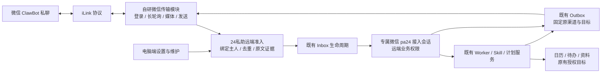

# 自研微信 ClawBot 接入：当前代码能力与实施边界

研究日期：2026-11-08（Asia/Shanghai）。范围：自行实现微信接入，复用24私助的业务内核；不安装或依赖 `dsh-im` 或 OpenClaw runtime，不部署、不操作真实账号。

## 结论

可以自主开发。当前最合适的落点是在 `@benz-ai-x/dsh-24pa` 内增加微信接入模块，内部保持 `WeixinTransport` 独立，只提取本次接入所需的远端入口契约。首版按一个工作区、一个主人、一个微信账号接入，先把身份、远端会话、Inbox、事项回传和 Outbox 接成完整链路。微信负责接收主人的请求和呈现结果；日历、待办、资料、计划与 Worker 仍由24私助现有服务处理。

这轮迭代确实增加了可复用能力：F50 已把对话和面板的计划管理统一，包含真实主人输入确认；F52 已补齐配置影响预览和保存前复核。但微信登录、协议传输、微信身份、微信会话和微信投递尚未实现。现有插件服务暴露 `PaRuntime`，不等于已经提供第三方接入注册协议。[C01][C02][C03]

建议第一期交付“主人私聊文字 → 24私助交办 → 原微信会话结果”，再接入计划文本确认和既有计划结果投递。图片资料、微信内审核、语音消息和群聊分别验收，不把飞书既有能力或协议字段存在直接算作微信能力。

## 1. 当前版本与研究方法

| 对象 | 本次核验基线 |
|---|---|
| 当前远端 `main` | `2527f5d2c711e946f4d5b6e67b7de6c18de0a821`，2026-11-08 11:08:09 +0800 |
| 插件与宿主 | 插件 `0.2.2-rc.1.3`；本轮发布宿主基线仍为 dsh `0.2.2-rc.1`。[C04] |
| 实际只读源码快照 | `/private/tmp/24pa-release-20261108`，HEAD `e48983c7d2865890621db4c37b00eb3f3f8c0478` |
| 快照一致性 | 上述提交与远端 `2527f5d` 的 Git tree 均为 `f1ba4e6b1cbbef78c2fc2536e0f83f7cc47a812a`；本文代码链接全部固定远端提交 |
| 上轮研究基线 | `97cc04731b3fdf4c145aabb6d132ac4d80529cc1`，插件 `0.2.2-rc.1.2` |
| 根工作目录 | 仍在 `55d7c1205abe5bc74927a7386091139565eca5f1`，有未提交文档；未 pull/reset，也未覆盖这些内容 |

`97cc047 → 55d7c12` 只有文档变化；`55d7c12 → 2527f5d` 已包含 F52、F50 和发布变更，共 83 个文件。因此不能以根目录滞后的 HEAD 得出“本轮没有代码迭代”。本次重新读了远端等价快照的实现、类型、存储和测试断言；草案、研究记录与源码事实分开。

本次以静态源码研究为主，并在上述隔离快照重跑构建及四份已有单元测试，结果见第 8 节；没有新建微信插件。下文区分“本次复验”“当前测试代码覆盖什么”和“仓库既有验收记录”，均不代表微信真实账号验收。

## 2. F50 / F52 改变了什么

### F50：微信可以复用同一套对话计划管理

新增 `PlanConversation` 接到 `TaskPlanService`；`reminders` Worker 的 `digest_enable/control/list` 已使用这个入口。对话与面板共用创建默认、原计划 ID、设置和历史：晨报默认智能工作规划，旧计划保留原 Skill、语音、时间规则与历史，调整不会自动迁移。[C02][C05]

创建、恢复、改时和语音调整先预览，再确认。确认 token 有 15 分钟有效期，绑定工作区、身份和原父会话；必须来自预览之后的一条真实主人消息，逐字匹配确认文字。模型传入 `confirm` 或复述原请求不构成确认。版本或授权变化会拒绝，必要时保留暂停草稿；暂停/停止也要求已采用的主人原文。[C02]

这适合微信的文字交互，但不能原样插入一条模型提示就调用：`WorkOwnerInput.kind` 仍只有 `session/panel/feishu`；远端原文回查只认 `feishu:` Inbox，身份指纹仍取工作区、`ownerOpenId/mode/larkProfile/notifyChannel`。微信要接入同一可信原文链，保留来源事件与消息 ID，并把微信绑定代次纳入授权。[C06]

### F52：微信设置应复用变更影响检查

新增 `configurationImpact()`，根据实际生效配置、磁盘配置、密钥与未决业务计算影响，返回不透明版本凭据；保存时再核对。它也覆盖“以前保存但未生效”的身份变化，避免普通改名顺带切换身份。身份变更仍会检查未结 Inbox、运行中事项、待发/未知投递和待审资料。[C03]

现影响分类只识别飞书身份字段及既有业务目标；密钥白名单和传输重连也没有微信字段。微信的扫码绑定、解绑、重绑需要接入这些检查，并显示“已绑定／需重新登录／正在接收／最近发送结果”等可理解状态；不能把扫码成功视作业务收发已验收。[C03][C07]

## 3. 插件形态：宿主可扩展，24私助接入尚未可插拔

`index.ts` 通过 `ctx.reflect.provide('pa24', runtime)` 提供服务，监听宿主会话事件；宿主已有创建会话、排队输入、子任务和刷新持久会话的结构接口。因此自研传输不必重造模型调用器或任务调度器。[C01][C08]

但当前存在四个具体限制：

1. `handleInbound(InboundEvent)` 是飞书入口：类型包含 app/tenant/openId，函数校验私聊、主人、应用和租户，并固定写 `source='feishu'`。没有通用 `registerInboundChannel`。[C09]
2. Outbox 支持适配器对象，但它由 `PaRuntime` 私有构造，现仅 `local/wecom/feishu`，没有运行时注册接口；`registerRole` 扩展的是 Worker 业务角色，不是消息通道。[C10]
3. 角色识别只有固定飞书会话、已登记 Worker 和本地顶层 `pa24` 会话。一个外部插件新建的顶层 `pa24` 会话，在同工作区且无父级时会落入 `local-robot`，取得本地工具集合；不能把它直接作为微信入口。[C11][C27]
4. 复用固定飞书会话也不成立：普通轮回复固定入飞书 Outbox，事项 `origin/delivery` 也只有飞书或本地。将微信消息伪装成飞书事件会损坏身份、原文确认和结果归属。[C12]

| 形态 | 真实可行性 | 本次建议 |
|---|---|---|
| 只写独立伴随插件，直接操作现有 `ctx.pa24` / 会话 | 能调用部分宿主和公开服务；无法在现有契约内完整登记微信身份、远端权限和固定回传 | 不作为第一期正式实现 |
| 在24私助包内新增微信模块，适量抽出远端接入契约 | 可直接复用现有执行、账本、配置和生命周期，在同一变更里补齐所有调用点 | 推荐 |
| 核心先开放有限接口，再把自研微信协议独立打包 | 可行；仍需先修改24私助核心、定义生命周期与版本契约 | 后续确有独立分发需求时再拆 |

这不是否定独立插件，而是把“协议实现可以独立”与“业务归属必须由24私助掌握”分开。不要让伴随插件写数据库、扫描所有会话输出或绕过既有权限来补接口缺口。

## 4. 建议的数据流（尚未实现）

建议只增加三类窄接口：可信入站接纳、远端会话/主人绑定查询、带明确结果语义的发送适配器。名称与类型在实施时定；这些接口目前不存在。传输模块不决定可调用哪些业务工具，不自行授权主人确认，不另建计划或业务重试队列。

## 5. 能具备哪些能力

下表的“可复用”表示核心业务实现已存在；所有微信行仍须完成身份、会话、入站和出站适配才能使用。

| 微信侧能力 | 当前可复用部分 | 还需开发或保留的边界 |
|---|---|---|
| 与24私助文字对话、查询交办、停止/继续、补充输入、接收异步结果 | `delegate/jobs`、原生 Worker、执行容量、续办与结算 | 微信专属远端角色、会话绑定；补充输入按原事项路由；结果固定回原入口。[C11][C12][C13] |
| 查日程、查空闲、建立/改期/取消日程、管理待办 | SourceRegistry、日历/待办读写、外部操作回执 | 微信只是入口；对象仍在已授权飞书/企微等现有业务来源，不是微信原生日历或待办。[C14] |
| 晨报、晚间/每周回顾、计划查询/改时/暂停/恢复 | F50 同一计划服务、预览确认、原生 Schedule、历史 | 接入可信微信原文；计划投递枚举/授权加入微信，已有计划不因新渠道自动改投。[C02][C05][C15] |
| 定时生成结果并发到微信 | PlanEngine、PlanResults、免打扰、有效期、执行/投递分离 | iLink 主动发送资格与上下文须实测；失败保留业务结果，不能因回传失败重跑业务。[C15][C16] |
| “半小时后提醒我”等简单提醒 | 现有 ReminderRouter 将提醒交给日历原生通知 | 不据此新增常驻微信闹钟。若要微信定时提醒，是单独产品能力与投递验证。[C14] |
| 检索有效业务记忆、查资料 | `pa24_memory search`、笔记/备忘查询 | 沿远端只读记忆权限；记忆维护、历史/回收与配置仍在电脑端。[C17] |
| 执行已放行的业务 Skill | `enabledWorkers`、`extraBusinessSkills`、Skill 版本与运行账本 | 复用业务白名单；不开放任意 Shell、本地文件或全部宿主 Skill。[C11][C18] |
| 发送图片/文件，整理手写资料 | 原稿保存、哈希、识别、草稿与版本账本 | iLink 下载/解密/大小限制及通用附件准入要新增；现 `collectNotePage` 依赖飞书 resource key/transport。[C19] |
| 整理备忘/纪要，返回文档链接 | 现有 memo、minutes、飞书文档创建与回读 | 允许微信发起而继续写飞书，需明确产品选择；当前不是独立于飞书的文档库。[C20] |
| 资料审核 | 版本指纹、一次性审核令牌、审阅与事务裁决 | 当前审核卡、主人 openId 和回调强耦合飞书。第一期保留飞书审核；微信文字审核需独立设计与验收。[C19] |
| 语音输入/语音结果 | TTS 引擎、音色、试听配置及文本兜底已存在 | 微信语音入站解析、转写可信度、出站编码/接口需核验；现计划 voice 只允许飞书。保留现有语音，不宣称微信已支持。[C21] |
| 扫码登录、掉线重连、主动通知 | 无现成微信模块；可复用设置、密钥保存和健康展示模式 | 自研协议、账号状态、游标和 context token 保存；扫码/接收/发送分别留证。[C03][C07] |
| 群聊、代主人管理微信联系人/发送到任意聊天 | 当前代码无此能力 | 不列入首期；ClawBot/iLink 私聊不等于接管全部微信聊天、通讯录或朋友圈，协议类型中有 `group_id` 也不构成群支持证明。 |

“在微信里使用24私助”与“去掉飞书作为业务后端”是两个范围。当前 `mode` 只有 `demo/feishu`，账本主人登记、资料发布与部分通知仍依赖飞书配置。新增微信应使用独立接入绑定配置，不应简单增加互斥的 `mode=wechat` 导致飞书业务停用。若要求只绑定微信即可初始化，还须把稳定的工作区主人标识从 `ownerOpenId` 中分离，不能把微信 ID 填进飞书字段。[C03][C20][C22][C26]

## 6. 核心适配点

### 身份与会话

应新增“工作区主人 ↔ 微信账号/机器人 ↔ 微信用户 ↔ 会话”的显式绑定，并给绑定设置代次或版本。飞书与微信可以属于同一主人，但应由电脑端已授权流程确认，不按昵称或任意第一条消息自动合并。当前账本通过 `ownerOpenId` 识别既定主人且禁止配置转让，须兼容旧账本。[C07][C22]

现持久会话只有 `feishu_session_id/local_session_id`。微信需要自己的接入会话和恢复记录；角色判定须优先识别已登记的远端会话，并在未知来源时拒绝本地权限。除了工具挂载，还要同步修改委派、资料、记忆、事项控制等内部角色校验。[C11][C22]

### 收件与可信原文

`InboxRepo` 已有全局唯一 `event_id`、原始 payload 和处理状态，`InboxLifecycle` 会在进入宿主前持久化接纳意图；未知宿主接纳结果不自动重发。可以保留这些语义，扩展 source 和标准入站封装，使用包含渠道、账号与原消息 ID 的去重键，防止跨账号碰撞。[C23]

微信长轮询的游标提交应以24私助已持久接纳对应消息为边界；协议解码/媒体保存失败要能记录，不能先推进游标再依赖内存异步处理。当前 Inbox 的重启策略会把处理中行恢复、已接纳未完成行标为中断并通知，不能描述为所有会话自动无损续跑。[C23]

具体应在整批消息已完成必要身份校验、接收或拒绝记录已持久化之后提交该批游标；无需等待模型执行结束。游标与接收记录应使用同一账本事务或可证明的先后提交关系。回复上下文按账号、对端和绑定代次保存，不能把一个会话的 token 用到另一账号；token 与密钥不进入模型提示或诊断正文。新增绑定、游标和回执字段的迁移及恢复须同时覆盖 SQLite 与 PostgreSQL。

F50 的确认链要保留真实的微信原消息 ID、原文、接纳账号/主人和绑定版本；`captureOwnerInput`、`WorkOwnerInput` 与 `planConversationAuthority` 应共同调整。确认仍回到原父会话，不能仅根据模型说“用户确认了”就执行。[C06][C28]

### 结果与投递

普通对话回复、Worker 最终结果、计划结果和资料通知是不同生产点，全部需走固定目的地。仅监听 `assistant/message` 不足以覆盖异步事项、后台计划和业务回执，也可能重复发送本地回传触发的新回合。[C12][C13][C16]

现 `OutboxRow.channel`、`NewOutbox.channel` 仅 `feishu/local/wecom`；`WorkItemRow.origin` 仅 `feishu/local`；Worker 结算将非 local 一律送飞书。应把原入口和已授权投递目标持久化，并修改这些分支；不能只新增一个 `sendText()`。[C10][C13]

Outbox 已区分明确未发送与发送结果未知：前者最多三次尝试，后者进入 `unknown` 不自动重发；保存了回执后只修复本地关联，不再次发送。微信应沿用该业务语义，协议网络重试不等于业务可以安全重发。当前回复路由仅为飞书登记，微信引用/续办还需按 `channel/account/nativeMessageId` 隔离。首版可用明确事项编号续办；没有原生消息 ID 时不能假造引用关系。[C24]

微信协议客户端生成的 `clientId` 与服务端可选 `message_id` 必须分开保存，不能为满足现 `send(): {messageId}` 而伪造平台回执。需要先定义“平台接受、服务器消息 ID、可引用、用户已读”的证据等级；成功发送也不等于用户已读。

### 计划与配置

计划必须固定主人、渠道和身份指纹；`TaskPlanAccess.verifyDelivery` 已拒绝身份/默认目标变化后自动改投，`PlanResults` 也检查原目的地、静默期和有效期。微信要成为这些类型和校验中的正式渠道，不能用全局 `notifyOwner` 覆盖已有计划目的地。[C15][C16]

F50 并未改变计划执行会话：`planContext.sessionId` 仍是固定 `accessSessionId`，`planStep` 也只拦截该会话的原生 Schedule 输入。微信管理计划与计划结果改投微信是两项适配；前者不要求把所有旧计划移到微信会话。需要明确稳定的后台执行归属，并保持已有计划、历史与授权不被隐式迁移。[C29]

账号重绑应进入 F52 的配置影响检查：扫描该旧身份未结 Inbox、Outbox、执行和授权，再决定可否切换。凭据不能进入聊天原文或普通配置展示。现密钥库存取模式可以复用，但微信 token/刷新状态字段和失效处理需新增。[C03][C07]

## 7. 开发顺序与验收建议

1. **先完成文本闭环**：电脑端扫码和显式主人绑定；微信专属远端会话；带账号范围去重的入站；普通文本回复、Worker 异步结果、重启恢复和未知投递状态。验收陌生人/旧账号/错误工作区均不获业务权限。
2. **复用既有业务**：日历、待办、交办和有效记忆检索。保持业务来源原授权，验证微信交办结果不会转发到飞书默认目标或另一微信绑定。
3. **接入 F50**：同一计划从电脑端和微信查看/调整；真实原文确认；过期、伪造、旧账号和并发版本变化拒绝；旧计划、语音选择与历史不被迁移。再验证计划主动投递及投递失败不重复执行。
4. **扩展媒体**：图片/文件准入与资料原稿先行；保留飞书审核。微信内审阅、音频输入/输出另设完整验收，不用协议类型枚举替代端到端结果。

第一期不需要新增手机网页；账户管理、诊断、核对未知结果仍在24私助电脑端。聊天只是既有微信客户端入口，遵守当前电脑端产品基线。[C25]

必须新增的微信专属验证包括：轮询重投与游标崩溃窗口；换账号后旧 context token/收件/出站隔离；入站已接纳但宿主超时；长文本分段部分成功；发送结果未知；账号解绑期间在途结果；F50 原文确认；无新入站触发的 Worker/计划最终结果；宿主真实 Loader/Session 装配。所有外部适配桩与真实账号验收分别报告。

## 8. 测试证据与尚未验证内容

本次在 `/private/tmp/24pa-release-20261108/packages/24pa` 执行 `npm run build` 通过，随后运行 `plan-conversation`、`config-impact`、`local-tool-access`、`channel-reliability` 四份现有单元测试，共 **62 项通过**（6 + 7 + 7 + 42，19.23 秒）。受测源码 tree 与远端 `2527f5d` 一致；覆盖现有服务、SQLite 与外部适配替身。本次没有重跑 PostgreSQL 或真实 Loader，也没有微信适配器或真实账号测试。

| 当前证据 | 已覆盖的代码语义 | 本次不据此声称 |
|---|---|---|
| `plan-conversation.test.mjs:59–148` | 公开工具预览无写入、伪造确认拒绝、幂等确认、跨入口同计划、投递身份变化/过期拒绝 | 微信确认链已经接通。[T01] |
| `f50-plan-consistency.e2e.mjs:13–25,53–106` | 真实 Host/Session；模型与飞书 CLI 为替身；对话/面板设置、旧历史、重启和自愿迁移 | 微信账号、真实模型质量或真实飞书投递验收。[T02] |
| `config-impact.test.mjs:18–95` | 影响读取无写入；未生效身份变化；并发/未决投递拒绝；不回显密钥 | 微信扫码/重绑已受保护。[T03] |
| `runtime-ownership.test.mjs:104–199` | 接纳/持久化故障、原输入消费身份、补充输入迟到结算、不盲目重发 | 微信游标与 Inbox 原子关联已实现。[T04] |
| `channel-reliability.test.mjs:436–544` | 保存回执、路由补记、unknown 停止、有界明确失败重试、原本地目标 | iLink 服务端提供幂等或可靠消息查询。[T05] |
| `work-item-lifecycle.test.mjs:58–76` | 重启恢复不复活停止事项；结果和投递事务一致、重复回合不重复通知 | 任意新渠道已经实现相同保障。[T06] |

仓库 F50 交付记录报告最终增量 5 文件 162 项通过，双后端真实 Loader/Session 各 2 文件 11 项通过；F52 记录报告最终配置界面回归 4 文件 45 项通过、PG Loader 2 文件 10 项通过。其完整回归与定向修复的时间范围分别记录，不能合并成“本次全量测试全绿”。发布记录说明 `.1.3` 复用两项功能验收。[T07][T08][C04]

尚未验证：任何微信代码/真实 ClawBot 账号；主动发送服务端时效或额度；群支持；微信音频格式与播放；微信媒体到资料审核完整流程；宿主与自研插件装配。以上均不能从 `dsh-im` 的演示或官方客户端源码单独推导为24私助已交付。

## 9. 微信协议的当前依据与自研边界

本轮重新读取腾讯仓库 `Tencent/openclaw-weixin` 的默认分支，固定到 `874637a0dbc24050f72d1385add4fc6170a2d726`。它提供可审阅的 HTTP 协议和客户端实现。自研24私助模块可以按这些接口实现传输；腾讯现有包的 OpenClaw SDK 依赖和会话路由不能原样当成 DSH 插件接口。此判断是基于公开客户端代码的工程可行性判断，尚不代表当前账号的接入资格或所有服务端行为已验证。

| 自研需实现的部分 | 一手依据与范围 |
|---|---|
| 扫码绑定 | `POST /ilink/bot/get_bot_qrcode?bot_type=3`；轮询 `get_qrcode_status`，处理扫码、确认、过期、验证码与重定向。确认结果包含 bot token、bot ID、扫描者 ID 和 API 地址。 |
| 消息收取 | `POST /ilink/bot/getupdates` 长轮询，使用 `get_updates_buf`；无需为收信暴露公网回调端口，运行24私助的主机需保持联网和进程运行。 |
| 文字回复 | `POST /ilink/bot/sendmessage`；保留稳定的 `client_id` 和对应会话的 `context_token`，HTTP 状态与业务返回码分别检查。 |
| 输入中提示 | `getconfig` 获取 ticket，再调用 `sendtyping`；提示失败不应阻塞业务结果。首版可选。 |
| 图片、视频、文件 | `getuploadurl` 加 CDN 加密上传／下载，再发送媒体条目；是额外实现范围，不能只给模型一个未下载的媒体引用。 |
| 语音 | 入站可能附 `voice_item.text`；缺少转写时需实际解码／转写能力。已核验的发送帮助函数覆盖文本、图片、视频和文件；不能仅凭 voice 枚举宣布原生语音出站已打通。 |
| 群聊与完整个人微信访问 | `group_id` 仅存在于类型，不构成群聊支持证明。上述协议没有提供全部好友聊天历史、通讯录或朋友圈访问能力。 |

主动消息必须单独验证。官方文档建议回复时带回入站 `context_token`，同时明确“客户端在缺失时仍发请求”不能证明服务端会接纳。此次未取得足以承诺任意时刻主动推送的窗口、配额或长期 token 保证，也不引用未经证实的“24 小时／10 条”等数字。首版交付普通回复和异步结果时，也要验证真实延迟场景；若 token 不可用，保留结果并显示投递受限，不能标成已送达。

还须修正现有 Outbox 的回执契约：腾讯发送函数的 `messageId` 是本地生成的 `client_id`，实际平台消息号在可选 `serverMessageId`。建议分别持久化本地投递标识、平台接纳依据、可选原生消息号与发送结果。服务端明确接纳但没返回原生号，不应被错误归入失败后重发；网络超时、接纳不明则保持 unknown，不能把生成的 client ID 当作平台接纳证据。客户端提供 client ID 也不等于已证实服务端幂等保证。

来源：
- [腾讯协议文档（固定提交）](https://github.com/Tencent/openclaw-weixin/blob/874637a0dbc24050f72d1385add4fc6170a2d726/docs/protocol.md)。
- [腾讯发送实现（固定提交）](https://github.com/Tencent/openclaw-weixin/blob/874637a0dbc24050f72d1385add4fc6170a2d726/src/messaging/send.ts)。
- [腾讯类型定义（固定提交）](https://github.com/Tencent/openclaw-weixin/blob/874637a0dbc24050f72d1385add4fc6170a2d726/src/api/types.ts)。
- [腾讯插件说明（固定提交）](https://github.com/Tencent/openclaw-weixin/blob/874637a0dbc24050f72d1385add4fc6170a2d726/README.md)。

## 10. 首版使用流程建议

在电脑端“接入”位置增加微信账号卡：连接微信 → 展示二维码与绑定状态 → 主人扫码 → 核对绑定账号 → 开启。日常参数只呈现启用状态、结果是否可回传与最近连接情况；账号重绑、注销、凭据等操作放维护入口，复用本轮 F52 的变更影响提示和生效状态，具体字段仍需开发。

首版保持同一工作区、同一主人、一个微信绑定。微信身份必须映射到现有工作区主人，不把微信 ID 写入 `ownerOpenId`；既有飞书／企微业务授权继续服务于日历、待办和文档。当前 `mode: demo | feishu` 同时承担部分业务就绪判断，简单加 `mode=wechat` 会把“交互入口”与“业务能力”继续绑在一起。建议单独增加微信入口配置；完全脱离飞书的实例属于后续依赖拆分范围。

首次演示应覆盖：微信说“查看明天安排”→已有来源查询；说“把晨报改到八点半”→返回同一计划的预览→回复确认文字→电脑端看到同一计划已更新；交办较长事务→有已接纳反馈→完成后按原微信入口返回。原计划的通知目标保持原值，只有另行预览、确认改为微信并通过投递核验，才把周期结果送微信。

## 来源索引

以下24私助来源均固定到 `2527f5d2c711e946f4d5b6e67b7de6c18de0a821`；行号以该 tree 为准。

[C01]: https://github.com/benz-ai-x/dsh-24-PA/blob/2527f5d2c711e946f4d5b6e67b7de6c18de0a821/packages/24pa/src/index.ts#L6-L60
[C02]: https://github.com/benz-ai-x/dsh-24-PA/blob/2527f5d2c711e946f4d5b6e67b7de6c18de0a821/packages/24pa/src/plan-conversation.ts#L24-L153
[C03]: https://github.com/benz-ai-x/dsh-24-PA/blob/2527f5d2c711e946f4d5b6e67b7de6c18de0a821/packages/24pa/src/runtime.ts#L1442-L1615
[C04]: https://github.com/benz-ai-x/dsh-24-PA/blob/2527f5d2c711e946f4d5b6e67b7de6c18de0a821/docs/research/2026-11-08-release-0.2.2-rc.1.3.md
[C05]: https://github.com/benz-ai-x/dsh-24-PA/blob/2527f5d2c711e946f4d5b6e67b7de6c18de0a821/packages/24pa/src/task-plan-settings.ts#L6-L47
[C06]: https://github.com/benz-ai-x/dsh-24-PA/blob/2527f5d2c711e946f4d5b6e67b7de6c18de0a821/packages/24pa/src/runtime.ts#L2263-L2304
[C07]: https://github.com/benz-ai-x/dsh-24-PA/blob/2527f5d2c711e946f4d5b6e67b7de6c18de0a821/packages/24pa/src/config-impact.ts#L5-L23
[C08]: https://github.com/benz-ai-x/dsh-24-PA/blob/2527f5d2c711e946f4d5b6e67b7de6c18de0a821/packages/24pa/src/host.ts#L149-L179
[C09]: https://github.com/benz-ai-x/dsh-24-PA/blob/2527f5d2c711e946f4d5b6e67b7de6c18de0a821/packages/24pa/src/runtime.ts#L1968-L2028
[C10]: https://github.com/benz-ai-x/dsh-24-PA/blob/2527f5d2c711e946f4d5b6e67b7de6c18de0a821/packages/24pa/src/runtime.ts#L232-L291
[C11]: https://github.com/benz-ai-x/dsh-24-PA/blob/2527f5d2c711e946f4d5b6e67b7de6c18de0a821/packages/24pa/src/runtime.ts#L1746-L1756
[C12]: https://github.com/benz-ai-x/dsh-24-PA/blob/2527f5d2c711e946f4d5b6e67b7de6c18de0a821/packages/24pa/src/runtime.ts#L2239-L2258
[C13]: https://github.com/benz-ai-x/dsh-24-PA/blob/2527f5d2c711e946f4d5b6e67b7de6c18de0a821/packages/24pa/src/work-item-lifecycle.ts#L215-L241
[C14]: https://github.com/benz-ai-x/dsh-24-PA/blob/2527f5d2c711e946f4d5b6e67b7de6c18de0a821/packages/24pa/src/runtime.ts#L972-L1012
[C15]: https://github.com/benz-ai-x/dsh-24-PA/blob/2527f5d2c711e946f4d5b6e67b7de6c18de0a821/packages/24pa/src/task-plan-access.ts#L28-L94
[C16]: https://github.com/benz-ai-x/dsh-24-PA/blob/2527f5d2c711e946f4d5b6e67b7de6c18de0a821/packages/24pa/src/plan-results.ts#L23-L44
[C17]: https://github.com/benz-ai-x/dsh-24-PA/blob/2527f5d2c711e946f4d5b6e67b7de6c18de0a821/packages/24pa/src/runtime.ts#L2658-L2678
[C18]: https://github.com/benz-ai-x/dsh-24-PA/blob/2527f5d2c711e946f4d5b6e67b7de6c18de0a821/packages/24pa/src/runtime.ts#L2279-L2298
[C19]: https://github.com/benz-ai-x/dsh-24-PA/blob/2527f5d2c711e946f4d5b6e67b7de6c18de0a821/packages/24pa/src/handwriting-pipeline.ts#L207-L745
[C20]: https://github.com/benz-ai-x/dsh-24-PA/blob/2527f5d2c711e946f4d5b6e67b7de6c18de0a821/packages/24pa/src/runtime.ts#L2926-L2995
[C21]: https://github.com/benz-ai-x/dsh-24-PA/blob/2527f5d2c711e946f4d5b6e67b7de6c18de0a821/packages/24pa/src/task-plan.ts#L102-L113
[C22]: https://github.com/benz-ai-x/dsh-24-PA/blob/2527f5d2c711e946f4d5b6e67b7de6c18de0a821/packages/24pa/src/db.ts#L54-L98
[C23]: https://github.com/benz-ai-x/dsh-24-PA/blob/2527f5d2c711e946f4d5b6e67b7de6c18de0a821/packages/24pa/src/inbox-lifecycle.ts#L38-L129
[C24]: https://github.com/benz-ai-x/dsh-24-PA/blob/2527f5d2c711e946f4d5b6e67b7de6c18de0a821/packages/24pa/src/outbox-delivery.ts#L63-L112
[C25]: https://github.com/benz-ai-x/dsh-24-PA/blob/2527f5d2c711e946f4d5b6e67b7de6c18de0a821/docs/agents/product.md
[C26]: https://github.com/benz-ai-x/dsh-24-PA/blob/2527f5d2c711e946f4d5b6e67b7de6c18de0a821/packages/24pa/src/config.ts#L14-L55
[C27]: https://github.com/benz-ai-x/dsh-24-PA/blob/2527f5d2c711e946f4d5b6e67b7de6c18de0a821/packages/24pa/src/local-tool-access.ts#L4-L41
[C28]: https://github.com/benz-ai-x/dsh-24-PA/blob/2527f5d2c711e946f4d5b6e67b7de6c18de0a821/packages/24pa/src/work-owner-input.ts#L4-L37
[C29]: https://github.com/benz-ai-x/dsh-24-PA/blob/2527f5d2c711e946f4d5b6e67b7de6c18de0a821/packages/24pa/src/runtime.ts#L762-L811
[T01]: https://github.com/benz-ai-x/dsh-24-PA/blob/2527f5d2c711e946f4d5b6e67b7de6c18de0a821/packages/24pa/tests/unit/plan-conversation.test.mjs#L59-L148
[T02]: https://github.com/benz-ai-x/dsh-24-PA/blob/2527f5d2c711e946f4d5b6e67b7de6c18de0a821/packages/24pa/tests/e2e/f50-plan-consistency.e2e.mjs#L13-L106
[T03]: https://github.com/benz-ai-x/dsh-24-PA/blob/2527f5d2c711e946f4d5b6e67b7de6c18de0a821/packages/24pa/tests/unit/config-impact.test.mjs#L18-L95
[T04]: https://github.com/benz-ai-x/dsh-24-PA/blob/2527f5d2c711e946f4d5b6e67b7de6c18de0a821/packages/24pa/tests/unit/runtime-ownership.test.mjs#L104-L199
[T05]: https://github.com/benz-ai-x/dsh-24-PA/blob/2527f5d2c711e946f4d5b6e67b7de6c18de0a821/packages/24pa/tests/unit/channel-reliability.test.mjs#L436-L544
[T06]: https://github.com/benz-ai-x/dsh-24-PA/blob/2527f5d2c711e946f4d5b6e67b7de6c18de0a821/packages/24pa/tests/unit/work-item-lifecycle.test.mjs#L58-L76
[T07]: https://github.com/benz-ai-x/dsh-24-PA/blob/2527f5d2c711e946f4d5b6e67b7de6c18de0a821/docs/research/2026-11-08-plan-consistency-implementation.md
[T08]: https://github.com/benz-ai-x/dsh-24-PA/blob/2527f5d2c711e946f4d5b6e67b7de6c18de0a821/docs/research/2026-11-08-config-info-implementation.md
