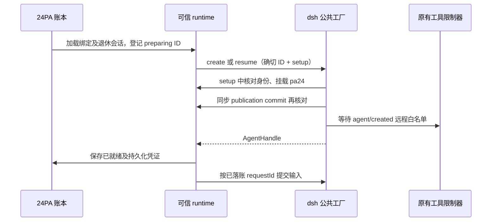

# 微信首版的宿主接入契约核验

日期：2026-11-08。用途：#279 的 F53/F54 正式实现依据；本报告只做源码和既有证据审读，不实现代码、不访问真实服务或凭据。

## 结论与来源版本

可以复用 dsh 的公开会话、原生 Worker 和持久事件能力，不需要 dsh-im 或 OpenClaw 运行时。必须补齐的是：**在会话获得工具权限之前登记微信身份；持久保存跨宿主接纳的意图；用原输入的持久消费证据恢复；把已采用的主人原文带到计划确认。** 稳定请求编号有帮助，但不是全部生命周期的幂等保证。

| 来源 | 本次核验版本与边界 |
|---|---|
| 24PA 业务代码 | `2527f5d2c711e946f4d5b6e67b7de6c18de0a821`，包 `0.2.2-rc.1.3`；本次核对的 runtime、tools、host、Inbox/Worker 等核心文件与功能工作树相同 |
| 功能工作树 | `/private/tmp/24pa-weixin-279-20261108`；本报告写入前 HEAD `e43b68f12ab64a4640bbc62a80314b1873ce47b5`，新增的是协议与文档证据；主代理后续实现不属于本报告已验证事实 |
| dsh | 干净本地第一方源码 `deepseek-harness@66491b05e3f05ad35bcdd4f6cd7ed26041d9e3db`，包 `0.2.2-rc.1`；核验实际安装的 `dsh-api-session-controller`、`dsh-agent-preset-registry` 类型及构建 |
| 构建一致性 | 已装 `dsh-api-session-controller/lib/index.js` 与上述源码树构建逐字节相同，SHA-256 `4cf6c66e65cce865d270fa89405b96d048ffa62e493e4ffbd1a826be2207a4cd`；不据此声称所有本机/服务器 Host 安装都相同 |
| 微信官方客户端 | `Tencent/openclaw-weixin@874637a0dbc24050f72d1385add4fc6170a2d726`，`2.4.10`；沿用同日已完成的[协议核验](2026-11-08-weixin-protocol-contract-verification.md) |
| 本人账号证据 | [服务器 A 的清洁证据](evidence/2026-11-08-weixin-protocol/server-account-evidence.json)：两条本人确认可见，第二条延迟 `391132 ms`、恢复原游标后无新增观察入站；不是 F53/F54 业务或通知 B 验收 |

已按仓库要求复核产品基线、GLOSSARY、ADR-0001 和[微信规格 2.20](../planning/24PA-微信ClawBot接入-SPEC.md)。下文固定源码链接指向上表版本。没有读取生产会话目录或真实密钥；没有执行新增测试。本机部分旧 peer symlink 已悬空，正式验收须显式记录实际 CLI/Loader 路径与版本，不能把这些包目录当成一次完整启动证据。

## 可复用的公开接口

| 目的 | 公开接口 | 已核实的限制 |
|---|---|---|
| 普通会话创建 | `ctx.sessionController.create({sessionId, workspaceId, agentPreset})` | 是“创建新对话/复用空白对话”，**不是恢复指定已有对话**；返回 `sessionId` 可以不同 |
| 指定身份创建与恢复 | `ctx.agents.create({sessionId, meta, agentOptions, setup})`、`ctx.agents.resume({resumeSessionId, …, setup})` | 精确 ID；`setup` 先于 Agent 发布和 `agent/created`；调用方持有 `AgentHandle` 并负责生命周期 |
| 预设与模型装配 | `installModelSelection(agentCtx)`、`ctx.agentPresets.mount(agentCtx, 'pa24')`；默认模型服务 `currentSelection()` | SessionController 自己也这样装配；沿用一个 `pa24` preset，不另设用户可见微信 preset |
| 解析已有顶层会话 | `ctx.sessionController.resolveAgent(id)` | 可恢复冷会话、可能挂载工具；调用前必须已经加载远程身份。原生子会话不能当普通顶层解析 |
| 提交 Lead 输入 | `ctx.sessionController.prompt({requestId, sessionId, mode:'queue', content, clientTimeZone}, signal)` | 返回 `{accepted:true}`，**不返回宿主 MessageId**；生成 `source.kind='user'`、`source.rpcId=requestId`；不存在任意自定义微信 source 参数 |
| 持久屏障 | `ctx.sessions.flush(session)` | `true` 才证明有持久监听者参与且全部成功；`false` 和抛错均不能作为持久完成依据 |
| 冷/热历史读取 | `sessionController.events({address, throughSeq, beforeSeq, maxMessages}, signal)`；`sessionPersistence.open(id,'read') → read/close` | 前者可固定 cursor 分页、不会启动模型；热观察不是 flush。后者是公开只读能力，可取 header、完整事件和继承切点；无需读取私有日志文件 |
| 当前队列与事件通知 | `sessionController.state`、`observeEvent`、`ctx.on('session/event', …)` | `state.queue===null` 表示无可读活跃队列，不证明无历史输入；事件通知只是补账线索，不替代持久证据 |
| 原 Worker 后续输入 | `ctx.subagents.sendMessage(originalParent, childId, content, {signal})` | 使用真实父子归属，由现有 WorkItemLifecycle 包装；不是向子会话调用普通 `sessionController.prompt` |

依据：[SessionController 类型][H1]、[prompt 实现][H2]、[Agent 工厂契约][H3]、[SessionController 装配][H4]、[持久屏障][H5]、[公开持久只读接口][H6]、[历史控制器][H7]、[现有 Worker 接续][P1]。

`packages/24pa/src/host.ts` 是旧版本的最小结构类型，仍列 `inspect`、把 prompt signal 写成可选、把返回值写成可能包含 error；它不能代替 `0.2.2-rc.1` 的真实契约。新增适配应按实际公开接口补最小类型，不调用这个 Host 已没有公开声明的 `inspect`。当前源码没有独立 `lead-input.ts`；Lead 输入逻辑分布于 runtime、InboxLifecycle、host-turn 和 work-owner-input。[现有类型][P2]

## 首次工具权限必须怎样建立

### 创建与恢复是两种操作

宿主 `sessionController.create` 遇到已有 turn、被归档、不在指定 Workspace 或被其他 writer 持有的空白 Session，可能另外生成 `session-UUID`；成功返回时，新 Agent 已完成装配。当前 `prepareOwnedSession/createOwnedSession` 多处忽略返回的新 ID，不能直接复制到微信。[create 实现][H8] [官方用例][H9] [现有入口创建][P3]

现有 `tools.ts` 在串行 `agent/created` 回调中计算角色并 `restrict`；宿主会等待这些回调完成再释放 queued work。因而“创建完成之后再登记微信”太晚：未知的同工作区 `pa24` 顶层 Agent 会被现有 `roleFor` 当成 `local-robot`。[工具限制][P4] [现有角色推断][P5] [宿主发布时序][H10]

### 推荐的最小实现路线

建议微信专属父会话使用公开 **exact-ID Agent 工厂**，输入仍走 SessionController，子任务仍走原生 subagents。这样无需改宿主，也无需新增 IM 框架或第二种产品 preset。

1. 在 24PA 数据库事务中保存持久绑定及候选随机 Session ID；状态为 preparing。身份包括持久工作区 ID、账号、主人、绑定代次和会话 ID。
2. 在任何创建/恢复、Workspace 生效或工具装配前，将该工作区的活跃与退休远程映射载入可信 runtime。preparing 可识别为远程，但不能接纳业务；retired 仍被识别为远程并拒绝调用。
3. 新建用 `ctx.agents.create` 的确切 ID；恢复先通过公开只读接口核对历史 header、工作区、顶层归属、当前 preset 与绑定，再用已有 live Agent 或公开 resume。已有记录缺失/冲突不能静默新建并复用旧授权。
4. `setup` 中再次核对绑定，安装模型选择、挂载同一 `pa24` preset；必要时返回同步 `commit`，在最后一个 await 之后、发布之前核对身份是否仍有效。现有 `agent/created` 限制器必须把它识别为远程白名单。
5. 用公开 Workspace 的 `attachSession` 加入工作区，完成必要 flush，再启用传输派发。挂载、附加或持久化失败保留 preparing/故障记录，不能开放业务。
6. 每次收件派发、模型步和业务调用重验活跃绑定；不能仅信 header preset、ID 前缀或上一轮计算的角色。正常重启和同身份续期保留原持久代次。

工厂的 `setup` 是公开同进程扩展点，明确要求只做装配，不能在 setup 内驱动 Agent；`AgentHandle.dispose()` 会取消并 drain，只有 handle 持有人拥有主动 teardown 能力。[工厂契约][H3] [真实实现][H10] [装配参考][H4]

如果实现仍选 SessionController 路线，必须先登记不冲突的新候选 ID、恢复只用 `resolveAgent`，并证明任何另铸 ID 在首次限制器中也不能获得本地权限。只在返回后检查 `actualId===candidateId` 不足以证明这一点。不要用未验证的全局临时变量把同时创建的本地会话误归为微信。上述 exact-ID 路线减少这类额外机制。

## Lead 接纳、持久化和恢复

### 不能把相同 requestId 重发当成完整幂等

宿主的 `hasPromptRequest` 只查看当前 `inbox.nextTurn/nextStep` 和历史 `user/message.source.rpcId`。它不回放已取消或已消费的 `agent/inbox/spliced`；某输入若在 pre-step 被拒绝，可能已离开队列却没有进入 user/message。因此同 requestId 再 prompt 仍可能制造第二个输入。[去重实现][H11]

此外，队列检查发生在异步附件接纳之前，不是数据库唯一约束；微信应保留每个父 Session 的串行准入，不能依靠两个并发 prompt 的相同编号去重。`requestId` 是本地可信账本生成的稳定关联，不接受模型提供。

### 复用已有生命周期，但补齐三个缺口

现有 InboxLifecycle 已先写 `admitted + requestId + targetSession` 再调用宿主；接纳后写账失败不会自动重发，明确拒绝才移除待结算关联。这个跨边界顺序可复用。[Inbox 接纳][P6]

但微信还需补齐：

- **持久恢复关联**：`replies` 是内存 Map，`recover` 当前统一把 admitted 改成 rejected 并提示重发。需由持久收件关联及宿主证据重建，不直接复用旧恢复策略。
- **严格持久屏障**：当前 `submitToSession` 只 catch flush 抛错，不检查 false；Lead `onTurnEnd` 又吞掉 flush 错误继续结算。微信须采用 WorkCompletionHistory 的严格 checkpoint，false/throw 都留下待核对/待补账。
- **状态与投递分离**：`complete` 中的 delivered 表示回复已进入 Outbox，不等于微信平台接纳。普通回复、拒绝和恢复提示都保存显式 Inbox/turn/WorkItem 关联；不能从 dedup_key 反拆业务关系。

依据：[恢复与回复内存队列][P7] [当前提交与回合结算][P8] [严格 checkpoint][P9]。

### 建议恢复判据

下面是实现建议，尚未表示已有微信实现：

| 可核对证据 | 恢复动作 | 禁止的推断 |
|---|---|---|
| received/processing，且没有跨宿主接纳意图 | 按持久 Inbox 正常派发；派发前复核身份 | 仅凭游标已推进认定业务已完成 |
| admitted，完整持久 splice 证明同 requestId 仍排队 | 重建关联；允许恢复会话持有原队列，不重新 prompt | accepted 或 queue 存在即已采用；resume 即自动执行 |
| 同输入已被消费，回合尚开或恢复产生 interrupted | 保留已消费身份，核对关联 WorkItem/外部动作；可显示中断待处理 | 自动补发原输入；把 synthetic closer 当正常完成 |
| 同输入有唯一、持久完成回合 | 按原 turn 和原目标幂等补 Outbox/收件结算 | 再执行模型/Worker 以便生成一份新结果 |
| 已有原 WorkItem/出站结果，但 Lead 末尾不完整 | 先核对原业务结果与显式输入关系，补可证明的账 | 因 Lead 无回复而重复委派已开始的业务 |
| 取消或明确拒绝记录 | 保留取消/拒绝和原 identity，不自动复活 | 用户再次查询或系统重启等于要求重做 |
| admitted 但没有足够持久证据；读取失败/损坏/归属不符/同编号多输入 | 进入可见待核对，继续只读补证 | “未查到”就等于“宿主没接纳”，直接重发 |

按输入回放 `agent/inbox/spliced`、`user/message`、`turn/start/end`，同时核对 canceledInputIds。当前 host-turn 已区分排队与消费，也能识别 pre-step 前已被取走的消息，可抽取为共享纯读取逻辑。真实 Host 的队列 target 是 `next-turn/next-step`；部分旧单测用 `queue`，新验收须用真实格式。取消结果和原文采用不能只看最后一条消息。[现有回放][P10] [Host inbox][H12]

读取 live Session 必须先 flush；冷态通过公开 `sessionPersistence.open(id,'read')` 取 header、events、inheritedEventCount，并在 finally close。只对属于绑定的普通父会话或账本证明的原 Worker 读取；继承前缀不能冒充本次输入。若采用 events 分页，首读固定 cursor，并向前读到完整判定边界；只读末尾 50 条不足以否定早期接纳。[公开读取][H6] [分页][H7] [既有只读适配][P9]

### resume 与关闭的实际边界

`ctx.agents.resume` 会重建 inbox，并对崩溃留下的开放回合补 `reason.kind='interrupted'`；这是一种历史修复，不证明原模型/工具成功。构造后的 Agent 为 idle；maintenance 只有收到 wakeRequested 才驱动，resume 本身不能保证把已有排队消息自动执行。官方测试同样在恢复注入上下文后，再发送新的真实 followup 才开始下一轮。[恢复实现][H13] [驱动条件][H14] [官方恢复用例][H15]

首版可以保留“已接纳、待恢复/核对”的准确状态，不要求伪造新主人消息唤醒。若要主动唤醒原排队输入，需单独验证公开队列操作与原输入 ID、取消记录、授权和重复保障；不能把 `updateQueue/steer` 的存在直接等同于安全的通用恢复。

正常 teardown 与崩溃也不同：已发布 handle 的 dispose 会清空 pending inbox 并记录取消；只有初始化失败时保留 inbox。故需测试正常停机、插件重载和硬中断三条路径，不能承诺每次正常关闭都无损恢复排队。停止/取消仍是可追溯事实，不因下一次启动撤销。[teardown 实现][H16] [保留与取消用例][H17]

## 可信后续原文与 Worker 采用

现有链路可复用为：**微信清洁 Inbox 原文 → Lead 本轮实际消费 → WorkOwnerInput → Worker 执行意图/原生输入 → Worker adopted → PlanConversation 确认**。

1. `captureWorkOwnerInput` 只取开放回合中 kind=user、未取消的真实 user/message；历史、仅排队、agent-message 和混入 schedule 的回合不建立新的主人确认。不能把所有 kind=user 都认作微信主人：SessionController 本身并不认识微信账号。[原文捕获][P11]
2. 现有飞书分支用 `source.rpcId` 回查已验证 Inbox，再恢复 clean 原文，去掉提交给模型时附加的时间/路由包装。微信需要同样回查，并核对 source、账号、主人、持久绑定代次、target parent、原平台消息身份和接纳状态。原文/来源从账本取得，不能从 tool args 取得。[runtime 捕获][P12]
3. 首次 calendar/reminders 委派已保存 owner_input；WorkItemRepo.beginExecution 在提交原生子输入前保存 execution_id、工作区/父子/代次与 ownerInput。微信扩展来源，不改写原 WorkItem 的父会话或结果目标。[首次委派][P13] [执行意图][P14]
4. 可靠引用与明确编号续办均沿 WorkItemLifecycle.resume，传入可信 ownerInput；当前飞书引用已保留原文。编号由模型解析时仍须验证原工作、当前远程可操作范围及原文确实对应这次请求，不能只因号码存在就认可确认。[引用续办][P15]
5. WorkerRuns.observe 依据 execution marker、原父 senderSessionId、唯一原生输入与已消费回合，区分 received/adopted；runtime.adoptedOwnerInput 只返回当前 execution 已 adopted 的来源。排队成功或 sendMessage 返回 ID 不能提前授权计划写入。[Worker 采用][P16] [当前采用读取][P17]
6. PlanConversation 已绑定预览父会话、authority、15 分钟期限、后续新消息 ID 与完整确认文字。微信 authority 必须纳入持久工作区/账号/主人/绑定代次；短期 workspaceBinding 可继续使重启前预览失效，但不能代替持久绑定身份。计划后台执行会话和结果目标保持原规则。[确认实现][P18]

当前 `planConversationAuthority()` 只涵盖 workspaceBinding、飞书主人/配置等；不能只把 WorkOwnerInput.kind 扩成 weixin 便认为微信确认安全。首次、引用和显式编号三个入口都须贯通至同一条采用证据链。[现有 authority][P17]

## send 仅返回 message_id 时的正式判据

**可以把正确响应中的合法原生 message_id 作为平台接纳依据；不应要求服务端必须返回 ret。** 这不是从可选类型单独推断：

- 官方 `sendMessage` 只在 `resp.ret` 存在且非零时抛错，缺省 ret 可返回。[API 实现][W1]
- `sendMessageWeixin` 将 `response.message_id` 保存为 serverMessageId，与自行生成的 clientId 分开。[发送实现][W2]
- 官方测试明确返回 `{message_id:'18446744073709551615'}`、没有 ret，断言成功获得平台号并用于出站引用缓存；另测缓存失败不会把已成功发送反转为失败。[直接测试证据][W3]
- 本人服务器实测正是 HTTP 200、仅 message_id 字符串的响应，并有两次本人可见核对。它加强了该形状在本次账号/版本上的判断，不证明任意空响应或长期主动通知。

建议正式 adapter 的最小分类：

| 响应 | 判定与记录 |
|---|---|
| 正确请求对应的 HTTP 2xx、合法 JSON 对象、非空且无损保存的原生 message_id；ret 缺省或为数字 0，没有显式矛盾失败 | accepted；basis=`native_message_id`，同时记录独立 client ID 与原生 ID |
| HTTP 2xx、明确 `ret===0`，无矛盾失败码，原生号缺省 | accepted；basis=`ret_zero`，原生号保持空，不登记虚构引用 |
| 非零 ret 或其他明确业务拒绝，与 message_id 同时出现 | 不以 ID 覆盖矛盾；按经核实的错误契约拒绝/待核对 |
| HTTP 2xx，但既无明确成功码又无合法原生号；只有 client_id；JSON 不合法/类型不符 | unknown，不能按官方客户端宽松返回值直接宣称接纳 |
| 请求已经可能发出后的超时、断连、崩溃或本地回执写失败 | unknown 或依已有正向证据补账；不自动重发 |

有效 ID 的语法要按原始响应无损解析；不经 JavaScript Number 转换 uint64。HTTP 非 2xx、业务失败与未知分别记录；不是每个失败都能证明“未发送”，可自动重试须有明确未接纳依据。[ID 类型][W4] [官方 HTTP 边界][W5]

这修正的是**正式实现策略**，不改写历史探针的 `unknown`。早期探针采用 ret-only 的保守实验规则，实际缺 ret 时保留 unknown 与本人核对是当时完整事实。平台接纳不等于设备送达、已读或主人验收；clientId 不证明服务端去重；这两条延迟回复也不证明 F55 的时间窗口、额度或必达。

## 已有验证证据与本次必须补测的边界

以下测试文件已完整阅读，本次未执行。它们多数用真实账本、替换的 Host/外部边界；不能把此前通过数替代新适配器验收。

| 既有测试 | 可复用证据 | 尚不覆盖 |
|---|---|---|
| runtime-ownership | prompt 后 flush 报错保留 admitted；早晚两次补充各自结算；本地写账失败不重 send | 微信绑定首次挂载、持久重建 replies、Host 真正 create 返回不同 ID |
| work-planning-consent | 摘要伪造不成立；只有已消费续办才能确认；飞书原文独立于包装 | 微信账号/绑定代次、显式编号与原生引用三路径 |
| worker-run | received/adopted 分离；原生 ToolRuntime 写后错误为 unknown；停止及补投不新建执行 | 微信 Lead 准入与远程权限投影 |
| work-completion | 双库结果/Outbox 原子提交；断账后冷读补结算不重执行；false/throw checkpoint；错误归属拒绝 | 普通 Lead 回复的同等级持久恢复 |

源测试：[归属][T1]、[主人输入][T2]、[Worker 档案][T3]、[完成恢复][T4]。Host 自带的创建/恢复用例是额外源码证据，本次没有运行它们。

进入首版验证至少需要：

1. 真实 Loader 与 `pa24` preset：首建/恢复/退休/换号前工具面均不含本地工具；故意返回新 ID 或已有冲突不能获得 local；并发本地创建不受临时微信标记误归属。
2. 入站落账、admitted 意图、Host 插入、flush、消费、turn/end、Outbox 插入、Inbox 结算各处故障注入；恢复不再次提交已接纳的原模型/Worker 输入，未知可见且不自动重发，外部业务仍沿自身幂等规则核对。
3. 同 requestId 并发、pre-step 拒绝、队列取消、同一回合多输入、两个连续回合、schedule 共批、补充写账失败、历史缺失/损坏/跨父会话；使用真实 next-turn/next-step 事件。
4. 正常关闭/插件重载/硬中断分测；恢复已排队输入不重复提交，已消费中断不冒充完成；没有公开自动唤醒保证时明确呈现等待状态。
5. 首次委派、原生引用、明确事项编号分别验证原文到 adopted 再到确认；旧预览、错账号/代次/父会话、取消或仅排队的确认均不写计划。
6. 出站覆盖 ret0 无 ID、ID 无 ret、明确拒绝、矛盾码、空对象、超时与写账失败；平台接纳/本人核对分开，无原生 ID 不伪造路由；补投不重跑 Worker。

## 阅读覆盖与固定证据索引

完整阅读的 24PA 核心文件：`inbox-lifecycle.ts` 131 行、`host-turn.ts` 72 行、`work-owner-input.ts` 38 行、`worker-runs.ts` 189 行、`work-completion.ts` 115 行、`work-item-lifecycle.ts` 295 行、`repo/inbox.ts` 112 行；完整测试：`runtime-ownership.test.mjs` 209 行、`work-planning-consent.test.mjs` 103 行、`work-completion.test.mjs` 229 行、`worker-run.test.mjs` 204 行。上述合计 1697 行。runtime、tools、host、plan-conversation、repo/work 按相关完整函数与调用路径阅读，不称本次重读全 runtime。

Host 完整阅读本次相关短文件：`agent-loop/src/inbox.ts` 232 行、`session-controller/src/history/controller.ts` 256 行、`session-persistence/src/handle.ts` 117 行。其余按公共接口、装配/发布/恢复函数、prompt 去重及相应测试段核对。官方微信发送实现和测试范围见本报告 W1–W5；QR/协议全读清单沿用前一份协议报告。

[H1]: https://github.com/deepseek-ai/deepseek-harness/blob/66491b05e3f05ad35bcdd4f6cd7ed26041d9e3db/packages/api/session-controller/src/types.ts#L265-L335
[H2]: https://github.com/deepseek-ai/deepseek-harness/blob/66491b05e3f05ad35bcdd4f6cd7ed26041d9e3db/packages/api/session-controller/src/index.ts#L465-L490
[H3]: https://github.com/deepseek-ai/deepseek-harness/blob/66491b05e3f05ad35bcdd4f6cd7ed26041d9e3db/packages/core/agent/src/index.ts#L40-L205
[H4]: https://github.com/deepseek-ai/deepseek-harness/blob/66491b05e3f05ad35bcdd4f6cd7ed26041d9e3db/packages/api/session-controller/src/agent.ts#L270-L285
[H5]: https://github.com/deepseek-ai/deepseek-harness/blob/66491b05e3f05ad35bcdd4f6cd7ed26041d9e3db/packages/core/session/src/index.ts#L1330-L1362
[H6]: https://github.com/deepseek-ai/deepseek-harness/blob/66491b05e3f05ad35bcdd4f6cd7ed26041d9e3db/packages/session/session-persistence/src/index.ts#L123-L211
[H7]: https://github.com/deepseek-ai/deepseek-harness/blob/66491b05e3f05ad35bcdd4f6cd7ed26041d9e3db/packages/api/session-controller/src/history/controller.ts#L32-L58
[H8]: https://github.com/deepseek-ai/deepseek-harness/blob/66491b05e3f05ad35bcdd4f6cd7ed26041d9e3db/packages/api/session-controller/src/agent.ts#L340-L390
[H9]: https://github.com/deepseek-ai/deepseek-harness/blob/66491b05e3f05ad35bcdd4f6cd7ed26041d9e3db/packages/api/session-controller/tests/session-presets.host.spec.ts#L520-L552
[H10]: https://github.com/deepseek-ai/deepseek-harness/blob/66491b05e3f05ad35bcdd4f6cd7ed26041d9e3db/packages/core/agent-loop/src/index.ts#L621-L649
[H11]: https://github.com/deepseek-ai/deepseek-harness/blob/66491b05e3f05ad35bcdd4f6cd7ed26041d9e3db/packages/api/session-controller/src/commands.ts#L542-L555
[H12]: https://github.com/deepseek-ai/deepseek-harness/blob/66491b05e3f05ad35bcdd4f6cd7ed26041d9e3db/packages/core/agent-loop/src/inbox.ts#L108-L232
[H13]: https://github.com/deepseek-ai/deepseek-harness/blob/66491b05e3f05ad35bcdd4f6cd7ed26041d9e3db/packages/core/agent-loop/src/index.ts#L787-L828
[H14]: https://github.com/deepseek-ai/deepseek-harness/blob/66491b05e3f05ad35bcdd4f6cd7ed26041d9e3db/packages/core/agent-loop/src/agent.ts#L136-L219
[H15]: https://github.com/deepseek-ai/deepseek-harness/blob/66491b05e3f05ad35bcdd4f6cd7ed26041d9e3db/packages/core/agent-loop/tests/resume.spec.ts#L1014-L1043
[H16]: https://github.com/deepseek-ai/deepseek-harness/blob/66491b05e3f05ad35bcdd4f6cd7ed26041d9e3db/packages/core/agent-loop/src/index.ts#L488-L533
[H17]: https://github.com/deepseek-ai/deepseek-harness/blob/66491b05e3f05ad35bcdd4f6cd7ed26041d9e3db/packages/core/agent-loop/tests/resume.spec.ts#L754-L782
[P1]: https://github.com/benz-ai-x/dsh-24-PA/blob/2527f5d2c711e946f4d5b6e67b7de6c18de0a821/packages/24pa/src/runtime.ts#L1818-L1840
[P2]: https://github.com/benz-ai-x/dsh-24-PA/blob/2527f5d2c711e946f4d5b6e67b7de6c18de0a821/packages/24pa/src/host.ts#L149-L168
[P3]: https://github.com/benz-ai-x/dsh-24-PA/blob/2527f5d2c711e946f4d5b6e67b7de6c18de0a821/packages/24pa/src/runtime.ts#L1667-L1714
[P4]: https://github.com/benz-ai-x/dsh-24-PA/blob/2527f5d2c711e946f4d5b6e67b7de6c18de0a821/packages/24pa/src/tools.ts#L25-L41
[P5]: https://github.com/benz-ai-x/dsh-24-PA/blob/2527f5d2c711e946f4d5b6e67b7de6c18de0a821/packages/24pa/src/runtime.ts#L1737-L1759
[P6]: https://github.com/benz-ai-x/dsh-24-PA/blob/2527f5d2c711e946f4d5b6e67b7de6c18de0a821/packages/24pa/src/inbox-lifecycle.ts#L56-L90
[P7]: https://github.com/benz-ai-x/dsh-24-PA/blob/2527f5d2c711e946f4d5b6e67b7de6c18de0a821/packages/24pa/src/inbox-lifecycle.ts#L91-L131
[P8]: https://github.com/benz-ai-x/dsh-24-PA/blob/2527f5d2c711e946f4d5b6e67b7de6c18de0a821/packages/24pa/src/runtime.ts#L2185-L2259
[P9]: https://github.com/benz-ai-x/dsh-24-PA/blob/2527f5d2c711e946f4d5b6e67b7de6c18de0a821/packages/24pa/src/work-completion.ts#L18-L63
[P10]: https://github.com/benz-ai-x/dsh-24-PA/blob/2527f5d2c711e946f4d5b6e67b7de6c18de0a821/packages/24pa/src/host-turn.ts#L1-L72
[P11]: https://github.com/benz-ai-x/dsh-24-PA/blob/2527f5d2c711e946f4d5b6e67b7de6c18de0a821/packages/24pa/src/work-owner-input.ts#L4-L32
[P12]: https://github.com/benz-ai-x/dsh-24-PA/blob/2527f5d2c711e946f4d5b6e67b7de6c18de0a821/packages/24pa/src/runtime.ts#L2263-L2277
[P13]: https://github.com/benz-ai-x/dsh-24-PA/blob/2527f5d2c711e946f4d5b6e67b7de6c18de0a821/packages/24pa/src/runtime.ts#L2303-L2353
[P14]: https://github.com/benz-ai-x/dsh-24-PA/blob/2527f5d2c711e946f4d5b6e67b7de6c18de0a821/packages/24pa/src/repo/work.ts#L87-L108
[P15]: https://github.com/benz-ai-x/dsh-24-PA/blob/2527f5d2c711e946f4d5b6e67b7de6c18de0a821/packages/24pa/src/runtime.ts#L2148-L2182
[P16]: https://github.com/benz-ai-x/dsh-24-PA/blob/2527f5d2c711e946f4d5b6e67b7de6c18de0a821/packages/24pa/src/worker-runs.ts#L70-L118
[P17]: https://github.com/benz-ai-x/dsh-24-PA/blob/2527f5d2c711e946f4d5b6e67b7de6c18de0a821/packages/24pa/src/runtime.ts#L580-L587
[P18]: https://github.com/benz-ai-x/dsh-24-PA/blob/2527f5d2c711e946f4d5b6e67b7de6c18de0a821/packages/24pa/src/plan-conversation.ts#L115-L151
[W1]: https://github.com/Tencent/openclaw-weixin/blob/874637a0dbc24050f72d1385add4fc6170a2d726/src/api/api.ts#L579-L596
[W2]: https://github.com/Tencent/openclaw-weixin/blob/874637a0dbc24050f72d1385add4fc6170a2d726/src/messaging/send.ts#L103-L137
[W3]: https://github.com/Tencent/openclaw-weixin/blob/874637a0dbc24050f72d1385add4fc6170a2d726/src/messaging/send.test.ts#L105-L135
[W4]: https://github.com/Tencent/openclaw-weixin/blob/874637a0dbc24050f72d1385add4fc6170a2d726/src/api/types.ts#L239-L244
[W5]: https://github.com/Tencent/openclaw-weixin/blob/874637a0dbc24050f72d1385add4fc6170a2d726/src/api/api.ts#L394-L435
[T1]: https://github.com/benz-ai-x/dsh-24-PA/blob/2527f5d2c711e946f4d5b6e67b7de6c18de0a821/packages/24pa/tests/unit/runtime-ownership.test.mjs#L104-L209
[T2]: https://github.com/benz-ai-x/dsh-24-PA/blob/2527f5d2c711e946f4d5b6e67b7de6c18de0a821/packages/24pa/tests/unit/work-planning-consent.test.mjs#L33-L103
[T3]: https://github.com/benz-ai-x/dsh-24-PA/blob/2527f5d2c711e946f4d5b6e67b7de6c18de0a821/packages/24pa/tests/unit/worker-run.test.mjs#L133-L204
[T4]: https://github.com/benz-ai-x/dsh-24-PA/blob/2527f5d2c711e946f4d5b6e67b7de6c18de0a821/packages/24pa/tests/unit/work-completion.test.mjs#L66-L179
