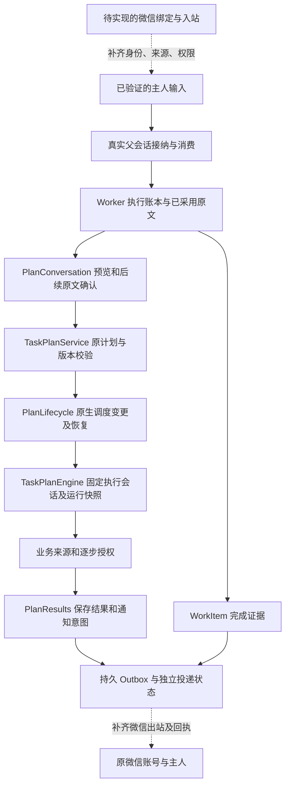

# 微信 ClawBot 规格复核：计划管理、Worker 授权与结果通知

日期：2026-11-08。性质：当前源码的逐文件审读与待实施规格复核，不是微信实现或真实账号验收。

## 1. 结论与复核基线

F50 已提供可复用的计划预览、主人原文确认、原计划变更、调度恢复、授权快照和结果投递账本。微信首版无需另造计划引擎或 Worker 执行器；需要补齐微信身份和真实输入链路、限制远程可读/可控范围，并扩展普通回复的投递核对。F55 的微信周期通知仍是另一项有条件的能力，不能由“微信能管理计划”推导已可用。

建议将 F53、F54 合为一次首版实施交付，保留两个需求及验收分组；F55 继续单独管理。这个建议来自两者共同依赖的身份、会话、原文确认和出站可靠性边界，不表示相关代码已经实现，也不表示本报告已修改工单。

- 源码基线：[`main@2527f5d2c711e946f4d5b6e67b7de6c18de0a821`](https://github.com/benz-ai-x/dsh-24-PA/tree/2527f5d2c711e946f4d5b6e67b7de6c18de0a821)，插件 `0.2.2-rc.1.3`。
- 读取副本：`/private/tmp/24pa-release-20261108`，HEAD 为 `e48983c7d2865890621db4c37b00eb3f3f8c0478`。本次再次核验它与上述 main 的 tree 均为 `f1ba4e6b1cbbef78c2fc2536e0f83f7cc47a812a`，没有将旧根目录代码当最新实现。
- 规格快照：[微信 ClawBot 接入 SPEC](../planning/24PA-微信ClawBot接入-SPEC.md)，读取时 SHA-256 为 `627ca4b4873836b81e749d91f8e9a6f00dd55da56b3be49081d446d4b44a6589`。下文指其当时的段落；主审后续修订可能已消除问题。
- 指引：完整读取根目录 AGENTS、产品基线、领域文档约定、GLOSSARY、ADR-0001。它们新增的微信目标属于待实施规格，不能作为当前代码已支持微信的证据。
- 本报告完整阅读 15 个实现文件、7 个测试文件，共 **3670 行**，另局部交叉核对 runtime 的主人输入入口。完整清单见第 7 节。
- 本次子项为静态审读，没有重新运行测试、真实平台、账号或生产操作。上一轮重新构建与 62 项测试通过是先前研究的独立证据，不能代替本轮新增微信验收。
- 本子项没有读取/更改 GitHub Issue 正文，也没有修改主 Spec 或业务代码；Issue 的实时状态由主审另核对。

## 2. 当前链路与可复用基础

| 能力 | 当前实现与可复用点 | 微信实施必须补的边界 |
|---|---|---|
| 主人真实输入 | 只接受当前已消费回合的用户消息，后台 schedule 混入、取消输入不能授权；已采用原文与 Worker 委派文字分离 | 微信 Inbox 原始身份/文本/消息标识和绑定代次必须进入同一条可信链路，不能只把模型生成指令标成 owner input |
| 计划确认 | 预览与工作区、authority、父会话绑定；有效期 15 分钟；确认须是预览后新的真实消息；重复确认复用原结果 | 对微信增加身份作用域；覆盖首次委派、引用原事项、明确编号续办三条路径；重启后重新预览 |
| 原计划管理 | 计划服务、旧计划兼容、版本校验、原生调度回执恢复均已实现；设置只修改选择字段 | 明确远程可管理计划与字段；保留既有后台执行会话，不能换成微信父会话 |
| Worker 控制 | 实际子会话与原父会话绑定；未知外部效果阻止继续；停止与外部回滚分开 | 微信只获得允许的业务查询/控制；本地任务型 Skill 的完整运行历史和诊断信息不能随共享接口开放 |
| 异步结果 | WorkItem 完成证据与投递意图一并落账；重启恢复优先核对原执行而非再跑模型 | 当前完成投递仍有 local/feishu 分支，必须使用创建时固定的微信目标；不能落入默认飞书分支 |
| 计划结果通知 | 结果、通知意图、文本/语音分量、失败次数、免打扰、有效期和核对分别记录 | F54 不增加微信投递；F55 才扩展固定授权目的地和微信平台条件，不改在途快照 |

依据：[主人输入](https://github.com/benz-ai-x/dsh-24-PA/blob/2527f5d2c711e946f4d5b6e67b7de6c18de0a821/packages/24pa/src/work-owner-input.ts#L5-L37)、[确认入口](https://github.com/benz-ai-x/dsh-24-PA/blob/2527f5d2c711e946f4d5b6e67b7de6c18de0a821/packages/24pa/src/plan-conversation.ts#L38-L64)、[后续确认](https://github.com/benz-ai-x/dsh-24-PA/blob/2527f5d2c711e946f4d5b6e67b7de6c18de0a821/packages/24pa/src/plan-conversation.ts#L115-L148)、[Worker 真实归属和逐步授权](https://github.com/benz-ai-x/dsh-24-PA/blob/2527f5d2c711e946f4d5b6e67b7de6c18de0a821/packages/24pa/src/worker-runs.ts#L34-L85)、[异步完成目标](https://github.com/benz-ai-x/dsh-24-PA/blob/2527f5d2c711e946f4d5b6e67b7de6c18de0a821/packages/24pa/src/work-item-lifecycle.ts#L223-L235)。

## 3. 建议修改或补明确的规格

### R1：F54 需要明确可管理计划和可读结果，不等同整个电脑端计划面板

现 Spec “F54：微信管理周期服务”覆盖查询、创建、改时、暂停/恢复、语音和最近结果。这个方向成立，但当前代码有三层不同的能力范围：

1. 对话新建仅接受 `morning/evening/weekly/once`；固定模板和智能晨报的选择可保留。它不是任意 cron、月度、间隔规则编辑器。[新建入口 66–85](https://github.com/benz-ai-x/dsh-24-PA/blob/2527f5d2c711e946f4d5b6e67b7de6c18de0a821/packages/24pa/src/plan-conversation.ts#L66-L85)
2. 未升级旧计划的常用管理仅允许上述四类且必须属于原执行会话；业务专用的等待跟进、会前准备等计划不能据此全部开放。已升级 `task_config` 计划的控制并没有统一按四类过滤，故实施还需按产品范围做准入。[旧计划范围 152–178](https://github.com/benz-ai-x/dsh-24-PA/blob/2527f5d2c711e946f4d5b6e67b7de6c18de0a821/packages/24pa/src/task-plan-service.ts#L152-L178)
3. 常用设置只有 `time/timeZone/weekdays/at/voice`；`time` 仅每日/每周，`at` 仅一次性，cron 可保留原规则调整时区，但不能由此宣称支持完整复杂规则编辑。设置不会改 Skill、参数和目标；其他配置应回原配置入口。[设置完整实现 14–47](https://github.com/benz-ai-x/dsh-24-PA/blob/2527f5d2c711e946f4d5b6e67b7de6c18de0a821/packages/24pa/src/task-plan-settings.ts#L14-L47)

建议 F54 明文列出首版可管理业务计划和常用字段。删除、复制、恢复回收、迁移、重新绑定授权、任意 Skill 选择、立即运行、复杂规则配置不能仅因底层 `TaskPlanService.change` 支持而自动出现在微信工具面。它们当前是更多的管理操作，需要分别决定权限与交互，不能与“同一计划常用管理”混为一谈。[完整变更入口 184–274](https://github.com/benz-ai-x/dsh-24-PA/blob/2527f5d2c711e946f4d5b6e67b7de6c18de0a821/packages/24pa/src/task-plan-service.ts#L184-L274)、[立即运行 74–96](https://github.com/benz-ai-x/dsh-24-PA/blob/2527f5d2c711e946f4d5b6e67b7de6c18de0a821/packages/24pa/src/task-plan-engine.ts#L74-L96)。

“最近结果查询”还需明确是状态还是正文：当前 `PlanConversation.list` 直接返回计划行、阻断、最新运行摘要和一个历史定位对象；`recentRun` SQL 只取运行编号、状态、投递状态、创建时间及类型，没有结果正文。既有测试也只证明列表状态和历史定位，不证明微信能读取结果全文。[对话列表 49–54](https://github.com/benz-ai-x/dsh-24-PA/blob/2527f5d2c711e946f4d5b6e67b7de6c18de0a821/packages/24pa/src/plan-conversation.ts#L49-L54)、[服务列表 55–70](https://github.com/benz-ai-x/dsh-24-PA/blob/2527f5d2c711e946f4d5b6e67b7de6c18de0a821/packages/24pa/src/task-plan-service.ts#L55-L70)、[最新运行 SQL 243–249](https://github.com/benz-ai-x/dsh-24-PA/blob/2527f5d2c711e946f4d5b6e67b7de6c18de0a821/packages/24pa/src/repo/task-plan.ts#L243-L249)。

建议首版明确返回计划摘要、执行与投递状态；若要结果正文，另列“允许的业务结果读取”要求，使用受限字段投影，过滤本地 Skill、完整调用记录、原始授权和诊断数据。当前原始行展开不是为微信专设的安全输出结构。对应补入 WX-08、WX-13，避免只验“工具调用被拒绝”却遗漏间接读取。

### R2：暂停计划、停止当前执行和继续事项必须分清

对已升级计划，对话 `stop` 转成 `pause`；旧计划仍保留原 `stop` 语义。计划暂停保存主人关闭选择并停止未来调度，账本只取消尚在队列中的计划运行，不自动中断已经在途的运行。删除计划才另有等待或停止活动运行的明确选择。[对话控制 87–111](https://github.com/benz-ai-x/dsh-24-PA/blob/2527f5d2c711e946f4d5b6e67b7de6c18de0a821/packages/24pa/src/plan-conversation.ts#L87-L111)、[暂停与删除 245–264](https://github.com/benz-ai-x/dsh-24-PA/blob/2527f5d2c711e946f4d5b6e67b7de6c18de0a821/packages/24pa/src/task-plan-service.ts#L245-L264)、[暂停仅取消 queued 154–164](https://github.com/benz-ai-x/dsh-24-PA/blob/2527f5d2c711e946f4d5b6e67b7de6c18de0a821/packages/24pa/src/repo/task-plan.ts#L154-L164)。

WorkItem 停止则记录停止请求、请求宿主中断并核对实际静止状态；它不撤销已经产生的外部业务效果。恢复也不是补发丢失结果：未结外部效果、原宿主接纳未知等状态必须先核对。[事项恢复 75–119](https://github.com/benz-ai-x/dsh-24-PA/blob/2527f5d2c711e946f4d5b6e67b7de6c18de0a821/packages/24pa/src/work-item-lifecycle.ts#L75-L119)、[停止 122–142](https://github.com/benz-ai-x/dsh-24-PA/blob/2527f5d2c711e946f4d5b6e67b7de6c18de0a821/packages/24pa/src/work-item-lifecycle.ts#L122-L142)。

建议将 Spec “暂停/停止沿 F50”补成可观察文案：“暂停后不再产生新的计划执行；已开始的执行是否继续单独显示。停止当前工作需定位该次工作，不能承诺撤销原平台操作。”WX-08、WX-15 覆盖暂停时 queued、running、waiting、needs-reconciliation 的差别，以及停止后引用消息不会自动复活。

### R3：原文确认可复用，但微信必须覆盖原事项续办与明确编号两条入口

当前代码已经有正确的基础，不应再沿用旧研究中“原事项续办遗漏 authority”的疑虑：飞书引用原事项时，实际原文、来源事件及 authority 会传入 `resume`；通用控制的继续/补充路径也调用 `captureOwnerInput`。首次日历/提醒 Worker 委派会捕获主人输入，飞书入口还从 Inbox 还原原文并核对发送者。[引用续办 2167–2171](https://github.com/benz-ai-x/dsh-24-PA/blob/2527f5d2c711e946f4d5b6e67b7de6c18de0a821/packages/24pa/src/runtime.ts#L2167-L2171)、[捕获原文 2263–2276](https://github.com/benz-ai-x/dsh-24-PA/blob/2527f5d2c711e946f4d5b6e67b7de6c18de0a821/packages/24pa/src/runtime.ts#L2263-L2276)、[首次委派 2303–2304](https://github.com/benz-ai-x/dsh-24-PA/blob/2527f5d2c711e946f4d5b6e67b7de6c18de0a821/packages/24pa/src/runtime.ts#L2303-L2304)、[控制续办 2520–2523](https://github.com/benz-ai-x/dsh-24-PA/blob/2527f5d2c711e946f4d5b6e67b7de6c18de0a821/packages/24pa/src/runtime.ts#L2520-L2523)。

微信需要的是扩展 `WorkOwnerInput` 的来源与身份，并确保实际已消费才算已采用，沿原父会话授权；不能把微信 payload 拼成一段字符串后当成本地可信输入。当前 `WorkOwnerInput.kind` 只有 session/panel/feishu；Worker 原始输入与后续 parent 发来的消息采用条件也不同。[输入类型和采集 5–32](https://github.com/benz-ai-x/dsh-24-PA/blob/2527f5d2c711e946f4d5b6e67b7de6c18de0a821/packages/24pa/src/work-owner-input.ts#L5-L32)、[实际采用 70–85](https://github.com/benz-ai-x/dsh-24-PA/blob/2527f5d2c711e946f4d5b6e67b7de6c18de0a821/packages/24pa/src/worker-runs.ts#L70-L85)。

既有对话测试的确认辅助函数每次在同一父会话重新委派一个 reminders Worker，证明同父会话预览可以确认，但不是微信 Inbox→引用/编号路由→原 Worker 实际采用的端到端证明。[测试辅助与断言 53–78](https://github.com/benz-ai-x/dsh-24-PA/blob/2527f5d2c711e946f4d5b6e67b7de6c18de0a821/packages/24pa/tests/unit/plan-conversation.test.mjs#L53-L78)。

建议 WX-14 增加：首次交办预览后，通过可靠原生引用或明确 WorkItem 编号回到原工作确认；原文有装饰/摘要、未被宿主采用、已取消、旧消息重投、错误账号/入口、变更绑定代次均不能确认。无可靠原生消息号时只使用明确编号，不为通过测试假造引用关系。

### R4：F53 的未知投递核对需要扩展模型，不能直接复用现有计划核对 UI

Spec 已要求普通回复、事项结果和状态通知全部走 Outbox，并在首版提供电脑端核对；方向正确，但实现工作不能遗漏以下差异：

- 现 `PlanResultRepo.repair` 要求 Outbox 属于 `task_plan_delivery` 的运行，或能通过 `worker_run.outbox_key` 找到对应运行；普通回复和独立状态通知不属于这两种关联时会被拒绝。
- `review(outcome: sent)` 强制填写原平台 `messageId`，并以此修复出站状态。微信“平台已接纳但没有可用原生消息号”的情形不能直接套用，也不能填本地 client ID 冒充原生号。
- “确认未发送”只解除 unknown，状态变 failed；实际补投是另一次明确动作，并保留原收件人和期限。这个已有约束应保留。

上述均可直接定位到 [核对实现 137–164](https://github.com/benz-ai-x/dsh-24-PA/blob/2527f5d2c711e946f4d5b6e67b7de6c18de0a821/packages/24pa/src/repo/plan-result.ts#L137-L164)；[已有测试 141–164](https://github.com/benz-ai-x/dsh-24-PA/blob/2527f5d2c711e946f4d5b6e67b7de6c18de0a821/packages/24pa/tests/unit/plan-results.test.mjs#L141-L164)只覆盖计划关联和有原生消息号的确认。

建议 F53 的 WX-06、WX-12 明确覆盖普通回复、事项结果、状态通知和每个长文分段的核对对象；关联原账号、绑定代次、原出站及回执版本。证据区分平台接纳、人工核对、可选原生号，不能把无原生号自动当失败，也不能将发送尝试当接纳。无足够依据时保持 unknown；只补本地记录或明确补投，不重跑业务。这不是应等到 F55 才做的计划通知工作。

### R5：保留旧计划语义，同时区分旧计划与升级计划的目的地证据

“微信管理不迁移旧计划、不重建调度、不改变执行会话”与当前实现一致。常用设置在原行和原调度 ID 上变更；迁移是单独预览/确认，且须等待旧运行结束。新建/恢复中的未知原生回执也使用已记录的原请求核对，不盲建第二份。[旧计划迁移 19–51](https://github.com/benz-ai-x/dsh-24-PA/blob/2527f5d2c711e946f4d5b6e67b7de6c18de0a821/packages/24pa/src/task-plan-migration.ts#L19-L51)、[账本迁移 102–137](https://github.com/benz-ai-x/dsh-24-PA/blob/2527f5d2c711e946f4d5b6e67b7de6c18de0a821/packages/24pa/src/repo/task-plan.ts#L102-L137)、[原生恢复 160–237](https://github.com/benz-ai-x/dsh-24-PA/blob/2527f5d2c711e946f4d5b6e67b7de6c18de0a821/packages/24pa/src/plan-lifecycle.ts#L160-L237)。

但旧计划未必已有固定历史接收者的不可变授权：`legacyDelivery` 来自当前业务通知配置；升级计划才通过 `task_authorization` 与运行快照固定来源/接收者。因此 Spec 可要求“微信管理不修改原通知配置、不隐式迁移或重新授权”，不宜将全部旧计划描述为已经具有同样的固定身份快照。[旧计划投递预览 152–178](https://github.com/benz-ai-x/dsh-24-PA/blob/2527f5d2c711e946f4d5b6e67b7de6c18de0a821/packages/24pa/src/task-plan-service.ts#L152-L178)、[授权目的地类型 11–25](https://github.com/benz-ai-x/dsh-24-PA/blob/2527f5d2c711e946f4d5b6e67b7de6c18de0a821/packages/24pa/src/task-plan.ts#L11-L25)。

实现上继续使用计划服务既有的后台 `context.sessionId`。微信只是管理父会话，若把计划上下文切成微信接入会话，旧计划的 `row.session_id === context.sessionId` 校验会拒绝；迁移调度也会破坏既有恢复边界。[归属校验 152–154](https://github.com/benz-ai-x/dsh-24-PA/blob/2527f5d2c711e946f4d5b6e67b7de6c18de0a821/packages/24pa/src/task-plan-service.ts#L152-L154)、[原执行会话触发与恢复 100–152](https://github.com/benz-ai-x/dsh-24-PA/blob/2527f5d2c711e946f4d5b6e67b7de6c18de0a821/packages/24pa/src/task-plan-engine.ts#L100-L152)。

### R6：F55 需扩展固定通知授权；不能只加 Outbox 的微信适配器

目前 `TaskPlanConfiguration.delivery.channel` 是 none/feishu/wecom，固定授权的 delivery 是 feishu/wecom；语音仅飞书。授权比较会阻止工具、动作、资源扩权和目标漂移，发送前重新核验固定身份，不使用当前默认目标兜底。[配置与授权类型 5–25](https://github.com/benz-ai-x/dsh-24-PA/blob/2527f5d2c711e946f4d5b6e67b7de6c18de0a821/packages/24pa/src/task-plan.ts#L5-L25)、[授权比较 36–69](https://github.com/benz-ai-x/dsh-24-PA/blob/2527f5d2c711e946f4d5b6e67b7de6c18de0a821/packages/24pa/src/task-plan-access.ts#L36-L69)。

F55 应把微信账号、主人、绑定代次及可核验发送条件作为明确的投递授权扩展；生成通知时继续使用该次运行的 snapshot，而不是新默认配置。结果通知 TTL、免打扰、等待通知是否已过时，以及执行失败计数应继续独立判断；三次最终失败阻断未来运行并保留主人启用选择，不是三个网络发送错误就停业务。[结果结算 52–110](https://github.com/benz-ai-x/dsh-24-PA/blob/2527f5d2c711e946f4d5b6e67b7de6c18de0a821/packages/24pa/src/repo/plan-result.ts#L52-L110)、[发送前检查 23–40](https://github.com/benz-ai-x/dsh-24-PA/blob/2527f5d2c711e946f4d5b6e67b7de6c18de0a821/packages/24pa/src/plan-results.ts#L23-L40)。

现 Spec 已区分 F54/F55、在途快照、文字通知与原飞书语音，应保留；不需让首版等待任意时刻主动发送的保证。微信平台能力记录由主研究另核验，本报告没有以本地类型推断平台能力。

## 4. 已核对无须推翻的要求

- **预览无写入、真实后续原文确认、版本变化拒绝、重复确认不重复建计划**：已有实现及测试；保存成功后启用失败保留原草稿是有意行为。微信应延用，而不是另设模型 `confirm: true` 快捷路径。[确认实现 115–148](https://github.com/benz-ai-x/dsh-24-PA/blob/2527f5d2c711e946f4d5b6e67b7de6c18de0a821/packages/24pa/src/plan-conversation.ts#L115-L148)、[确认测试 59–148](https://github.com/benz-ai-x/dsh-24-PA/blob/2527f5d2c711e946f4d5b6e67b7de6c18de0a821/packages/24pa/tests/unit/plan-conversation.test.mjs#L59-L148)。
- **来源权限仍归业务平台**：来源访问核验与计划逐步动作授权已有实现；微信是入口，不能用微信登录替代飞书/企微来源身份或扩展已锁定资源。[来源核验](https://github.com/benz-ai-x/dsh-24-PA/blob/2527f5d2c711e946f4d5b6e67b7de6c18de0a821/packages/24pa/src/source-access.ts#L1-L122)、[逐步授权 71–89](https://github.com/benz-ai-x/dsh-24-PA/blob/2527f5d2c711e946f4d5b6e67b7de6c18de0a821/packages/24pa/src/task-plan-access.ts#L71-L89)。
- **业务完成与投递分开**：文本成功、语音失败可显示 partial，不改业务完成或失败计数；等待通知结束后不迟到推送；仅保存/仅异常策略仍保留业务结果。[结果测试 105–135](https://github.com/benz-ai-x/dsh-24-PA/blob/2527f5d2c711e946f4d5b6e67b7de6c18de0a821/packages/24pa/tests/unit/plan-results.test.mjs#L105-L135)。
- **未知结果不自动重发、不重跑模型**：宿主/外部调用未知与确定失败区分，原 Worker 完成证据结算可重试的是本地账本，不是业务调用；调度未知也核对原身份。[Worker 未知效果](https://github.com/benz-ai-x/dsh-24-PA/blob/2527f5d2c711e946f4d5b6e67b7de6c18de0a821/packages/24pa/src/worker-runs.ts#L87-L161)、[完成证据结算](https://github.com/benz-ai-x/dsh-24-PA/blob/2527f5d2c711e946f4d5b6e67b7de6c18de0a821/packages/24pa/src/work-item-lifecycle.ts#L171-L255)。
- **停止/重启不会任意复活旧选择**：旧启用回执不能覆盖后来的暂停，旧调度代次、取消输入和伪造普通文字 schedule 不进入新计划执行；这些是微信需沿用的已有语义。[计划操作回放 211–251](https://github.com/benz-ai-x/dsh-24-PA/blob/2527f5d2c711e946f4d5b6e67b7de6c18de0a821/packages/24pa/src/task-plan-service.ts#L211-L251)、[触发恢复测试 462–495](https://github.com/benz-ai-x/dsh-24-PA/blob/2527f5d2c711e946f4d5b6e67b7de6c18de0a821/packages/24pa/tests/unit/task-plan-service.test.mjs#L462-L495)。

## 5. 实施 Issue 的建议组织

F53、F54 合并为一个首版实施 Issue/主功能 PR 更贴合当前代码：微信身份、远程角色、Inbox 原文、父会话和出站核对都是一次必须完成的入口工作；F50 已经存在，计划操作由 reminders 工具承载。若拆成先 F53 后 F54，就需要专门的阶段能力门禁，避免共享工具提前开放未验收计划操作。这并非两个独立大模块从零建设。

合并后仍分别列 F53 和 F54 的验收项，不删身份/游标/回执/桌面恢复项，也不把 F54 当“无需测试的顺带功能”。完成条件至少包括：普通文字交办、真实延迟结果、原工作续办、受限查询、常用计划预览确认、原计划保留、账号/版本变化拒绝、桌面未知核对，以及两种账本和真实宿主装配的隔离测试。

WX-R01 的基础收发证据依然是进入正式实现的前置；F55 继续作为有条件后续，不因合并首版而提前承诺主动通知。现有 Spec 若仍写“F53 合并后再做 F54、各一个主功能 PR”，需要与实际 Issue 组织一起改，不能只在代码设计里暗自合并。

此处只是源代码复核形成的交付建议。实际调整哪个 Issue、如何保留父子追踪和关闭重复项，需主审按已授权事项范围及仓库约定处理，本报告未操作 Issue。

## 6. 现有测试证据与微信新增验收缺口

| 已完整阅读的测试 | 现有证据 | 不能据此声称 |
|---|---|---|
| plan-conversation | 真正 ToolRuntime 下的预览/确认、同父会话、重复确认、旧计划保留、权限变化后保留草稿 | 已验证微信 Inbox、绑定代次、引用/编号续办及原 Worker 采用 |
| task-plan-service | SQLite/PG 参数化的真实仓储与服务；授权/旧迁移/原调度回执/代次/单次运行/保留 owner 选择 | 微信可管理所有面板计划；测试文件已在本轮跑过 |
| plan-lifecycle | 原生调度替身下的创建回执丢失、原 ID 恢复、并发恢复/暂停、规则冲突、旧确认不覆盖新选择 | 真实宿主调度全部故障窗口、真实微信网络已验收 |
| plan-results、plan-delivery-guards | 结果与通知独立、部分失败、TTL 二次检查、免打扰、未知不重发、人工核对、真实账本 | 平台无原生号的接纳已适配；普通回复/分段已有通用核对 |
| work-item-lifecycle、worker-run | 排队/停止/继续/恢复、完成与 Outbox 事务、外部效果未知阻止继续、实际消费与采用区分 | 新微信目标及远程可读字段已覆盖；出站失败可重跑业务 |

优先追加的微信用例：

1. 同工作区不同入口/账号/绑定代次不能借用另一预览；首次、原引用、明确编号确认均以实际采用原文为依据。
2. 微信查计划和查工作只返回允许的业务摘要/结果，不返回本地任务型 Skill、完整调用记录和诊断字段；不支持的计划操作明确引导电脑端。
3. 暂停未来计划与停止某次工作分别可观察；未知外部效果、旧停止和取消消息不因新入站而复活。
4. 普通回复、事项结果、独立状态、长文每段都能关联原出站核对；平台接纳但无原生号与完全未知区分，人工核对和补投有独立证据。
5. 微信管理旧计划保留 ID、Skill、语音、历史和原会话；不自动迁移、不伪造固定授权；升级计划和在途运行继续使用原授权快照。

本轮没有新增或执行这些用例。需要在实施阶段使用真实 Loader/Session 与真实 SQLite/PG 账本、替换外部网络/模型边界完成；真实账号测试单独列证据。

## 7. 完整阅读覆盖清单

以下路径均相对于 `packages/24pa/`，标记为完整意味着从第 1 行到文件末尾均已读取，不以搜索命中或接口摘要代替。行数以本次固定源码副本为准。

| 实现文件 | 行数 | 完整阅读的重点 |
|---|---:|---|
| src/plan-conversation.ts | 153 | 原文、预览、创建/控制、确认与重复请求 |
| src/work-owner-input.ts | 38 | 当前回合、用户来源、取消和后台输入排除 |
| src/task-plan.ts | 122 | 配置/授权类型、预设、时序与通知草稿 |
| src/task-plan-settings.ts | 47 | 允许字段及保留旧行语义 |
| src/task-plan-migration.ts | 53 | 显式迁移、来源选择、旧通知约束 |
| src/task-plan-service.ts | 274 | 列表/预览/设置/授权/启停/删除/恢复完整分支 |
| src/task-plan-access.ts | 95 | 工具/动作/资源与通知固定授权 |
| src/task-plan-engine.ts | 154 | 固定会话、触发、运行、恢复和消息消费 |
| src/plan-lifecycle.ts | 240 | 原生调度意图、回执、恢复、停止与冲突 |
| src/repo/task-plan.ts | 263 | 原始数据、变更回执、迁移、启停、阻断、历史 |
| src/plan-results.ts | 46 | 明确核对、发送前 TTL/静默/身份检查 |
| src/repo/plan-result.ts | 173 | 业务结算、通知/投递事务、聚合与核对 |
| src/source-access.ts | 122 | 来源身份、可读资源、写入能力核验 |
| src/worker-runs.ts | 189 | 原生 Worker 归属、采用、调用回执、未知效果 |
| src/work-item-lifecycle.ts | 295 | 队列、开始/恢复/停止、持久完成证据与重启 |
| **实现小计** | **2264** | **15 个文件** |

| 测试文件 | 行数 |
|---|---:|
| tests/unit/plan-conversation.test.mjs | 148 |
| tests/unit/task-plan-service.test.mjs | 515 |
| tests/unit/plan-lifecycle.test.mjs | 199 |
| tests/unit/plan-results.test.mjs | 165 |
| tests/unit/plan-delivery-guards.test.mjs | 99 |
| tests/unit/work-item-lifecycle.test.mjs | 76 |
| tests/unit/worker-run.test.mjs | 204 |
| **测试小计** | **1406** |

额外局部核对 `runtime.ts` 的 2162–2175、2258–2278、2299–2307、2518–2527、2560–2568 行；这些不计入完整文件清单。runtime 全文件及入口权限、配置、收件/出站、桌面链路由主审负责，本报告不扩大“完整阅读”的声称。

未在本子项复验：当前 GitHub Issue 正文、微信服务端策略/真实账号、全套集成或 PG/Loader 运行结果。对不存在测试证据的能力均保留实施/验证边界，不以既有单测通过推导微信已可用。
