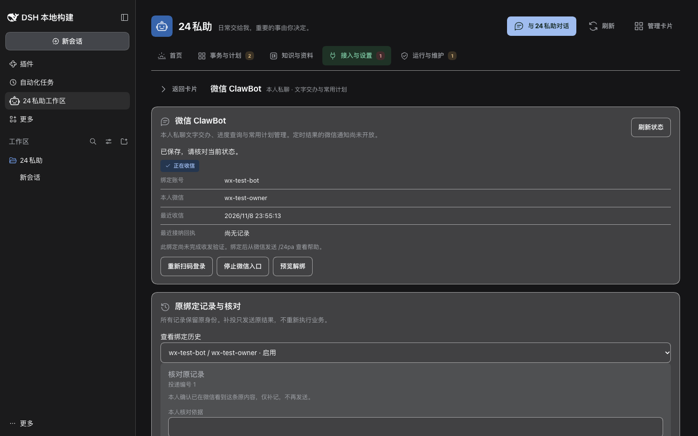

# 微信首版实现、隔离验收与 8010 部署记录

日期：2026-11-09（Asia/Shanghai）。关联 [#279](https://github.com/benz-ai-x/dsh-24-PA/issues/279)、[Draft PR #282](https://github.com/benz-ai-x/dsh-24-PA/pull/282)、[规格 2.20](../planning/24PA-微信ClawBot接入-SPEC.md)。

## 当前结论

F53/F54 已在功能分支实现，完成双库真实宿主隔离验证、单元回归和桌面 T20；按主人授权已安装到原 8010 实例。正式插件成功取得微信二维码，但主人选择稍后扫码，当前没有正式微信绑定、入站或出站消息。**正式插件的本人微信收发及业务流程验收尚未完成，PR 保持 Draft，#279 保持打开，未合并、未发布 npm 版本。**

协议探针的真实账号验证与正式插件验收分别记录：前者 A 已通过，不能替代后者；B 及 F55/#281 继续后置。自行实现接入，不依赖 dsh-im 或 OpenClaw 运行时。

## 固定版本与实现范围

| 项目 | 本轮证据 |
|---|---|
| 比较基线 | `2527f5d2c711e946f4d5b6e67b7de6c18de0a821` |
| 分支 | `codex/weixin-clawbot` |
| 已部署代码 | `f26d833b59688cc6ef5183fed9eaad0b30324964` |
| 制品 | `@benz-ai-x/dsh-24pa` 开发包，包号沿用 `0.2.2-rc.1.3`；不能用包号代替本行提交与下行哈希 |
| 制品 SHA-256 | `7cc6c8f742854a73eca0cda9dd6448abe72315c1e8cb8579c012c045d6f070ff` |
| 8010 宿主 | 原 dsh `0.2.2-rc.1`、Node `v24.22.0`、`web` profile |
| 隔离测试宿主 | dsh 源码 `66491b05e3f05ad35bcdd4f6cd7ed26041d9e3db`，本机 Node `v26.4.0` |

扫码候选、影响预览、明确启用；固定主人/账号/代次与退休会话；清洁收件持久化后推进游标；普通回复与异步结果经原身份 Outbox；分段接纳、可选原生号、unknown 人工核对；同身份续期、停用和重启恢复；常用计划查询/预览/真实后续原文确认；电脑端维护及联合恢复均已实现。媒体、群聊、任意本地 Skill、微信周期通知不在首版。

接入凭据只保存在工作区专用密钥文件，权限为目录 0700、文件 0600；不进入持久 Inbox、模型输入、普通日志、导出或产品联合备份。部署回滚用的私有整实例归档含原实例凭据，仅保留在服务器 root 私有目录，不作为仓库证据。

## 回归与真实宿主隔离验证

完整单元集分批执行，最终去重为 **105 个文件、1,761 项：1,760 通过、1 项既有跳过**。不能描述为一次命令全部通过：第二批首次有 3 项失败，修正测试替身和等价文案表达后，最终 62 项定向复验通过。日志保留首次失败与复验结果。

| 执行批次 | 实际结果与边界 | 证据 |
|---|---|---|
| 7 个单元文件 + SQLite 微信 E2E | 200 单元 + 5 E2E 通过 | [日志](evidence/2026-11-09-weixin-first-release/fixes-and-sqlite.log) |
| 原文确认/冷恢复补验 | 10 通过；其中 4 项与前批重复，新增覆盖 6 项 | [日志](evidence/2026-11-09-weixin-first-release/boundaries.log) |
| 其余 97 个单元文件 | 首跑 1,551 通过、3 失败、1 跳过 | [日志](evidence/2026-11-09-weixin-first-release/remaining-unit.log) |
| 最终内容定向复验 | client、weixin-panel、client-i18n、work-tool-schema 共 62 通过，覆盖上行全部失败项 | [日志](evidence/2026-11-09-weixin-first-release/final-regression.log) |
| PostgreSQL 微信 E2E + 计划边界 | 5 E2E + 4 单元通过；不重复计入单元总数 | [日志](evidence/2026-11-09-weixin-first-release/postgres.log) |

从 `packages/24pa` 执行 `npm run build`、`npm run preset:check`、`node --check client.js`；均通过。单元入口为 `npx vitest run tests/unit`，本轮按上表分批去重完成；微信矩阵为 `PA24_E2E_STORAGE=sqlite|postgres npx vitest run tests/e2e/weixin.e2e.mjs`，`DSH_BIN` 指向上述已编译宿主。测试使用真实 Loader、Session、业务代码与实际 SQLite/隔离 PostgreSQL，只替换模型和外部平台边界。

两种账本均覆盖以下 5 条完整流程：

1. 只读查看不自动登录；首次会话只挂远程白名单；本人文字、错误身份/媒体拒绝、稳定去重、帮助回复和密钥隔离。
2. 常用计划预览后采用真实后续主人原文确认，与电脑端同一计划对象，保留语音/历史/通知；任意本地 Skill 明确拒绝。
3. 日程/待办沿原平台回执办理；明确工作编号续办复用原工作，新运行与本次微信原文及结果关联，避免重复创建。
4. `ret=0` 无原生号接纳、unknown 核对不重发、停用、同身份续期与重启恢复。
5. 换绑保留退休身份及远程权限；空微信会话也包含在联合备份中；隔离恢复不启动外部消费者且排除凭据。

这些是隔离验收，未冒充真实微信、飞书/企微对象写入或真实模型使用验收。

## 桌面 T20

真实宿主上完成中英文 × 明暗主题 × 1280×800、1440×900、1920×1080，检查无横向溢出；覆盖只读空态、加载、二维码、候选及影响确认、核对表单、键盘操作、错误、离线禁写与恢复。

[检查清单](evidence/2026-11-08-weixin-first-release/desktop/checks.json)及同目录 19 张截图为隔离环境证据，二维码和账号均为替身，不含真实凭据。布局修正为 `cba1ff1`，最终 `f26d833` 的文案等价改写已定向复验。

## 8010 实际部署

2026-11-09 00:14:06 +08:00 原 `pa24.service` 经原启动脚本启动。安装使用原 CLI 和 `web` profile，制品位于 `/DSH/24-PA/deployments/weixin-279-f26d833/`，没有发布 npm 或改动其他直接依赖版本。

停机前保存原 profile 清单/锁、服务定义和启动脚本。整实例回滚归档位于服务器 `/root/24pa-backups/weixin-279-f26d833-20261109/`；联合备份使用原版本代码，隔离恢复读取 **235 个 Session（40 个必需引用）、131 个附件**，没有启动 Agent、模型、调度或收发消费者。副本 `complete=true`、`productionReady=false` 是预期结果：副本未恢复凭据、未核对远端对象、未获准上线；本次升级继续使用原实例及原授权，并未把隔离副本直接上线。

离线校验最初因未显式解析宿主 `@deepseek-ai/cordis` 而失败，原服务由保护逻辑恢复。修正仅用于校验脚本的解析方式后重新停机，完成原生恢复验证及最新完整归档，再进行插件切换。没有改动宿主代码或降低校验要求。

迁移副本从 schema 33 到 34，原 76 张业务表计数一致，原生 SQLite `integrity_check=ok`、外键检查无异常。上线后再次核验真实账本、主人/工作区身份和来源登记一致，全部历史表计数无变化：工作 26 完成、12 停止，Outbox 69 已发送，无待发或未知项。

| 上线检查 | 结果 |
|---|---|
| 启动脚本 | SHA-256 `bd07ef4c071dd91376908ccb2da58a3a932408ccc3fff6ea57c0e0f48393348f`，升级前后一致 |
| 原配置/工作区 | 配置摘要、`/DSH/24-PA/workspace`、SQLite 与 feishu 模式一致 |
| 六项运行就绪 | host、config、账本、workspace、feishu、sessions 均 `ok` |
| 飞书 | 原 `sdk-ws` 长连接恢复；没有代发真实测试消息 |
| 全部扩展 | 218 行；187 启用且 active，31 延续原配置禁用；模块/启用/运行态及重复数与升级前一致 |
| 完整启动日志 | 当前进程 stdout/stderr 为服务日志；31 行中无失败、禁用或不兼容匹配 |
| 微信正式入口 | RPC、电脑端卡片及真实二维码获取成功；尚未绑定，消息数 0 |

目录选择器的两项运行时 entryId 在重启后重新生成；清单比较以实际模块、启用及运行态的多重集合为准，没有将随机编号变化当作扩展更换。安装器的可选 peer 提示与原 `autoInstallPeers: false` 策略一致，实际宿主装配全部启用插件成功。

[脱敏部署证据](evidence/2026-11-09-weixin-first-release/deployment.json)保存实际检查值。真实二维码、网页登录凭据、微信 token 与完整运行备份不入库。

## Standards

固定基线 `2527f5d`，实现全量审查 `4fee9e9`，修复复审 `9d6ddf7`，布局增量 `cba1ff1`，最终代码头 `f26d833`。发现的“新目标错误返回旧工作编号”已修正并验证；最终代码复审 **0 新增、0 未清偿**。没有以 Spec 结论代替 Standards。

## Spec

相同基线与代码头。复审清偿旧计划同名 Skill/覆盖定义误放行、续办结果错误关联首条输入及相应冷恢复证据问题；补充两库流程与原文/身份边界验证。最终代码复审 **0 新增、0 未清偿**。正式插件真实账号验收仍待完成，不因代码审查通过而标为完成。

## 待本人扫码后的验收与回退

主人已明确选择稍后扫码。届时在 8010「接入与设置 → 微信 ClawBot → 绑定与核对」重新生成二维码；本人扫码、核对候选账号及影响后启用，从原微信发送 `/24pa`，核验实际帮助回复与账本回执。再按主人明确的测试内容验证文字交办/原编号续办、异步结果及常用计划预览/原文确认；真实日程或待办创建须使用明确的测试对象和范围。

未完成这些真实流程前，不关闭 #279、不把 PR 转为已验收合并状态。F55 主动通知条件仍未验证，不增加通知选项。回退必须停止服务并恢复升级前的完整实例和对应代码，不能只换旧包后继续使用 schema 34 的账本；原备份保留在服务器，不启动两个消费者。
